<p align="center">
  <picture>
    <source media="(prefers-color-scheme: dark)" srcset="docs/images/logo/logo-ngang-nen-trang.png">
    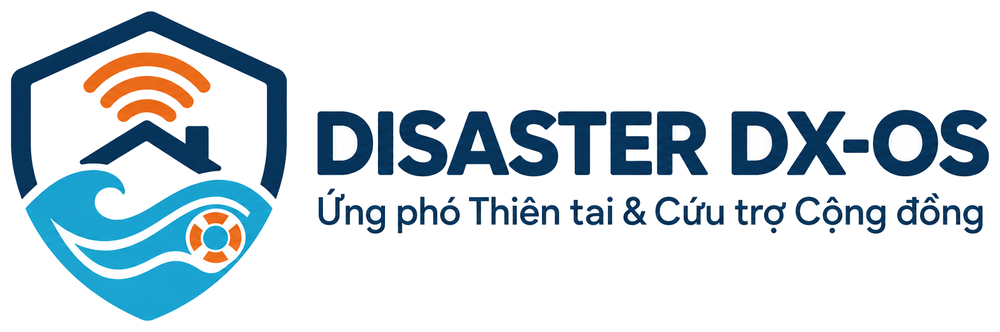
  </picture>
</p>


# Disaster DX-OS

**Hệ điều hành Ứng phó Thiên tai & Cứu trợ Cộng đồng**: nền tảng nguồn mở giúp chính quyền xã, đội cứu hộ và tình nguyện viên tiếp nhận tin kêu cứu, điều phối cứu hộ theo vị trí thật và công khai hàng cứu trợ để ai cũng kiểm chứng được.

[](LICENSE)
[](https://github.com/disaster-dxos/disaster-dxos/releases)
[](https://github.com/disaster-dxos/disaster-dxos/actions/workflows/ci.yml)

Bài dự thi OLP Phần mềm Nguồn mở 2026, đề tài DX-OS Open-Core, đội DTU_DZ_1.

## 🧭 Giới thiệu

Miền Trung mỗi năm hứng nhiều cơn bão và lũ. Trong vài giờ nước lên, cán bộ xã phải cùng lúc nghe điện thoại kêu cứu, tìm đội ca nô còn rảnh, theo dõi mực nước và chia hàng cứu trợ, phần lớn bằng sổ tay, nhóm chat và trí nhớ. Disaster DX-OS đưa tất cả việc đó lên một hệ thống chung: một lõi nguồn mở dùng lại được, và một ứng dụng cứu trợ chạy trên lõi đó.

## ⚠️ Thách thức

- **Tin kêu cứu rải rác:** đến qua điện thoại, mạng xã hội, người quen báo hộ; nhiều tin thiếu vị trí.
- **Cứu trợ trùng hoặc sót:** cùng một nhà được báo nhiều lần, trong khi nhà khác không ai tới.
- **Thiếu bức tranh thời gian thực:** người điều phối không biết mực nước đang ra sao, đội nào đang rảnh, đội nào ở gần.
- **Tiền và hàng thiếu minh bạch:** hàng đi qua nhiều tay, người dân và nhà tài trợ khó biết hàng đã đến đâu.

## 💡 Giải pháp

- **Chặn sai ngay từ đầu (Poka-yoke):** tin kêu cứu bắt buộc có tọa độ; tin trùng số điện thoại trong 200 m và 6 giờ bị chặn ngay trong CSDL.
- **Phân công theo vị trí thật:** workflow tìm đội sẵn sàng gần nhất, gán đội, chờ đội xác nhận có hạn, quá hạn thì tìm lại.
- **Số liệu hiện trường tự động:** trạm đo mực nước gửi dữ liệu liên tục, vượt ngưỡng thì phát cảnh báo.
- **Minh bạch kiểm chứng được:** mỗi phiếu nhập/xuất hàng được ghi vào sổ cái chỉ-thêm; ai cũng tự kiểm được, không cần tài khoản, không cần tin máy chủ.

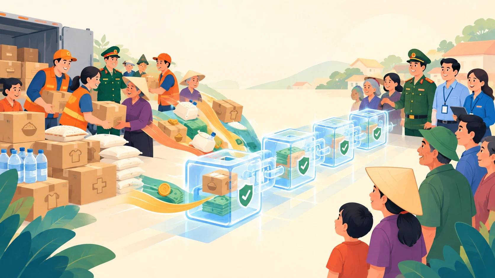

## 👥 Đối tượng

| Ai | Dùng để làm gì | Vai trò trong hệ thống |
|---|---|---|
| Chính quyền xã, người điều phối | Nhận tin, phân công đội, quản lý kho hàng cứu trợ | `dieu-phoi` (bắt buộc OTP) |
| Đội cứu hộ | Nhận việc, cập nhật hiện trường, xác nhận đã cứu | `cuu-ho` |
| Tình nguyện viên | Báo tin kêu cứu hộ người dân, gửi ảnh hiện trường | `tinh-nguyen` |
| Người dân | Gửi kêu cứu, xem cảnh báo | qua tình nguyện viên (sắp có app riêng) |
| Nhà tài trợ, báo chí | Tự kiểm chứng tiền và hàng cứu trợ | công khai, không cần tài khoản |

## 📱 Chức năng

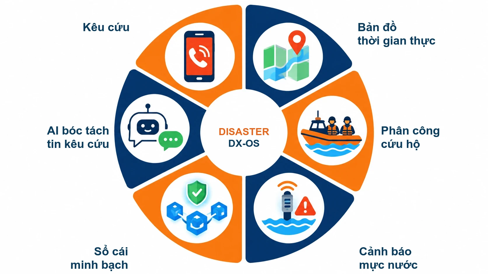

| Chức năng | Trạng thái |
|---|---|
| **Kêu cứu** có tọa độ, chặn tin trùng | ✅ Đã có ở v0.1 (API GraphQL, phân quyền theo vai trò) |
| **Phân công cứu hộ** đội gần nhất, chờ xác nhận | ✅ Đã có ở v0.1 (workflow Temporal, API `/workflow`); từ v0.2 (#67): tự khởi chạy khi có tin mới, ưu tiên theo mức khẩn, đội không nhận trong hạn thì phân công lại |
| **Cảnh báo mực nước** từ trạm đo | ✅ Đã có ở v0.1: trạm đo (giả lập) → MQTT → phát sự kiện vượt ngưỡng · từ v0.3 (#84, #85): 9 trạm ở Quảng Nam, Đà Nẵng với trận lũ mẫu 48 giờ (giả lập), mỗi trạm là một bản sao số NGSI-LD trên Scorpio, đọc qua gateway `/ngsi-ld/v1/*` · từ v0.3 (#87): mỗi đợt vượt ngưỡng là một workflow Temporal, báo đúng 1 lần khi vượt ngưỡng, khi lên nguy hiểm và khi về dưới ngưỡng, vào hộp thư nội bộ + web điều phối, hoặc Telegram khi đặt token bot |
| **Sổ cái minh bạch** tiền và hàng cứu trợ | ✅ Đã có ở v0.1 cho hàng (Tessera, trang công khai, CLI tự kiểm) · từ v0.3 (#89): tiền cứu trợ thu/chi lên sổ cái, worker tự niêm phong bù khi sổ cái tạm dừng, API xác minh chung theo mã phiếu hoặc mã bút toán kèm bằng chứng, danh sách và tổng hợp quỹ công khai |
| **Bản đồ thời gian thực** cho người điều phối | ✅ Đã có ở v0.2 (web Nuxt 4 + Nuxt UI + MapLibre, GraphQL subscription qua gateway, màn phân công cho điều phối và đội cứu hộ, thông báo Centrifugo) |
| **Dashboard điều hành, dữ liệu lịch sử** | ✅ Đã có ở v0.3 (#91, #92): Grafana OSS (`make up-bi`, mở http://localhost:9080/grafana/) với tin kêu cứu theo trạng thái, thời gian phản hồi, mực nước, tồn kho, quỹ cứu trợ, đọc bằng role chỉ đọc không thấy SĐT/họ tên; dữ liệu cũ xuất ra Parquet theo tháng trên SeaweedFS (`make luu-tru`), truy vấn bằng DuckDB (`make luu-tru-truy-van`) |
| **AI bóc tách tin kêu cứu** tự do, người duyệt lại | ✅ Từ tuần 5 (#102): SMS, tin Zalo dán vào, viết không dấu → đề xuất có địa chỉ, tọa độ (nếu tin có), SĐT, số người, mức khẩn cấp, nhu cầu; qua cùng Poka-yoke và chặn trùng của API kêu cứu; AI không tự tạo tin. Chọn mô hình bằng `LLM_PROVIDER`: Qwen2.5 7B qua Ollama (`make up-ai`), API ngoài, hoặc bộ luật không cần mô hình (mặc định) · từ tuần 5 (#104): **hàng chờ duyệt** trên web điều phối (trang "Duyệt tin AI"): đề xuất hiện cạnh văn bản gốc, người duyệt sửa, chọn vị trí trên bản đồ rồi duyệt mới tạo tin; lưu vết AI đề xuất gì, người sửa trường nào, ai duyệt, lúc nào · *AI review queue: a human approves or edits every AI suggestion before it becomes a rescue request; full audit trail* |
| **App hiện trường** cho tình nguyện viên, đội cứu hộ | ✅ Từ tuần 5 (#106): app React Native (Android, iOS) gửi kêu cứu bằng form + GPS hoặc chọn trên bản đồ, dán tin để AI điền sẵn, chuyển tin cho điều phối duyệt, gửi ảnh hiện trường và vị trí đội. **Mất mạng vẫn dùng được**: mọi thứ vào hàng đợi mã hóa trên máy, có mạng thì tự gửi; mỗi bản ghi một khóa idempotency nên gửi lại không tạo trùng. Đăng nhập Keycloak (PKCE) · *field app: works offline, resends safely with idempotency keys* ([`apps/cuu-tro/mobile/`](apps/cuu-tro/mobile/README.md)) |

Ngoài ra đã có: tải và xem ảnh hiện trường qua link ngắn hạn. Ánh xạ từng yêu cầu của đề vào mã nguồn: [`docs/de-thi-mapping.md`](docs/de-thi-mapping.md).

## 📸 Sản phẩm · Product demo

Web điều phối chạy trên stack thật, dữ liệu trên màn hình là dữ liệu giả. Quy trình demo: đăng nhập (Keycloak, vai điều phối có MFA), xem bản đồ tin kêu cứu và trạm đo mực nước, phân công cứu hộ, rồi tra trang Minh bạch công khai để trình duyệt tự kiểm sổ cái.
*The coordination web app running on the real stack with fake data: sign in (Keycloak, MFA for coordinators) → live map of SOS reports and water-level stations → rescue assignment → public transparency page where the browser verifies the ledger by itself.*

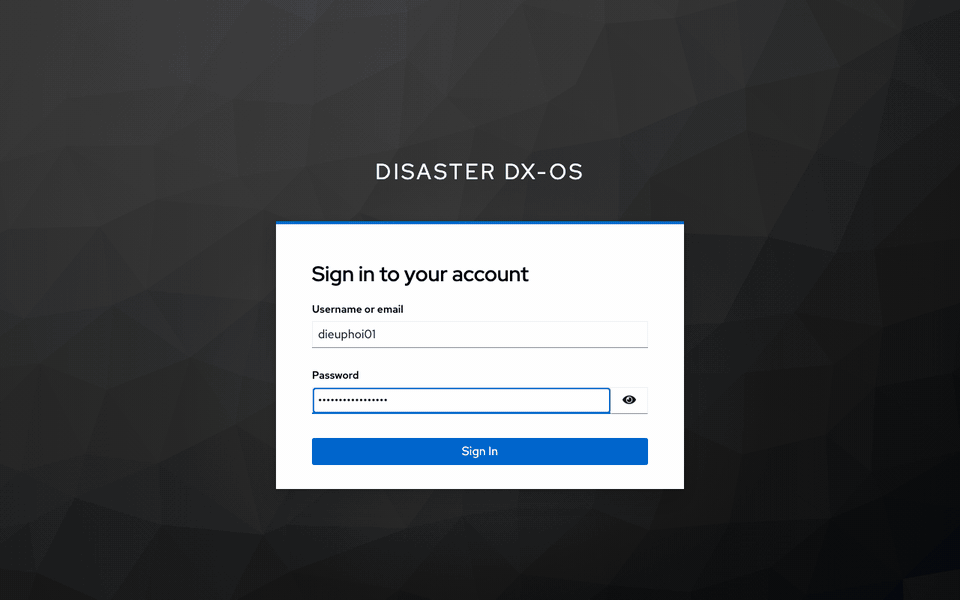

| Sáng · Light | Tối · Dark |
|---|---|
| 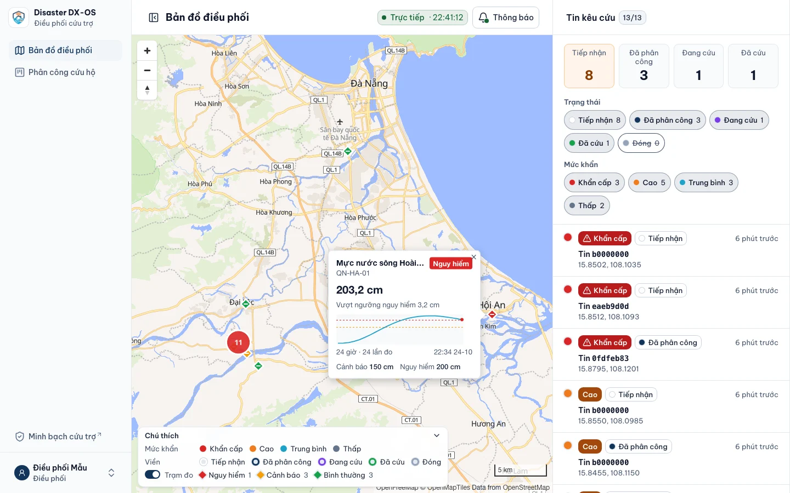 | 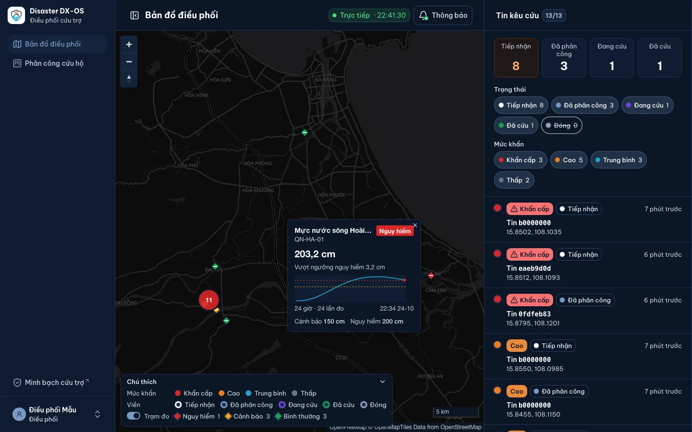 |
| Bản đồ: tin kêu cứu theo mức khẩn, trạm đo theo cấp báo động, popup mực nước 24 giờ · *Map: SOS reports by urgency, stations by alert level, 24-hour water-level popup* | |
| 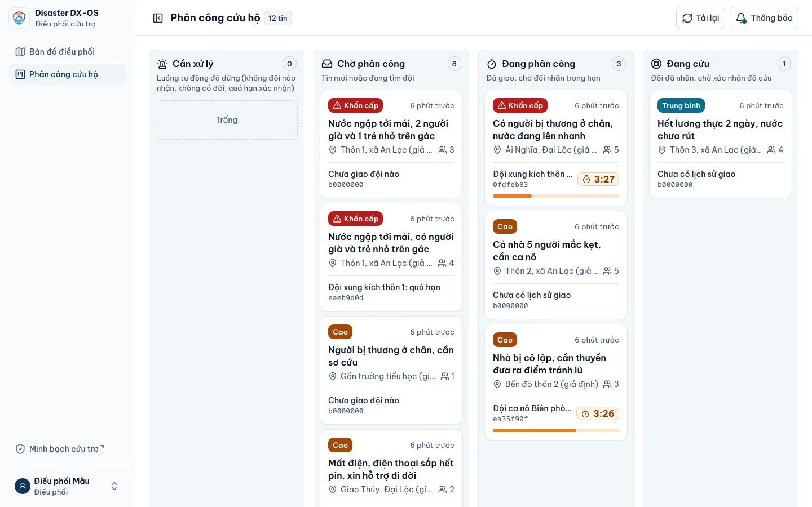 | 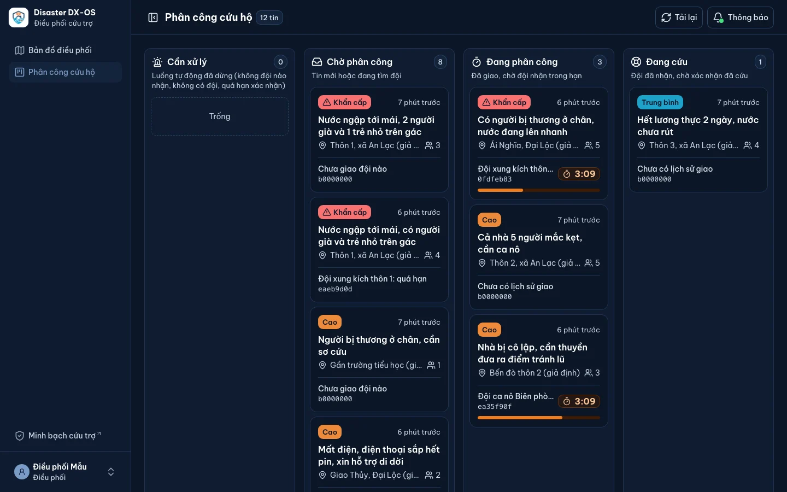 |
| Phân công: đội gần nhất, đồng hồ hạn nhận · *Assignment board: nearest team, acceptance countdown* | |
| 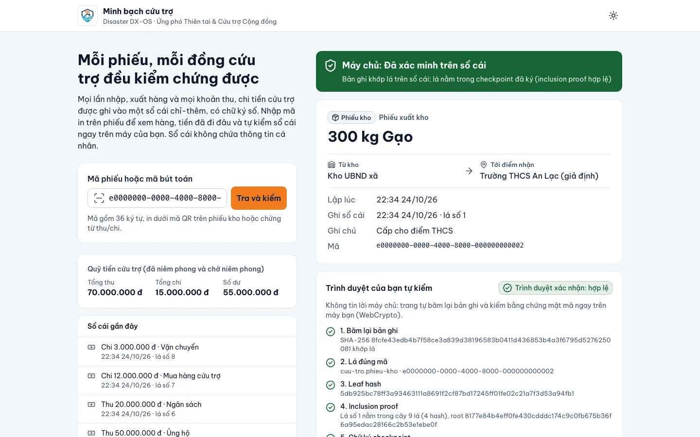 | 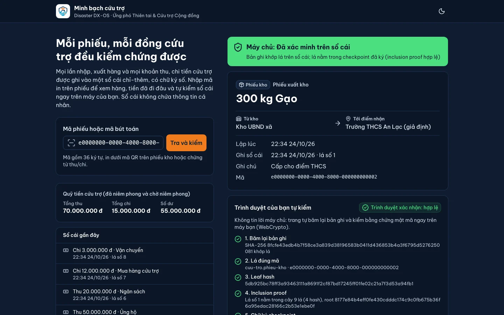 |
| Minh bạch: không cần đăng nhập, trình duyệt tự kiểm sổ cái · *Public transparency page: no login, in-browser ledger verification* | |

Chụp lại khi giao diện đổi: [`scripts/chup-anh/`](scripts/chup-anh/) (Playwright, xem [`docs/images/README.md`](docs/images/README.md)).

## 🗺️ Kiến trúc

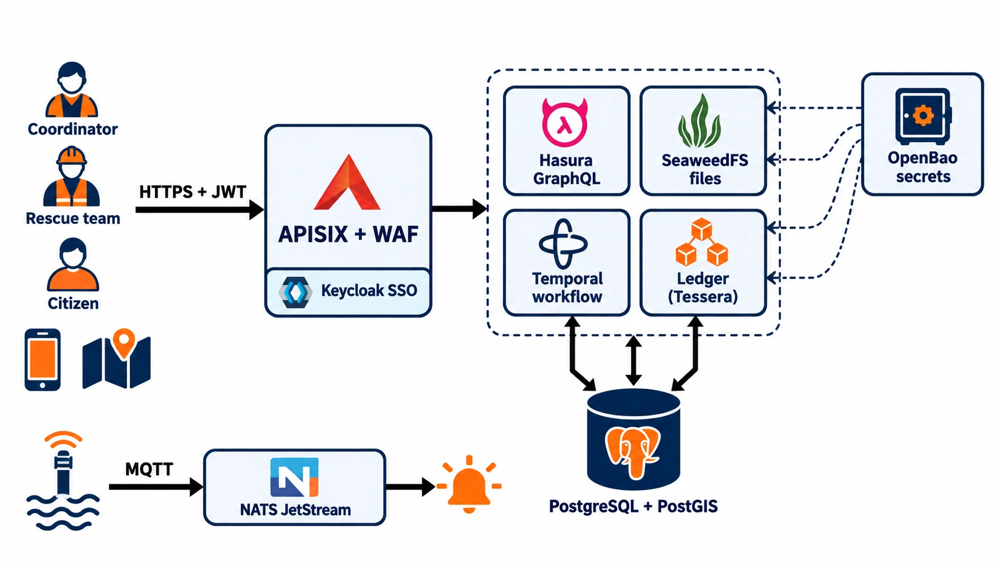

Hệ thống có hai tầng theo mô hình Open-Core của đề. **Tầng 1** (`core/`) là lõi headless: chỉ có API, không có giao diện người dùng cuối và không chứa nghiệp vụ thiên tai. Lõi có đủ 4 dịch vụ bắt buộc: **SSO** (Keycloak, có OTP), **API Gateway** (APISIX + Coraza WAF), **dữ liệu** có cấu trúc (PostgreSQL + PostGIS, GraphQL tự sinh bằng Hasura CE) và phi cấu trúc (SeaweedFS S3), **workflow engine** (Temporal); thêm NATS cho sự kiện và IoT, sổ cái Tessera, OpenBao giữ mọi bí mật. **Tầng 2** (`apps/cuu-tro/`) là ứng dụng cứu trợ, chỉ gọi lõi qua APISIX; muốn dùng lõi cho bài toán khác thì thêm một thư mục trong `apps/`, không sửa `core/`.

Sơ đồ chi tiết, luồng JWT, route gateway, quản lý bí mật: [`docs/architecture.md`](docs/architecture.md).

## ⚙️ Công nghệ

| Lớp | Thành phần | Giấy phép |
|---|---|---|
| SSO / MFA | Keycloak 26.8 | Apache-2.0 |
| API Gateway | Apache APISIX 3.19 + Coraza WAF (OWASP CRS 4.14) | Apache-2.0 |
| Dữ liệu có cấu trúc | PostgreSQL 17 + PostGIS 3.5, Hasura GraphQL Engine CE v2.51 | PostgreSQL, GPL-2.0 (dịch vụ riêng), Apache-2.0 |
| Dữ liệu phi cấu trúc | SeaweedFS (S3) | Apache-2.0 |
| Workflow | Temporal 1.29 + Python SDK | MIT |
| Sự kiện, IoT | NATS JetStream + MQTT | Apache-2.0 |
| Sổ cái minh bạch | Tessera (Go, `core/ledger`) | Apache-2.0 |
| Bản sao số (NGSI-LD) | Scorpio Broker 6.0 (dùng PostgreSQL + PostGIS, không MongoDB) | BSD-3-Clause |
| Bí mật | OpenBao | MPL-2.0 |
| Backend ứng dụng | Python 3.12, FastAPI | PSF-2.0, MIT |
| Dữ liệu lịch sử, dashboard | Parquet trên SeaweedFS + DuckDB (#91); Grafana OSS 13 dịch vụ riêng, profile `bi` (#92) | MIT; AGPL-3.0 (dịch vụ riêng, image gốc) |
| AI (Tầng [I]) | Ollama 0.40 dịch vụ riêng, profile `ai` + Qwen2.5 7B Instruct; hoặc API ngoài chuẩn OpenAI; mặc định bộ luật không cần mô hình (#102) | MIT; Apache-2.0 |
| App hiện trường (#106) | React Native 0.80 + TypeScript, React Navigation, TanStack Query, Zustand, i18next, MapLibre React Native, react-native-app-auth (PKCE) | MIT |
| Sắp có | Qdrant, ClamAV | Apache-2.0, GPL-2.0 (dịch vụ riêng) |

Phiên bản và giấy phép từng image, thư viện: [`DEPENDENCIES.md`](DEPENDENCIES.md).

## 🔄 Luồng nghiệp vụ

**Kêu cứu → cứu hộ**

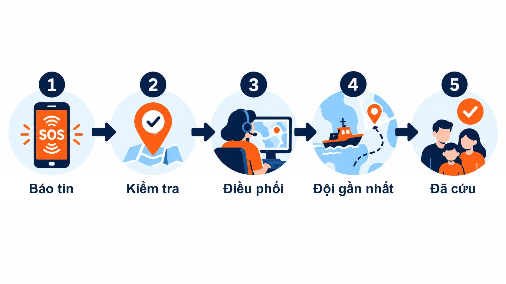

1. **Báo tin:** người dân hoặc tình nguyện viên gửi tin kêu cứu kèm tọa độ.
2. **Kiểm tra:** CSDL từ chối tin thiếu tọa độ và tin trùng số điện thoại trong 200 m / 6 giờ.
3. **Điều phối:** tin mới tự khởi chạy workflow Temporal (#67), tin khẩn được xếp trước; người điều phối chỉ can thiệp khi hệ thống báo (hết lần giao, không có đội).
4. **Đội gần nhất:** workflow tìm đội sẵn sàng gần nhất bằng PostGIS và giao đội; đội không nhận hoặc từ chối trong hạn (theo mức khẩn) thì giao đội kế tiếp.
5. **Đã cứu:** đội cứu hộ xác nhận, tin được đóng, đội trở lại trạng thái sẵn sàng.

**Hàng cứu trợ → kiểm chứng công khai**

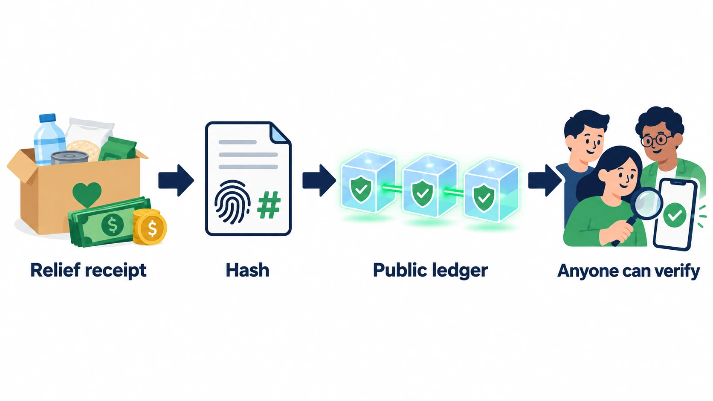

1. **Phiếu cứu trợ:** người điều phối lập phiếu nhập hoặc xuất kho, tồn kho tự cập nhật.
2. **Băm:** bản ghi phiếu chuẩn hóa, không chứa thông tin cá nhân, được băm SHA-256.
3. **Sổ cái công khai:** dấu băm được ghi vào transparency log Tessera, chỉ thêm, không sửa, có chữ ký.
4. **Ai cũng kiểm chứng được:** trang công khai hoặc công cụ `ledger-verify` tự kiểm phiếu từ dữ liệu công khai, không cần tài khoản.

API và lệnh mẫu của từng bước: [`apps/cuu-tro/README.md`](apps/cuu-tro/README.md).

## 🚀 Hướng phát triển

Theo [`docs/PLAN.md`](docs/PLAN.md):

- **Tuần 3:** web điều phối Nuxt 4 + Nuxt UI với bản đồ MapLibre thời gian thực, màn hình phân công; tự khởi chạy phân công khi có tin mới; thông báo realtime qua Centrifugo.
- **Tuần 4:** trạm đo thành bản sao số NGSI-LD trên Scorpio (đã có, #85); cảnh báo vượt ngưỡng qua Temporal, gửi Telegram (đã có, #87, cần token bot thật); dữ liệu cũ ra Parquet + DuckDB (đã có, #91); dashboard Grafana điều hành (đã có, #92); lên VPS có HTTPS.
- **Tuần 5:** AI bóc tách tin kêu cứu tự do thành dữ liệu có cấu trúc (đã có, #102), hàng chờ duyệt trên web điều phối (đã có, #104); app hiện trường React Native chạy được khi mất mạng (đã có, #106); demo công khai.
- **Tuần 6–7:** sửa theo phản hồi người dùng thật, module mẫu cho `apps/`, phát hành v1.0.0.

## 🛠️ Cài đặt từ máy sạch

### Yêu cầu máy

| Mục | Tối thiểu |
|---|---|
| Hệ điều hành | Linux, macOS (Intel hoặc Apple Silicon). Windows qua WSL 2 về lý thuyết chạy được, đội chưa kiểm thử. Apple Silicon (Docker Desktop hoặc Colima): `make` tự dùng Scorpio bản JVM, vì bản native cần AVX2 mà Rosetta không có (#99); chạy `docker compose up` trực tiếp thì đặt `SCORPIO_IMAGE` trong `.env` · *Apple Silicon: `make` picks the JVM build of Scorpio automatically (the native build needs AVX2, which Rosetta lacks)* |
| Docker | Docker Engine 24+ hoặc Docker Desktop, **Docker Compose 2.20+** (cần `include`) |
| RAM cấp cho Docker | 6 GB trở lên. Đo thật (v0.3.0, 24/10/2026): cả hệ thống khoảng 2,3 GB sau khi khởi động, khoảng 3,0 GB sau `make smoke` (gồm Grafana, profile `bi`) |
| Ổ trống | 15 GB trở lên. Đo thật (v0.3.0): image khoảng 8,5 GB (Grafana 1,4 GB, chỉ khi bật profile `bi`), build cache khoảng 0,8 GB; lúc chạy `make smoke` trên volume trống ổ giảm thêm tới khoảng 10 GB. Chạy xong: `make down` rồi `docker image prune -a` |
| AI bằng mô hình thật (tùy chọn, `make up-ai`) | Thêm ~12 GB ổ (image Ollama 7 GB + Qwen2.5 7B 4,7 GB) và ~5 GB RAM cho Docker. Đo trên MacBook Apple Silicon (CPU): ~11,5 giây mỗi tin. Không bật thì dùng bộ luật mặc định · *optional real model: +12 GB disk, +5 GB RAM, ~11.5 s per message on CPU* |
| Công cụ | `git`, `make`, `bash`, `curl`, `python3`, `openssl` |
| Cổng trống | `8080` (Keycloak), `9080` (APISIX); chỉ trên `127.0.0.1`: `8200`, `15432`, `8081`, `8333`, `7233`, `8088`, `4222`, `1883` |

Không bắt buộc: [`uv`](https://docs.astral.sh/uv/) để chạy pytest, Go 1.26 để chạy `go test`, `shellcheck` + `yamllint` cho `make lint`.

### Chạy

```bash
git clone https://github.com/disaster-dxos/disaster-dxos.git
cd disaster-dxos
cp .env.example .env
make up
make smoke
```

Sau `make up`, mở web điều phối qua gateway: **http://localhost:9080/** (đăng nhập bằng tài khoản mẫu bên dưới).

| Bước | Việc xảy ra |
|---|---|
| `cp .env.example .env` | Cấu hình cho máy dev. Không có bí mật nào trong file này; `KC_DEMO_USER_PASSWORD` chỉ là mật khẩu của tài khoản mẫu |
| `make up` | Chạy OpenBao, khởi tạo (Shamir 3 mảnh, ngưỡng 2), mở khóa, sinh ngẫu nhiên mọi bí mật lõi, rồi chạy profile `core` + `app`: kéo image, build 4 image từ mã nguồn (APISIX + Coraza, sổ cái Go, backend Python, web Nuxt), áp migration, áp metadata Hasura, tạo bucket |
| `make smoke` | Nạp dữ liệu giả rồi kiểm 782 ca (v0.3.0): OpenBao, JWT, route gateway + WAF, ràng buộc CSDL, phân quyền GraphQL, workflow phân công, cảm biến MQTT + trận lũ mẫu, bản sao số NGSI-LD, cảnh báo vượt ngưỡng, ảnh hiện trường, sổ cái (hàng + tiền), web điều phối, thông báo realtime, bản đồ, API kêu cứu, Parquet + DuckDB, Grafana (tự bật profile `bi`) |

Đo thật ngày 22/10/2026 trên bản clone sạch từ GitHub, chạy ở thư mục khác thư mục mã gốc (Mac Apple Silicon, Docker Desktop, Docker Engine 28.5, chưa có image nào trên máy): `make up` lần đầu 2 phút 36 giây (gồm kéo khoảng 6,9 GB image và build), lần sau 48 giây; `make smoke` 72 giây, đạt 339/339 (số đo v0.1.0). Ở v0.3.0, `make smoke` trên volume trống (project tạm) mất khoảng 4,5 phút (264 giây), đạt 782/782. Mạng chậm hơn thì lần đầu lâu hơn.

**Giữ kín `.data/openbao/`.** Lần đầu `make up` ghi unseal key và root token vào đây (đã nằm trong `.gitignore`); mất thư mục này thì không mở khóa được dữ liệu OpenBao. Sau khi khởi động lại máy, nếu OpenBao còn khóa: `make bao-unseal`.

Lệnh khác: `make ps`, `make logs`, `make down` (dừng, giữ dữ liệu), `make seed` (nạp lại dữ liệu giả), `make gia-lap`, `make gia-lap-vuot-nguong` và `make gia-lap-tran-lu` (giả lập trạm đo gửi MQTT; trận lũ mẫu 48 giờ, #84), `make up-bi` (Grafana, #92), `make luu-tru` và `make luu-tru-truy-van SQL="..."` (Parquet + DuckDB, #91), `make bao-status`, `make bao-init`. Danh sách đầy đủ trong [`Makefile`](Makefile).

Cấu hình qua biến môi trường, lệnh OpenBao, cách thêm ứng dụng mới vào `apps/`, kiểm thử và lint: [`docs/cai-dat.md`](docs/cai-dat.md).

### Tài khoản mẫu và thử API

Tài khoản trong realm `disaster` là **dữ liệu giả** của `apps/cuu-tro`, chỉ dùng trên máy dev. Mật khẩu là giá trị `KC_DEMO_USER_PASSWORD` trong `.env`.

| Tên đăng nhập | Vai trò | Ghi chú |
|---|---|---|
| `dieuphoi01` | `dieu-phoi` (cán bộ xã) | Đăng nhập qua trình duyệt bị bắt cài OTP |
| `cuuho01` | `cuu-ho` | Thành viên "Đội ca nô Biên phòng" trong dữ liệu mẫu |
| `tinhnguyen01` | `tinh-nguyen` | Chỉ thấy tin mình tạo, không thấy SĐT người báo |

Dữ liệu mẫu là xã An Lạc giả định (`make seed`, `make smoke` cũng tự nạp).

Web điều phối: http://localhost:9080/ chuyển sang trang đăng nhập Keycloak (client `dxos-web`, PKCE) rồi quay về bản đồ. Thử nhanh API qua gateway (client `dxos-dev-cli` chỉ dùng khi dev):

```bash
set -a; . ./.env; set +a
TOKEN=$(curl -s -X POST http://localhost:8080/realms/disaster/protocol/openid-connect/token \
  -d grant_type=password -d client_id=dxos-dev-cli -d username=dieuphoi01 \
  --data-urlencode password="$KC_DEMO_USER_PASSWORD" | python3 -c 'import sys,json; print(json.load(sys.stdin)["access_token"])')

# Tin kêu cứu qua GraphQL (Hasura lọc theo vai trò trong JWT)
curl -s -H "Authorization: Bearer $TOKEN" -H 'Content-Type: application/json' \
  -d '{"query":"{ incidents(limit: 3) { id description status } }"}' http://localhost:9080/graphql

# Không có token thì gateway trả 401
curl -s -o /dev/null -w '%{http_code}\n' http://localhost:9080/graphql

# Khóa công khai của sổ cái, đọc không cần đăng nhập
curl -s http://localhost:9080/ledger/verifier

# AI bóc tách tin kêu cứu viết tự do → đề xuất + Poka-yoke (không tạo tin; mặc định bộ luật, không cần mô hình)
curl -s -H "Authorization: Bearer $TOKEN" -H 'Content-Type: application/json' \
  -d '{"van_ban": "Cuu voi, nha o thon 3 ngap toi mai, 5 nguoi, 15.8502, 108.1035, sdt 0905 123 456", "nguon": "sms"}' \
  http://localhost:9080/workflow/ai/boc-tach
```

Chạy AI bằng mô hình thật Qwen2.5 7B (*run the extraction with a real open model*): `make up-ai` (tải image Ollama ~2,6 GB và mô hình ~4,7 GB lần đầu), đặt `LLM_PROVIDER=ollama` trong `.env`, rồi `make up`. Mô hình chạy CPU trong Docker; không đủ RAM thì giữ `LLM_PROVIDER=gia-lap`.

Duyệt tin AI trên web (*review AI suggestions in the web app*): đăng nhập `dieuphoi01`, mở http://localhost:9080/hang-cho, dán tin nhắn, bấm "Bóc tách bằng AI", sửa nếu cần rồi "Duyệt và tạo tin". Gọi API: thêm `"vao_hang_cho": true` vào lệnh trên rồi `POST /workflow/hang-cho/<mã>/duyet`.

Phân công đội, xác nhận, tải ảnh, lập phiếu kho, trang minh bạch, tự kiểm sổ cái bằng `ledger-verify`: xem [`apps/cuu-tro/README.md`](apps/cuu-tro/README.md).

### Xử lý lỗi thường gặp

| Hiện tượng | Nguyên nhân | Cách xử lý |
|---|---|---|
| `Bind for 0.0.0.0:8080 failed: port is already allocated` | Cổng đã có chương trình khác dùng | Đổi `KEYCLOAK_PORT` (kèm `KEYCLOAK_PUBLIC_URL`), `APISIX_PORT` (kèm `GATEWAY_PUBLIC_URL`) hoặc biến `*_PORT` tương ứng trong `.env`, rồi `make up`. Tìm chương trình đang chiếm: `lsof -i :8080` |
| Dịch vụ đứng ở `Waiting`, `openbao` unhealthy, `make bao-status` báo `Sealed true` | OpenBao luôn khởi động ở trạng thái khóa | `make bao-unseal`. Nếu báo thiếu key: kiểm tra `.data/openbao/` còn nguyên |
| `make smoke` lỗi `HTTPS required`, hoặc lấy token từ máy host trả 403 | Realm `external` chỉ cho HTTP với IP riêng; VPN, proxy hoặc mạng của Docker Desktop làm Keycloak thấy IP công khai (đã gặp khi kiểm chứng máy sạch) | Chỉ trên máy dev: đặt `KC_REALM_SSL_REQUIRED=none` trong `.env`. Realm chỉ import lần đầu nên tạo lại CSDL (giữ OpenBao): `make down && docker volume rm disaster-dxos_pgdata && make up` |
| Container thoát mã 137, `docker inspect` báo `OOMKilled` | Docker được cấp quá ít RAM | Tăng RAM cho Docker Desktop lên 4 GB trở lên; xem mức dùng bằng `docker stats` |
| `no space left on device` khi kéo image hoặc build | Thiếu ổ | Cần khoảng 10 GB trống. Dọn: `make down && docker image prune -a -f && docker builder prune -f` (giữ volume dữ liệu) |
| PostgreSQL khởi động và chạy chậm hơn trên Mac Apple Silicon | `postgis/postgis` chỉ có image amd64 (`POSTGIS_PLATFORM=linux/amd64`), Docker chạy giả lập | Bình thường, vẫn đạt `make smoke`. Bật "Use Rosetta for x86_64/amd64 emulation" trong Docker Desktop để nhanh hơn |
| `/workflow/*` trả 502 hoặc 503 | Backend ứng dụng chưa chạy | `make ps` xem `cuu-tro-api`; chạy lại `make up` (bật cả profile `app`) |
| Muốn làm lại từ đầu | | Xóa **mọi** dữ liệu dev: `docker compose --profile '*' down -v`, xóa thư mục `.data/openbao/`, rồi `make up`. Không chạy `down -v` mà giữ `.data/openbao/`: key cũ không mở được volume OpenBao mới |

## 🤝 Đóng góp

Quy trình: issue → nhánh `feature/<số-issue>-<tên-ngắn>` tách từ `develop` → PR về `develop` theo mẫu → CI xanh + 1 người duyệt → merge squash. Commit theo Conventional Commits, mô tả tiếng Việt. Trước khi mở PR: `make check`, `make lint`, thêm dòng vào `CHANGELOG.md`, file mới có header `SPDX-License-Identifier: Apache-2.0` (`make license`).

Chi tiết: [`CONTRIBUTING.md`](CONTRIBUTING.md). Quy tắc ứng xử: [`CODE_OF_CONDUCT.md`](CODE_OF_CONDUCT.md).

## 🐛 Báo lỗi

Mở issue tại [GitHub Issues](https://github.com/disaster-dxos/disaster-dxos/issues) theo mẫu "Báo lỗi": mô tả, cách tái hiện, môi trường (hệ điều hành, RAM, `docker compose version`).

## 📜 Giấy phép

Mã nguồn phát hành theo [Apache-2.0](LICENSE). Bản quyền và ghi nhận thành phần bên thứ ba: [`NOTICE`](NOTICE). Phiên bản và giấy phép từng image, thư viện: [`DEPENDENCIES.md`](DEPENDENCIES.md).

- Chỉ dùng thành phần có giấy phép được OSI công nhận.
- Thành phần copyleft (PostGIS GPL-2.0, Grafana AGPL-3.0; sắp có ClamAV GPL-2.0) chạy như dịch vụ riêng bằng image gốc, không sửa, không nhúng vào mã của dự án.
- Ảnh minh họa trong `docs/images/` do đội tạo bằng công cụ AI, sơ đồ SVG do đội vẽ; cấp phép cùng repo. Biểu tượng trong ảnh kiến trúc là hình minh họa, không phải logo chính thức ([`docs/images/README.md`](docs/images/README.md)).

## 📝 CHANGELOG

Theo [SemVer](https://semver.org/lang/vi/). Bản mới nhất: [v0.3.0](https://github.com/disaster-dxos/disaster-dxos/releases/tag/v0.3.0) (24/10/2026, Tầng [D]: bản sao số trạm đo NGSI-LD, trận lũ mẫu, cảnh báo vượt ngưỡng qua Temporal, tiền cứu trợ trên sổ cái minh bạch, Parquet + DuckDB, Grafana); bản trước: [v0.2.0](https://github.com/disaster-dxos/disaster-dxos/releases/tag/v0.2.0) (23/10/2026, web điều phối Nuxt UI: bản đồ realtime, phân công tự động, API kêu cứu, thông báo Centrifugo), [v0.1.0](https://github.com/disaster-dxos/disaster-dxos/releases/tag/v0.1.0) (22/10/2026, lõi Tầng 1 đầy đủ + ứng dụng cứu trợ, sổ cái minh bạch), [v0.0.1](https://github.com/disaster-dxos/disaster-dxos/releases/tag/v0.0.1) (19/10/2026, khung dự án + profile `core`). Thay đổi chưa phát hành và lịch sử: [`CHANGELOG.md`](CHANGELOG.md). Mỗi bản có gói mã nguồn `disaster-dxos-X.Y.Z.tar.gz` + `SHA256SUMS`; cách kiểm, build từ gói và quy trình phát hành: [`CONTRIBUTING.md`](CONTRIBUTING.md) mục 7 · *each release ships a source tarball with SHA-256 checksums; see CONTRIBUTING.md §7*.
