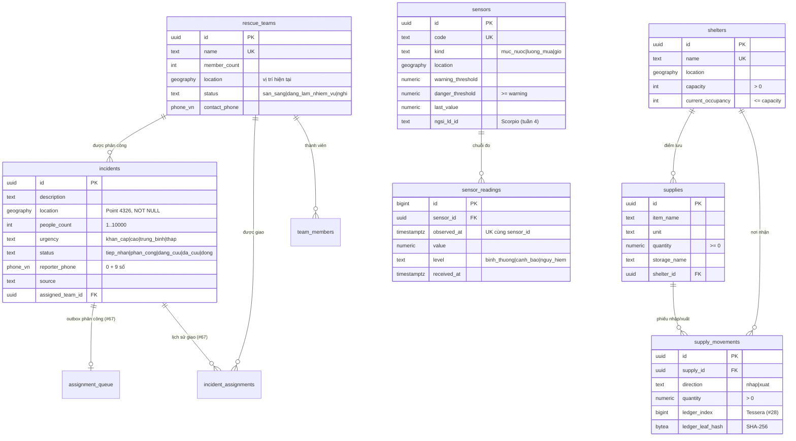
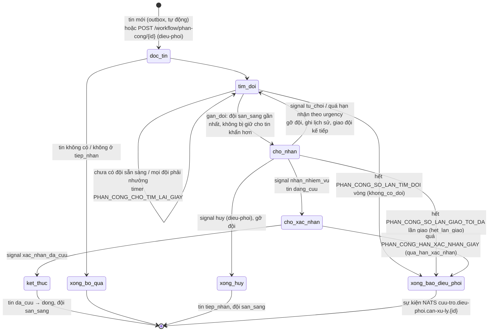
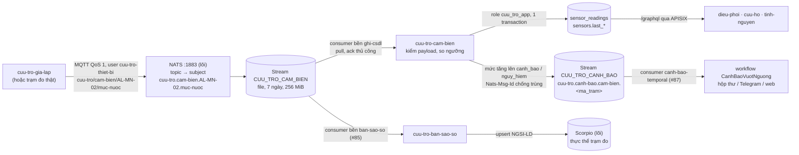

<!-- SPDX-License-Identifier: Apache-2.0 -->
# apps/cuu-tro — Ứng phó thiên tai & cứu trợ cộng đồng

Ứng dụng Tầng 2 cho chính quyền xã (điều phối), đội cứu hộ, tình nguyện viên và người dân cần cứu.

| Thư mục | Nội dung | Trạng thái |
|---|---|---|
| `keycloak/realm.json` | Realm `disaster`: vai trò `dieu-phoi`, `cuu-ho`, `tinh-nguyen`; client `dxos-gateway`, `dxos-web`, `dxos-dev-cli` (chỉ dev); 3 người dùng mẫu, mật khẩu lấy từ `.env` | Có |
| `db/migrations/` | Schema `cuu_tro`: `incidents`, `rescue_teams`, `shelters`, `supplies`, `supply_movements`, `sensors` (PostGIS); `team_members` (#26); `sensor_readings` chuỗi đo cảm biến (#30); `incident_media` ảnh hiện trường (#27); quyền lập phiếu + ghi sổ cái cho `cuu_tro_app` (#28); quyền tạo tin kêu cứu cho `cuu_tro_app` (#66) | Có (#25, #26, #30, #27, #28, #66) |
| `db/seed/` | Dữ liệu giả xã An Lạc (giả định) | Có (#25) |
| `db/tests/` | Kiểm thử ràng buộc (Poka-yoke, CHECK, quyền theo search_path, quyền role `cuu_tro_app`, chuỗi đo cảm biến, ảnh hiện trường, phiếu kho + sổ cái, tạo tin bằng role của API kêu cứu) | Có (#25, #26, #29, #30, #27, #28, #66) |
| `hasura/metadata/` | Metadata Hasura: bảng track, quan hệ, quyền theo vai trò JWT | Có (#26) |
| `workflow/` | Backend Python: Temporal worker (`PhanCongCuuHo`, `Hello`) + API FastAPI khởi chạy workflow qua gateway `/workflow/*` (#29); consumer cảm biến NATS JetStream + bộ giả lập trạm đo MQTT (#30); API ảnh hiện trường (#27); phiếu nhập/xuất → sổ cái minh bạch + trang công khai (#28); API tiếp nhận tin kêu cứu có Poka-yoke (#66); pytest | Có (#29, #30, #27, #28, #66) |
| `compose.yaml` | Dịch vụ `cuu-tro-worker`, `cuu-tro-api`, `cuu-tro-cam-bien`, `cuu-tro-thong-bao` (#68), `bao-agent-cuu-tro` (profile `app`), `cuu-tro-gia-lap` (profile `gia-lap`), lõi nạp bằng `include` | Có (#29, #30, #27) |
| `openbao/` | Policy + template bao agent cho backend (mật khẩu role `cuu_tro_app`, NATS/MQTT, khóa S3 của ứng dụng, token ghi sổ cái) | Có (#29, #30, #27, #28) |
| `s3/buckets.conf` | Bucket S3 của ứng dụng (`cuu-tro-media`), lõi tạo khi `make up` | Có (#27) |
| `nats/streams.json` | Khai báo stream/consumer JetStream của ứng dụng (`cuu-tro-cam-bien` tạo consumer `ghi-csdl`, `cuu-tro-thong-bao` tạo consumer `realtime-*`) | Có (#30, #68) |
| `web/` | Web điều phối Nuxt 4 + Nuxt UI + MapLibre: đăng nhập Keycloak OIDC + PKCE (client `dxos-web`), bản đồ + danh sách tin kêu cứu thời gian thực qua GraphQL subscription (gom cụm, lọc, chi tiết theo quyền); dịch vụ `cuu-tro-web`, mở qua gateway http://localhost:9080/; xem `web/README.md` | Khung (#59), trong stack (#64), bản đồ realtime (#60), nền Nuxt UI (#77) |
| `mobile/` | App hiện trường Flutter | Tuần 5 |

## Dữ liệu (`db/`, #25)

Schema `cuu_tro`, chủ sở hữu role `cuu_tro_owner` (`NOLOGIN`). Role `hasura` chỉ có quyền DML. Cơ chế migration là của lõi (`core/postgres/migrate.sh`, `docs/architecture.md` mục 7.1); thư mục này chỉ chứa SQL.



Mọi bảng có `created_at`, `updated_at` (trigger tự cập nhật), khóa chính UUID, chỉ mục GiST trên cột vị trí.

### Poka-yoke ở tầng dữ liệu
| Ràng buộc | Cách làm | Lỗi trả về |
|---|---|---|
| Tin kêu cứu phải có tọa độ | `location ... NOT NULL` | `23502` not_null_violation |
| Chặn tin trùng: cùng SĐT, cách tin còn mở (chưa `da_cuu`/`dong`) ≤ 200 m, trong 6 giờ | Trigger `incidents_no_duplicate` (INSERT và UPDATE vị trí/SĐT), khóa advisory theo SĐT để hai yêu cầu đồng thời không cùng lọt. Tham số trong bảng một dòng `incident_dedup_config` | `23505` unique_violation, constraint `incidents_no_duplicate`, DETAIL `incident_id=… distance_m=…`, HINT cập nhật tin cũ |
| Đã phân công / đang cứu phải có đội | CHECK `incidents_team_required` | `23514` |
| Điểm trú ẩn không quá sức chứa | CHECK `shelters_not_over_capacity` | `23514` |
| Xuất kho không quá tồn | Phiếu `supply_movements` cộng/trừ `supplies.quantity` trong cùng transaction, CHECK `quantity >= 0` | `23514` |
| Phiếu nhập/xuất không sửa/xóa (chỉ điền `ledger_*` một lần) | Trigger `supply_movements_immutable` | `23001` restrict_violation |

Tầng API (#66) kiểm thêm trước khi ghi và trả lỗi tiếng Việt theo trường: mục "Tiếp nhận tin kêu cứu" bên dưới.

Vì sao trigger mà không phải exclusion constraint: điều kiện "trong 6 giờ" và "tin cũ còn mở" phụ thuộc thời điểm và trạng thái, exclusion constraint (GiST) chỉ so được giá trị cố định của hai dòng.

Phiếu nhập/xuất và leaf sổ cái (#28) không chứa dữ liệu cá nhân (D-007). Chuỗi đo cảm biến: bảng `sensor_readings` (#30, mục "Cảm biến" bên dưới).

### Chạy
```bash
make up        # tự chạy migration (container migrate) trước Hasura
make seed      # nạp dữ liệu giả, chạy lại được
make test-db   # 29 ca kiểm thử ràng buộc, ROLLBACK sau khi chạy (cũng nằm trong make smoke)
make migrate   # chạy lại migration bằng tay (không có file mới thì không làm gì)
```

Thêm thay đổi schema: tạo file mới `db/migrations/0003_<tên>.sql` (số tiếp theo), không sửa file đã chạy (migrate báo lỗi checksum). Cả file chạy trong một transaction nên không dùng `CREATE INDEX CONCURRENTLY`. Reset từ volume trống: `docs/architecture.md` mục 7.1.

## API GraphQL và phân quyền (`hasura/metadata/`, #26)

Tầng 2 gọi `POST http://<gateway>:9080/graphql` với `Authorization: Bearer <access token Keycloak>`. Vai trò lấy từ claim `x-hasura-default-role` của token (client có thể xin vai trò khác bằng header `X-Hasura-Role` nếu nằm trong `x-hasura-allowed-roles`). Luồng JWT → Hasura → lọc theo hàng: `docs/architecture.md` mục 3.4; cách metadata được áp khi khởi động: mục 7.2.

Tên field gốc trùng tên bảng (không tiền tố schema): `incidents`, `insert_incidents_one`, `update_incidents`, `incidents_aggregate`… Cột vị trí là kiểu `geography`, nhập/xuất bằng GeoJSON `{"type":"Point","coordinates":[kinh độ, vĩ độ]}`.

### Bảng quyền theo vai trò

R = đọc, C = tạo, U = sửa, D = xóa, – = không có (bảng không xuất hiện trong schema GraphQL của vai trò). Không vai trò nào được xóa tin kêu cứu, đội, điểm trú ẩn, hàng, phiếu (đóng/ngừng bằng trạng thái). `anonymous` (không có JWT) không có quyền gì, và APISIX đã chặn 401 trước đó.

| Bảng | `dieu-phoi` (cán bộ xã) | `cuu-ho` (thành viên đội) | `tinh-nguyen` |
|---|---|---|---|
| `incidents` | R mọi tin, mọi cột · C · U nội dung, `status`, `assigned_team_id` | R chỉ tin của **đội mình**, có SĐT để liên lạc · U chỉ cột `status`: từ `phan_cong`/`dang_cuu` sang `dang_cuu`/`da_cuu` | C (luôn `tiep_nhan`, chưa có đội) · R chỉ tin **mình tạo**, **không có** `reporter_phone`, `reporter_name`, `created_by` |
| `rescue_teams` | R · C · U | R đội mình · U vị trí, trạng thái đội mình | – |
| `team_members` | R · C (gán) · U (chuyển đội) · D (gỡ khỏi đội) | R dòng của mình | – |
| `shelters` | R · C · U | R | R |
| `supplies` | R · C · U thông tin mặt hàng (**không** sửa `quantity`) | – | R |
| `supply_movements` | R (lập phiếu qua API `POST /workflow/kho/phieu`, #28; phiếu bất biến, không U/D) | – | – |
| `sensors` | R · U tên, ngưỡng, bật/tắt | R | R thông tin công khai của trạm (#30) |
| `sensor_readings` | R (quan hệ `sensor`, `sensors.readings`) | R | R (tối đa 500 dòng/truy vấn) |
| `incident_media` (#27) | R mọi ảnh (quan hệ `incident`, `incidents.media`) | R ảnh của tin **đội mình** | R chỉ ảnh **mình tải lên**, không có `uploaded_by`, `uploader_role` |
| `incident_assignments` (#67) | R mọi lần giao (quan hệ `incident`, `team`, `incidents.assignments`) | R lần giao cho **đội mình** | – |
| `incident_dedup_config`, `assignment_queue` (#67) | không track: không vai trò nào thấy | | |

Cột hệ thống gán từ token, client không tự đặt được: `incidents.created_by` = `X-Hasura-User-Id` (sub Keycloak); `supply_movements.created_by` = tên đăng nhập trong JWT, API gán (#28). Tồn kho chỉ đổi qua phiếu nhập/xuất (trigger, sổ cái #28); cột `ledger_*` và giá trị đo cảm biến do dịch vụ nội bộ ghi (#28, #30), không qua vai trò người dùng.

**Thành viên đội:** `cuu-ho` thấy tin nhờ bảng `team_members (user_id = sub Keycloak, team_id)`: filter `assigned_team.members.user_id = X-Hasura-User-Id`. Điều phối gán/chuyển đội trong ứng dụng, có hiệu lực ngay ở truy vấn sau (không chờ token mới):

```graphql
mutation GanDoi($u: String!, $t: uuid!) {
  insert_team_members_one(object: {user_id: $u, team_id: $t},
    on_conflict: {constraint: team_members_pkey, update_columns: [team_id]}) { user_id team_id }
}
```

User mẫu có `id` cố định trong `keycloak/realm.json` nên seed gán sẵn `cuuho01` vào "Đội ca nô Biên phòng" trên volume trống. Realm import từ trước #26 có `sub` ngẫu nhiên: gán lại bằng mutation trên (`scripts/smoke-hasura.sh` làm vậy).

Truy vấn mẫu: tin kêu cứu trong bán kính 500 m (PostGIS qua Hasura, vẫn áp quyền của vai trò):

```graphql
query GanToi($p: geography!) {
  incidents(where: {location: {_st_d_within: {from: $p, distance: 500}}}) { id description status }
}
# biến: {"p": {"type": "Point", "coordinates": [108.1035, 15.8502]}}
```

Sửa quyền: sửa file bảng trong `hasura/metadata/databases/default/tables/`, `docker compose restart hasura`, chạy `bash scripts/smoke-hasura.sh`. Lệch DB (bảng/cột không có) thì Hasura dừng khởi động, xem `docker compose logs hasura`.

Truy vấn SQL mẫu: đội sẵn sàng gần mỗi tin kêu cứu mới nhất (KNN trên chỉ mục GiST):

```sql
SELECT i.description, t.name, round(ST_Distance(t.location, i.location)) AS met
  FROM cuu_tro.incidents i
  CROSS JOIN LATERAL (SELECT name, location FROM cuu_tro.rescue_teams
                       WHERE status = 'san_sang' AND location IS NOT NULL
                       ORDER BY location <-> i.location LIMIT 1) t
 WHERE i.status = 'tiep_nhan';
```

## Workflow (`workflow/`, #29)

Backend nghiệp vụ của ứng dụng (D-008), không thuộc lõi. Hai dịch vụ dùng chung một image (`python:3.12-slim`, phụ thuộc cài từ `requirements.txt` có hash, sinh từ `uv.lock`):

| Dịch vụ | Lệnh | Gọi tới |
|---|---|---|
| `cuu-tro-worker` | `python -m cuu_tro_workflow.worker` | Temporal (task queue `cuu-tro`), PostgreSQL bằng role `cuu_tro_app` (`APP_DB_URL` từ OpenBao qua `bao-agent-cuu-tro`), NATS (báo điều phối, #67). Cùng tiến trình: bộ khởi chạy tự động `khoi_chay.py` (#67), bộ khởi chạy cảnh báo `canh_bao_khoi_chay.py` (#87) |
| `cuu-tro-api` | `uvicorn cuu_tro_workflow.api:app --root-path /workflow` | Temporal (start/signal/query), Hasura qua gateway `/graphql` bằng JWT người dùng. Không mở cổng ra host. Cấp token kết nối Centrifugo (#68) |
| `cuu-tro-thong-bao` | `python -m cuu_tro_workflow.thong_bao_cau_noi` | Cầu nối thông báo realtime (#68): consumer JetStream `realtime-dieu-phoi` (gồm thông báo cảnh báo trạm đo đã khử trùng lặp, #87) → HTTP API Centrifugo (mạng nội bộ) → kênh `dieu-phoi`. Không đọc CSDL |

Cách backend gọi lõi và vì sao: `docs/architecture.md` mục 7.3.

### `PhanCongCuuHo`: tiếp nhận → phân công → nhận → xác nhận → đóng (#29, #67)

**Tự khởi chạy (#67).** Không ai phải bấm "phân công": mỗi tin `tiep_nhan` mới (từ Hasura, API kêu cứu #66 hay SQL) được trigger `incidents_enqueue_assignment` ghi vào outbox `assignment_queue` **cùng transaction** rồi `pg_notify('cuu_tro_tin_moi')`. Bộ khởi chạy `khoi_chay.py` chạy trong tiến trình worker, `LISTEN` kênh đó và quét lại mỗi `PHAN_CONG_QUET_GIAY` giây (phòng lỡ NOTIFY), lấy tin khẩn trước (`urgency_rank`, rồi thời điểm tạo), `FOR UPDATE SKIP LOCKED`, khởi chạy workflow id **`phan-cong-<incident_id>`** rồi đánh dấu `started_at`. Gọi lại an toàn: đang chạy → dùng lại (`USE_EXISTING`), đã chạy xong → Temporal từ chối (`REJECT_DUPLICATE`). Seed dữ liệu mẫu đặt `SET LOCAL cuu_tro.tu_phan_cong = off` nên tin mẫu không tự chạy. Tắt cả cơ chế: `PHAN_CONG_TU_DONG=0` (vẫn khởi chạy tay qua API).



| Bước | Activity (I/O) | Ghi chú |
|---|---|---|
| `doc_tin` | `SELECT` tin (kèm `urgency`) | Chỉ phân công tin `tiep_nhan`; hạn nhận lấy theo `urgency` của tin |
| `tim_doi` | `tim_doi_ung_vien`: đánh dấu tin đang tìm đội (`assignment_queue.seeking_at`), tối đa 10 đội `san_sang` có vị trí trong `PHAN_CONG_BAN_KINH_M` (mặc định 20 km), xếp theo `location <-> incident.location` | Chọn đội: `logic.chon_doi_gan_nhat` (gần nhất; hòa thì đội đông người hơn, rồi theo id), bỏ các đội đã từ chối/quá hạn với tin này |
| `gan_doi` | Một transaction: khóa tin, **luật ưu tiên** `team_reserved_for_more_urgent`, `UPDATE` đội chỉ khi còn `san_sang`, ghi `incident_assignments` (`cho_nhan`, `deadline_at`) | Trả `da_gan` · `bi_gianh` (đội vừa bị tin khác lấy) · `nhuong` (đội đang được giữ cho tin khẩn hơn) · `tin_da_doi` |
| `cho_nhan` | – | Timer bền của Temporal (`wait_condition` có hạn), không vòng lặp sleep. Signal `nhan_nhiem_vu` / `tu_choi` mang `doi_id`: phản hồi muộn của đội đã bị thay bị bỏ qua |
| (từ chối/quá hạn/hủy) | `go_doi`: tin `phan_cong → tiep_nhan`, đội về `san_sang`, lịch sử `tu_choi`/`qua_han`/`huy` | Đội đã thử không được giao lại cho cùng tin |
| (nhận) | `nhan_nhiem_vu`: tin `phan_cong → dang_cuu`, lịch sử `da_nhan` | Sau khi đội nhận, signal `huy` không còn tác dụng (đội đang ở hiện trường) |
| `cho_xac_nhan` | – | Signal `xac_nhan_da_cuu`; quá hạn (mặc định 6 giờ) → báo điều phối, tin giữ `dang_cuu` |
| `ket_thuc` | Tin `da_cuu` → `dong`, đội về `san_sang` | Mọi activity chạy lại được (Temporal thử lại 5 lần); lỗi nghiệp vụ không thử lại |
| báo điều phối | `bao_dieu_phoi`: JetStream `cuu-tro.dieu-phoi.can-xu-ly.<incident_id>` (stream `CUU_TRO_DIEU_PHOI`), `Nats-Msg-Id` = run + lý do | Chỉ id tin, urgency, lý do, số lần giao: không có SĐT/tên. NATS lỗi kéo dài không làm hỏng kết quả workflow |

**Ưu tiên theo `urgency`** (`khan_cap` > `cao` > `trung_binh` > `thap`, hàm SQL `urgency_rank`):
1. Bộ khởi chạy lấy tin khẩn trước khi có nhiều tin cùng lúc.
2. Workflow và activity mang `priority_key` của Temporal (1 = khẩn nhất): máy chủ Temporal đưa việc của tin khẩn cho worker trước khi worker bận.
3. Quan trọng nhất là **giành đội**: khi đội khan hiếm, `gan_doi` của một tin không lấy đội nếu có tin **khẩn hơn hẳn**, còn `tiep_nhan`, đang tìm đội (`seeking_at` trong 2 chu kỳ tìm lại + 30 giây) và đội đó nằm trong bán kính của tin khẩn hơn. Tin kém khẩn đi tìm đội kế tiếp hoặc chờ vòng sau. Không giành lại đội đã giao (không ngắt nhiệm vụ đang làm); workflow chết thì `seeking_at` tự hết hạn, không ai bị chặn mãi.

**Hạn nhận nhiệm vụ** theo urgency: `PHAN_CONG_HAN_NHAN_GIAY_KHAN_CAP` (mặc định 300), `_CAO` (600), `_TRUNG_BINH` (900), `_THAP` (1800). Tối đa `PHAN_CONG_SO_LAN_GIAO_TOI_DA` (mặc định 3) lần giao, mỗi lần một đội, rồi báo điều phối.

Lịch sử giao (`incident_assignments`): mỗi lần giao một dòng (đội, lần, urgency, khoảng cách, `assigned_at`, `deadline_at`, kết quả, người phản hồi). GraphQL chỉ đọc: `dieu-phoi` mọi dòng, `cuu-ho` dòng của đội mình, `tinh-nguyen` không; quan hệ `incidents.assignments`.

Luồng trạng thái tin hợp lệ (`logic.CHUYEN_TRANG_THAI`): `tiep_nhan → phan_cong | dong`, `phan_cong → dang_cuu | da_cuu | tiep_nhan` (gỡ đội, #67), `dang_cuu → da_cuu`, `da_cuu → dong`. `cuu-ho` vẫn tự chuyển `phan_cong → dang_cuu` qua GraphQL (#26) khi bắt đầu cứu, workflow chấp nhận cả hai.

`Hello`: workflow một activity, kiểm đường đi gateway → API → Temporal → worker.

### API (qua gateway, `Authorization: Bearer <access token Keycloak>`)

| Phương thức, đường dẫn | Vai trò | Kết quả |
|---|---|---|
| `POST /workflow/hello` body `{"ten": "…"}` (tùy chọn) | mọi vai trò | `200 {"workflow_id", "ket_qua", "nguoi_goi"}` |
| `POST /workflow/keu-cuu` (#66) | `dieu-phoi`, `tinh-nguyen` | Tạo tin kêu cứu (tự phân công): `201` · `409` trùng kèm mã tin đang mở · `422` lỗi theo trường. Mục "Tiếp nhận tin kêu cứu" |
| `POST /workflow/phan-cong/{incident_id}` | `dieu-phoi` | Khởi chạy tay (tin mới đã tự chạy; dùng khi luồng tự động đã dừng và báo điều phối). `202 {"workflow_id": "phan-cong-<incident_id>", "run_id", "incident_id"}` · `404` tin không có · `409` tin không ở `tiep_nhan` hoặc luồng đang chạy |
| `GET /workflow/{workflow_id}` | `dieu-phoi`; `cuu-ho` của đội được giao | `200 {"workflow_id", "trang_thai": "RUNNING\|COMPLETED\|…", "chi_tiet": {buoc, urgency, han_nhan_giay, doi_id, doi_ten, khoang_cach_m, so_lan_tim, giao: [{lan, doi_id, doi_ten, ket_qua, …}], da_bao_dieu_phoi, xac_nhan, ket_qua, lich_su}}` |
| `POST /workflow/{workflow_id}/nhan` body `{"ghi_chu": "…"}` (tùy chọn) | `dieu-phoi`; `cuu-ho` của đội được giao | `202` · `409` không ở bước `cho_nhan` hoặc nhiệm vụ đã giao cho đội khác |
| `POST /workflow/{workflow_id}/tu-choi` body `{"ghi_chu": "…"}` (tùy chọn) | `dieu-phoi`; `cuu-ho` của đội được giao | `202` (workflow giao đội kế tiếp) · `409` như trên |
| `POST /workflow/{workflow_id}/huy` body `{"ly_do": "…"}` (tùy chọn) | `dieu-phoi` | `202` (gỡ đội nếu đang giao, tin về `tiep_nhan`) · `409` đội đã nhận hoặc workflow đã xong |
| `POST /workflow/{workflow_id}/xac-nhan` body `{"ghi_chu": "…"}` (tùy chọn) | `dieu-phoi`; `cuu-ho` của đội được giao | `202` (ở `cho_nhan` thì coi như đã nhận) · `409` workflow không chờ nhận/xác nhận |
| `GET /workflow/realtime/token` (#68) | `dieu-phoi` (`quan-tri` khi realm có) | `200 {"token", "han_giay", "kenh": ["dieu-phoi"]}`, `Cache-Control: no-store`: token HS256 kết nối Centrifugo qua `ws://<gateway>/realtime/websocket` (chỉ `sub` + kênh server-side, `REALTIME_TOKEN_HAN_GIAY` giây) · `403` vai khác · `503` chưa có khóa ký |

Không token → `401` ở APISIX; vai trò không đủ → `403` ở API; `cuu-ho` đội khác → `403` (API hỏi `incidents_by_pk` qua `/graphql` bằng JWT người dùng, luật lọc theo đội của Hasura trả `null`).

```bash
TOKEN=$(curl -s -X POST http://localhost:8080/realms/disaster/protocol/openid-connect/token \
  -d grant_type=password -d client_id=dxos-dev-cli -d username=dieuphoi01 \
  --data-urlencode password="$KC_DEMO_USER_PASSWORD" | python3 -c 'import sys,json; print(json.load(sys.stdin)["access_token"])')
curl -s -X POST -H "Authorization: Bearer $TOKEN" http://localhost:9080/workflow/phan-cong/b0000000-0000-4000-8000-000000000004
curl -s -H "Authorization: Bearer $TOKEN" http://localhost:9080/workflow/phan-cong-b0000000-0000-4000-8000-000000000004
```

Theo dõi trong Temporal không cần UI: `docker compose exec temporal temporal workflow list --address temporal:7233`.

### Phát triển

```bash
cd apps/cuu-tro/workflow
uv sync                 # tạo .venv theo uv.lock
uv run pytest -q        # hoặc từ gốc repo: make test-py
# Đổi phụ thuộc: sửa pyproject.toml rồi
uv lock && uv export --frozen --no-dev --no-emit-project -o requirements.txt
```

Test: logic thuần (chọn đội, chuyển trạng thái), workflow trên máy chủ test của `temporalio` (tự tua thời gian: quá hạn nhận → phân công lại, hạn theo urgency, hết lần giao → báo điều phối, tin khẩn cấp được đội trước, từ chối, hủy, tự khởi chạy không trùng; activity thay bằng bản giả trong bộ nhớ), API nhận/từ chối/hủy với Hasura và Temporal giả, kiểm JWT/vai trò của API bằng khóa RSA sinh tại chỗ. Luật SQL (outbox, `urgency_rank`, nhường đội, lịch sử giao, quyền `cuu_tro_app`): `db/tests/0007_phan_cong_tu_dong.sql` (`make test-db`). Lần chạy đầu `temporalio` tải máy chủ test về thư mục tạm. Kiểm thử thật qua gateway: `scripts/smoke-workflow.sh` (trong `make smoke`).

## Tiếp nhận tin kêu cứu (`workflow/cuu_tro_workflow/keu_cuu.py`, #66)

`POST /workflow/keu-cuu` là đường tạo tin kêu cứu có Poka-yoke ở tầng API, bổ sung cho ràng buộc ở tầng dữ liệu (#25). Tin tạo xong đi đúng luồng hiện có: trigger outbox xếp vào hàng phân công tự động (#67), bản đồ thấy ngay qua subscription (#60).

| Lớp | Đã có trước #66 | #66 thêm |
|---|---|---|
| CSDL (#25) | `location NOT NULL`; domain `phone_vn` (`0` + 9 số); `urgency` 4 giá trị, `people_count` 1..10000; trigger `incidents_no_duplicate` (cùng SĐT, tin chưa `da_cuu`/`dong`, `ST_DWithin` trên geography ≤ `radius_m`, trong `window_minutes`, khóa advisory theo SĐT); tham số trong bảng `incident_dedup_config` (200 m, 360 phút) | Migration `0008`: role `cuu_tro_app` được `INSERT` đúng các cột người báo nhập + `created_by` (không `status`, `assigned_team_id`), đọc lại `created_at`, **không** đọc SĐT/tên; trigger chặn trùng chạy `SECURITY DEFINER` (role chỉ có quyền INSERT theo cột vẫn được kiểm đủ) |
| API | Hasura mutation `insert_incidents_one` (dieu-phoi, tinh-nguyen) trả lỗi CSDL thô | Kiểm đủ mọi trường rồi trả **một** lỗi `422` liệt kê từng trường sai (tiếng Việt); chuẩn hóa SĐT (`+84`, dấu cách/chấm/gạch); vùng phục vụ; mô tả ≤ 500 ký tự; lỗi trùng của trigger → `409` kèm mã tin đang mở |
| Gateway | Route `/workflow/*` (JWT, WAF, 300 request/60 s/IP) | Route riêng `/workflow/keu-cuu` giới hạn chặt `GW_KEU_CUU_RATE_LIMIT_COUNT` (20)/60 s/IP, WAF đọc body |

**Vai trò:** `dieu-phoi`, `tinh-nguyen` (giống quyền tạo tin ở Hasura); `cuu-ho` → `403`; không token → `401` ở APISIX. **Không có đường gửi ẩn danh:** repo chưa có quyết định mở kênh công khai; kênh người dân (Telegram bot, việc sau) sẽ gọi API bằng tài khoản dịch vụ của bot. `created_by` = `sub` trong JWT (API gán, client không gửi được).

**Body JSON** (`Content-Type: application/json`, ≤ 16 KiB):

| Trường | Bắt buộc | Kiểm |
|---|---|---|
| `lat`, `lon` | có | Số (không nhận chuỗi, `true`, NaN), vĩ độ −90..90, kinh độ −180..180, trong vùng phục vụ `KEU_CUU_VUNG_PHUC_VU` (mặc định Việt Nam kể cả Hoàng Sa, Trường Sa: `102.1,6.0,117.9,23.4`) |
| `reporter_phone` | có | Di động Việt Nam 10 số đầu `03/05/07/08/09`; nhận `+84…`, `84…`, dấu cách, chấm, gạch, ngoặc rồi chuẩn hóa về `0…` |
| `description` | có | Chuỗi, bỏ khoảng trắng đầu cuối, 1..500 ký tự, không ký tự điều khiển |
| `urgency` | không (`trung_binh`) | `khan_cap`, `cao`, `trung_binh`, `thap` |
| `people_count` | không (1) | Số nguyên 1..10000 |
| `address_text`, `reporter_name` | không | ≤ 300, ≤ 100 ký tự |
| `source` | không (`app`) | `app`, `web`, `dien_thoai`, `telegram`, `mang_xa_hoi`, `khac` |

Trường lạ (vd `latitude`) cũng là lỗi, để client gõ sai tên không âm thầm mất vị trí.

| Kết quả | Body |
|---|---|
| `201` | `{"id", "status": "tiep_nhan", "urgency", "people_count", "lat", "lon", "created_at", "phan_cong": "tu_dong"}`, `Cache-Control: no-store`; không trả lại SĐT |
| `409` trùng | `{"detail": {"ma": "tin_trung", "thong_bao": "Số điện thoại này đã báo một tin kêu cứu còn mở cách vị trí này khoảng 150 m. Không tạo tin mới; …", "incident_id": "<tin đang mở>", "khoang_cach_m": 150, "ban_kinh_m": 200, "trong_vong_phut": 360}}` |
| `422` | `{"detail": {"ma": "du_lieu_khong_hop_le", "thong_bao": "Chưa gửi được tin kêu cứu: …", "loi": [{"truong": "lat", "thong_bao": "Thiếu vĩ độ: tin kêu cứu bắt buộc có vị trí."}, …]}}` |
| `401` / `403` / `413` / `429` | Không token (APISIX) / vai không được tạo tin hoặc WAF chặn / body > 16 KiB / vượt giới hạn tần suất |

**Gửi đồng thời.** Chặn trùng nằm trong CSDL, không ở API: trigger `BEFORE INSERT` lấy `pg_advisory_xact_lock` theo SĐT trước khi tìm tin trùng, nên yêu cầu thứ hai cùng SĐT phải chờ transaction thứ nhất commit rồi mới kiểm (READ COMMITTED: câu `SELECT` trong trigger lấy snapshot mới, thấy tin vừa commit) → `23505` → API trả `409`. Nhiều bản `cuu-tro-api` hay Hasura cùng ghi cũng không lọt. Kiểm thật: `scripts/smoke-keu-cuu.sh` (5 request cùng lúc qua gateway → 1 × `201` + 4 × `409`; hai phiên PostgreSQL, phiên sau phải chờ phiên trước rồi bị chặn).

**Đổi bán kính / khoảng thời gian chặn trùng** (áp cho mọi đường tạo tin, không cần khởi động lại): `UPDATE cuu_tro.incident_dedup_config SET radius_m = 300, window_minutes = 240;` bằng role chủ (`cuu_tro_owner`) hoặc superuser.

**Không ghi SĐT ra log:** API không bật access log, chỉ ghi mã tin đang mở khi trùng, lỗi CSDL bất thường chỉ ghi loại lỗi + tên ràng buộc (thông điệp của PostgreSQL có thể chứa giá trị); thông báo lỗi không lặp lại số người dùng nhập.

```bash
curl -s -X POST -H "Authorization: Bearer $TOKEN" -H 'Content-Type: application/json' \
  -d '{"lat": 15.8502, "lon": 108.1035, "reporter_phone": "0900 000 099", "description": "Nước ngập tới mái, 3 người", "urgency": "khan_cap", "people_count": 3}' \
  http://localhost:9080/workflow/keu-cuu
```

Kiểm thử: `tests/test_cuu_tro_keu_cuu.py` (kiểm dữ liệu, chuẩn hóa SĐT, ánh xạ 409/422, quyền theo vai, gửi đồng thời trên CSDL giả, không có SĐT trong log); `db/tests/0008_api_keu_cuu.sql` (INSERT thật bằng `cuu_tro_app`: thiếu tọa độ, SĐT sai, trùng trong 200 m, khác SĐT cùng chỗ, cùng SĐT ngoài 200 m, DETAIL đúng dạng API đọc, quyền theo cột); `scripts/smoke-keu-cuu.sh` (trong `make smoke`, chạy cuối vì ca 429 khóa route trong `GW_RATE_LIMIT_WINDOW` giây).

## AI bóc tách tin kêu cứu (`workflow/cuu_tro_workflow/boc_tach.py`, #102)

Tin kêu cứu thật hay là SMS, tin Zalo viết vội, không dấu. `POST /workflow/ai/boc-tach` nhận văn bản tự do và trả **đề xuất** theo đúng tên trường của `POST /workflow/keu-cuu`, cộng kết quả Poka-yoke và kiểm trước tin trùng. **AI không tạo tin**: người duyệt sửa rồi gửi `tin_keu_cuu` qua `POST /workflow/keu-cuu` (HITL). Thiết kế: `docs/architecture.md` mục 6.4.

**Nhà cung cấp** (`LLM_PROVIDER` trong `.env`, đọc khi `cuu-tro-api` khởi động):

| Giá trị | Chạy gì | Khi nào dùng |
|---|---|---|
| `gia-lap` (mặc định) | Bộ luật: regex SĐT/tọa độ, từ khóa không dấu cho mức khẩn cấp, nhu cầu, địa chỉ, số người | Máy yếu, CI, smoke. Không cần mô hình |
| `ollama` | Ollama của profile `ai` (`http://ollama:11434`, đổi bằng `LLM_BASE_URL`), mô hình `LLM_MODEL` (mặc định `qwen2.5:7b`, Apache-2.0) | `make up-ai` một lần (tải image ~2,6 GB + mô hình ~4,7 GB), đặt `LLM_PROVIDER=ollama`, `make up` |
| `openai-compatible` | `POST {LLM_BASE_URL}/chat/completions`, `response_format: json_object`; khóa API trong OpenBao | Máy chủ GPU của xã/tỉnh (vLLM, llama.cpp server, Ollama khác) hoặc dịch vụ ngoài: `bao kv put secret/app/cuu-tro/llm api_key=<khóa>` rồi `make up` |
| `tat` | Endpoint trả `503` | Tắt tính năng |

Ollama chạy CPU: đặt `LLM_SO_LUONG` (mặc định 6) khoảng một nửa số CPU cấp cho Docker; để Ollama tự chọn (0) thì trong VM Docker trên Mac các luồng tranh nhau, chậm ~30 lần. Đo thật trên MacBook (Qwen2.5 7B, CPU): ~11,5 s mỗi tin, đúng 58/59 trường trên tin mẫu (`make danh-gia-ai`, `docs/architecture.md` mục 6.4).

`LLM_MODEL` chứa `llama`, `gemma`, `qwen2.5:3b`, `qwen2.5:72b` → `cuu-tro-api` và `ollama-pull` từ chối khởi động (giấy phép không phải Apache-2.0/OSI). Mô hình lỗi, trả rác hoặc quá `LLM_TIMEOUT_GIAY` (90 s) → đề xuất do bộ luật dự phòng tạo, `ai.du_phong = true`, kèm cảnh báo.

**Vai trò:** `dieu-phoi`, `tinh-nguyen` (như quyền tạo tin); `cuu-ho` → `403`; không token → `401` ở APISIX. Route gateway riêng `/workflow/ai/*`: WAF đọc body, `GW_AI_RATE_LIMIT_COUNT` (30)/60 s/IP.

**Body JSON** (≤ 8 KiB): `van_ban` (bắt buộc, ≤ 2000 ký tự), `nguon` (`sms`, `zalo`, `dien_thoai`, `mang_xa_hoi`, `van_ban`; mặc định `van_ban`). Nguồn đổi sang `source` của tin: `sms`/`dien_thoai` → `dien_thoai`, `zalo`/`mang_xa_hoi` → `mang_xa_hoi`, `van_ban` → `khac`. Trường lạ, thiếu `van_ban`, nguồn sai → `422` theo trường.

**Kết quả `200`** (`Cache-Control: no-store`):

| Trường | Nội dung |
|---|---|
| `de_xuat` | `lat`, `lon`, `reporter_phone`, `reporter_name`, `address_text`, `people_count` (`null` = tin không nói), `urgency`, `description`, `nhu_cau` (`cuu_nguoi`, `y_te`, `luong_thuc`, `nuoc_uong`, `cho_o`, `di_doi`, `khac`) |
| `tin_keu_cuu` | Body sẵn để gửi `POST /workflow/keu-cuu` (bỏ trường trống) |
| `poka_yoke` | `hop_le`; `loi` theo trường đúng như `422` của `/keu-cuu` (vd thiếu `lat`/`lon` khi tin không có tọa độ: người duyệt chọn điểm trên bản đồ); `tin_trung` (`incident_id`, `khoang_cach_m`, `ban_kinh_m`, `trong_vong_phut`, `thong_bao`) khi SĐT này đã báo một tin còn mở gần đó |
| `ai` | `nha_cung_cap`, `mo_hinh`, `thoi_gian_ms`, `du_phong` |
| `canh_bao` | Vd mô hình đưa SĐT/tọa độ không có trong tin (đã bỏ), không rõ số người |

**Chống bịa:** SĐT và tọa độ chỉ lấy từ văn bản gốc (regex; số có nhãn "SĐT", "gọi", "liên hệ" được ưu tiên; tọa độ cần ≥ 4 chữ số thập phân để không nhầm giá tiền, tự đổi chỗ khi viết "kinh độ, vĩ độ"); SĐT mô hình đưa ra mà không có trong tin thì bỏ, tọa độ luôn lấy từ regex (mô hình hay đảo vĩ độ/kinh độ). Nhu cầu là hợp của mô hình và từ khóa. Địa chỉ của mô hình phải khớp ≥ 60% từ của tin, tên người báo khớp 100%. Tọa độ không suy từ địa chỉ.

**Kiểm trước tin trùng:** hàm `cuu_tro.incident_find_duplicate(sđt, kinh độ, vĩ độ)` (migration `0013`) dùng đúng điều kiện của trigger `incidents_no_duplicate`, chạy `SECURITY DEFINER`, chỉ trả mã tin + khoảng cách; chỉ `cuu_tro_app` được gọi. Không khóa, không ghi: trigger vẫn là chốt chặn cuối khi tạo tin.

**Dữ liệu cá nhân:** mô tả thay mọi SĐT bằng `[SĐT]` (số đã nằm ở `reporter_phone`, vai không được xem SĐT chỉ thấy bản che); không ghi văn bản tin hay SĐT ra log; tin nằm trong khung `<tin>…</tin>` khi gửi mô hình, lời dặn coi nội dung là dữ liệu.

```bash
curl -s -X POST -H "Authorization: Bearer $TOKEN" -H 'Content-Type: application/json' \
  -d '{"van_ban": "Toi la Nguyen Van An o to 5 phuong Hoa Khanh, 3 nguoi gia bi ket, can thuoc. Goi 0935 111 222. Vi tri 16.0712, 108.1503", "nguon": "zalo"}' \
  http://localhost:9080/workflow/ai/boc-tach
```

Kiểm thử: `tests/test_cuu_tro_boc_tach.py` (bộ luật trên tin mẫu `cuu_tro_workflow/du_lieu/tin_keu_cuu_mau.json`, chống bịa, Ollama và OpenAI-compatible qua máy chủ giả, dự phòng khi quá hạn/HTTP lỗi/JSON hỏng, chặn mô hình không được phép, endpoint); `db/tests/0013_kiem_trung_truoc.sql` (hàm và trigger cùng kết luận); `scripts/smoke-ai.sh` (trong `make smoke`, chế độ `gia-lap`, gọi thật qua gateway).

## Ảnh hiện trường (`workflow/cuu_tro_workflow/anh.py`, `s3.py`, #27)

Ảnh chụp tại hiện trường gắn với tin kêu cứu. Nội dung ảnh nằm trên SeaweedFS (bucket riêng tư `cuu-tro-media`), siêu dữ liệu ở bảng `incident_media` (migration `0005`). **Client Tầng 2 không bao giờ cầm khóa S3.**

**Thiết kế: tải lên qua API (cách a), xem bằng link presigned ngắn hạn (cách b).**

| Việc | Cách làm | Vì sao |
|---|---|---|
| Tải lên | Client gửi nội dung ảnh trong body `POST /workflow/tai-len/su-co/{incident_id}/anh`; `cuu-tro-api` kiểm quyền, kích thước, magic bytes, tính SHA-256 rồi tự ghi S3 bằng khóa của ứng dụng (từ OpenBao) | Phải **đọc nội dung** mới kiểm được magic bytes và kích thước thật; URL presigned PUT để client ghi thẳng S3 thì S3 nhận mọi thứ client gửi (HTML, tệp thực thi đổi đuôi .jpg). Một chỗ ghi duy nhất cũng là chỗ gắn quét ClamAV sau này |
| Xem | API kiểm quyền theo hàng rồi ký URL GET presigned cho **đúng một object**, hạn mặc định 5 phút (`ANH_LINK_HAN_GIAY`, client xin ngắn hơn bằng `?han_giay=`). Client mở `<gateway>/files/<bucket>/<key>?X-Amz-...` **kèm JWT** | Ảnh đi thẳng từ S3 qua gateway, API không phải chuyển tiếp byte. Link lộ ra ngoài vẫn cần JWT hợp lệ (APISIX) và hết hạn nhanh; đổi key/phương thức → S3 trả 403 |
| Route `/files/*` | Chỉ `GET`/`HEAD`. Gateway kiểm JWT (biết "đã đăng nhập"), S3 kiểm chữ ký (biết "được xem đúng object này đến lúc nào") | Kiểm quyền theo object nằm ở chữ ký: chỉ API giữ khóa, chỉ ký sau khi Hasura xác nhận người dùng thấy dòng `incident_media` đó. Không có đường ghi/xóa S3 từ ngoài |
| Khóa S3 | Định danh `cuu-tro-app` (`secret/app/cuu-tro/s3`) chỉ `Read`/`Write`/`List` bucket `cuu-tro-*`, không `Admin`; chỉ `cuu-tro-api` có (volume tmpfs riêng) | Lộ khóa ứng dụng không đụng được bucket khác, không tạo/xóa bucket. Khóa quản trị `secret/core/s3` không cấp cho ứng dụng |
| Thứ tự ghi | Kiểm quyền → đọc body (dừng ngay khi vượt giới hạn) → magic bytes → PUT S3 (ký kèm SHA-256 nội dung) → `INSERT incident_media`. CSDL lỗi → xóa object vừa ghi | Không có dòng trỏ tới object không có, không để object mồ côi |
| Tên object | `su-co/<incident_id>/<media_id>.<jpg\|png\|webp>`, đuôi theo loại thật | Không dùng tên tệp của người dùng (chặn path traversal, lộ thông tin) |
| Quét mã độc | Cột `scan_status` (mặc định `chua_quet`) chừa chỗ; ClamAV ở biên (profile `sec`) là việc sau | |

### Quyền theo vai trò

Quyền theo hàng không viết lại trong API: API hỏi Hasura qua gateway `/graphql` bằng JWT + vai trò của chính người dùng (`incidents_by_pk`, `incident_media_by_pk`), Hasura trả `null` nghĩa là không thấy. Người dùng có nhiều vai trò thì dùng vai trò rộng nhất (`dieu-phoi` > `cuu-ho` > `tinh-nguyen`).

| Vai trò | Tải ảnh lên | Liệt kê ảnh của tin | Lấy link xem một ảnh |
|---|---|---|---|
| `dieu-phoi` | Mọi tin (tin `dong` → 409, tin không có → 404) | Mọi tin | Mọi ảnh |
| `cuu-ho` | Tin phân công cho **đội mình**; đội khác → 403 | Tin của đội mình; đội khác → 403 | Ảnh của tin đội mình; khác → 403 |
| `tinh-nguyen` | Chỉ tin **mình vừa tạo**, khi tin còn `tiep_nhan` (lúc kêu cứu); tin khác hoặc đã phân công → 403 | Không được (403) | Chỉ ảnh **chính mình tải lên**; ảnh người khác → 403 |

### API (qua gateway, `Authorization: Bearer <access token Keycloak>`)

| Phương thức, đường dẫn | Kết quả |
|---|---|
| `POST /workflow/tai-len/su-co/{incident_id}/anh`, body = nội dung ảnh | `201 {id, incident_id, object_key, content_type, size_bytes, sha256, uploaded_by, uploader_role, uploaded_at, scan_status, link}` · `400` body rỗng · `413` quá `ANH_MAX_BYTES` (mặc định 10 MiB; gateway chặn trước ở `GW_UPLOAD_MAX_BODY_BYTES`, 20 MiB) · `415` không phải JPEG/PNG/WebP theo magic bytes |
| `GET /workflow/su-co/{incident_id}/anh` | `200 {incident_id, anh: [{id, content_type, size_bytes, sha256, uploaded_by, uploaded_at, scan_status, link}]}` |
| `GET /workflow/anh/{media_id}/link?han_giay=N` | `200 {…, link: {url, han_giay, het_han_luc}}` · `422` `han_giay` ngoài 1..`ANH_LINK_HAN_GIAY` |

`link.url` mở bằng `GET` kèm header `Authorization` (trình duyệt: `fetch` có header rồi `URL.createObjectURL`, không dùng thẳng trong ``). Mọi phản hồi có `Cache-Control: no-store`. Loại ảnh lấy từ magic bytes: `Content-Type` và đuôi tên tệp của client bị bỏ qua.

```bash
curl -s -X POST -H "Authorization: Bearer $TOKEN" --data-binary @anh.jpg \
  http://localhost:9080/workflow/tai-len/su-co/b0000000-0000-4000-8000-000000000002/anh
URL=$(curl -s -H "Authorization: Bearer $TOKEN" http://localhost:9080/workflow/su-co/b0000000-0000-4000-8000-000000000002/anh \
  | python3 -c 'import sys,json; print(json.load(sys.stdin)["anh"][0]["link"]["url"])')
curl -s -H "Authorization: Bearer $TOKEN" "$URL" -o anh-tai-ve.jpg
```

Kiểm thử: `tests/test_cuu_tro_anh.py` (ký SigV4 khớp ví dụ chính thức của AWS, magic bytes, luật quyền, endpoint với Hasura/S3/CSDL giả); `scripts/smoke-anh.sh` (trong `make smoke`) gọi thật qua APISIX. Luồng dữ liệu: `docs/architecture.md` mục 7.5.

## Sổ cái minh bạch: phiếu nhập/xuất, tiền cứu trợ → sổ cái → xác minh công khai (`workflow/cuu_tro_workflow/so_cai*.py`, #28, #89)

Mỗi phiếu nhập/xuất hàng cứu trợ được ghi thành một lá của sổ cái minh bạch của lõi (`core/ledger`, Tessera, D-007). Người dân, nhà tài trợ tra mã phiếu trên trang công khai, hoặc tự tải checkpoint + tile để kiểm, không cần tin hệ thống. Kiến trúc lõi: `docs/architecture.md` mục 5.1.

**Luồng ghi** (`POST /workflow/kho/phieu`, chỉ `dieu-phoi`):

1. `cuu-tro-api` kiểm JWT + vai trò, chặn ghi chú có dãy số dạng SĐT/CCCD (ghi chú hiện công khai) → 422.
2. `INSERT supply_movements` bằng role `cuu_tro_app` (migration `0006`); trigger cộng/trừ tồn kho (chạy với quyền chủ bảng), xuất quá tồn → 409. `created_by` = tên đăng nhập, chỉ nằm trong CSDL.
3. **Bản ghi chuẩn hóa**: `{loai: "cuu-tro.phieu-kho/v1", id, supply_id, direction, quantity ("10.00"), note, shelter_id, created_at (UTC, 6 chữ số micro giây)}`, mọi giá trị là chuỗi/null, **không có người lập phiếu**. JSON chuẩn tắc (khóa sắp xếp, không khoảng trắng, UTF-8; trùng RFC 8785 cho object chỉ gồm chuỗi) → SHA-256.
4. Gửi lá `{type: "cuu-tro.phieu-kho", ref: <mã phiếu>, sha256, attrs: {direction, quantity, at}}` tới `core/ledger` trong mạng nội bộ, kèm token ghi của ứng dụng (OpenBao `secret/app/cuu-tro/ledger`). Ledger trả `index` sau khi checkpoint đã ký chứa lá.
5. Điền `ledger_index`, `ledger_leaf_hash` (RFC 6962), `ledger_logged_at` đúng một lần (trigger chặn sửa lại).

Sổ cái lỗi ở bước 4 → phiếu vẫn được lập (202, `so_cai.trang_thai = chua_ghi_so`); gọi `POST /workflow/kho/phieu/{mã}/ghi-so` để ghi lại. Gửi lại an toàn: cùng phiếu → cùng lá → sổ cái chống trùng trả index cũ. Phiếu không còn lập được qua Hasura (bỏ quyền insert): mọi phiếu đều đi qua luồng ghi sổ.

**Trang công khai** `GET /workflow/minh-bach/phieu/{mã}` (không đăng nhập, route gateway `/workflow/minh-bach/*`): API đọc phiếu trong CSDL, dựng lại bản ghi chuẩn hóa, băm lại, lấy lá + inclusion proof + checkpoint từ sổ cái rồi tự kiểm: chữ ký checkpoint (Ed25519, khóa công khai của sổ cái), lá đúng loại/mã phiếu, SHA-256 trong lá = SHA-256 vừa tính, leaf hash = giá trị lưu trong CSDL, proof dẫn tới root của checkpoint (RFC 9162).

| `trang_thai` | Nghĩa |
|---|---|
| `da_xac_minh` | Bản ghi trong CSDL khớp lá trên sổ cái, lá nằm trong checkpoint đã ký |
| `khong_khop` | Lệch ở một bước (`chi_tiet` nói rõ): bản ghi bị sửa sau khi ghi sổ, leaf hash trong CSDL bị đổi, hoặc sổ cái/chữ ký không hợp lệ |
| `chua_ghi_so` | Phiếu chưa lên sổ cái (gọi lại `ghi-so`) |
| `khong_kiem_duoc` | Không gọi được sổ cái lúc này |

Phản hồi: `ma`, `trang_thai`, `chi_tiet`, `ban_ghi_chuan_hoa` (đúng object đã băm), `sha256`, `hien_thi` (tên hàng, đơn vị, kho, điểm nhận: chỉ để hiển thị, không nằm trong bản ghi đã băm), `so_cai` (`index`, `leaf_hash`, `logged_at`, `checkpoint`, `la`). Không có người lập phiếu, `Cache-Control: no-store`.

**Tự kiểm chứng** (không tin API): lưu phản hồi trang công khai rồi chạy CLI của lõi, CLI chỉ dùng checkpoint + tile công khai, tự dựng proof:

```bash
curl -s http://localhost:9080/workflow/minh-bach/phieu/<mã> -o phieu.json
VK=$(curl -s http://localhost:9080/ledger/verifier)   # nên lấy khóa công khai từ nguồn độc lập
INDEX=$(python3 -c 'import json; print(json.load(open("phieu.json"))["so_cai"]["index"])')
# Có Go: (cd core/ledger && go run ./cmd/ledger-verify -log http://localhost:9080/ledger/ -verifier "$VK" -index "$INDEX" -record ../../phieu.json)
# Không có Go: dùng image ledger (đã build khi make up), chỉ thấy gateway
docker run --rm -i --network disaster-dxos_default --entrypoint /ledger-verify disaster-dxos/ledger:0.1.0 \
  -log http://apisix:9080/ledger/ -verifier "$VK" -index "$INDEX" -record - < phieu.json
```

Kết quả `ĐÃ XÁC MINH` (mã 0) hoặc `KHÔNG KHỚP` kèm lý do (mã 1).

| Phương thức, đường dẫn | Quyền | Kết quả |
|---|---|---|
| `POST /workflow/kho/phieu` body `{supply_id, direction: nhap\|xuat, quantity (> 0, 2 chữ số thập phân), note?, shelter_id?}` | `dieu-phoi` | `201 {ban_ghi_chuan_hoa, sha256, so_cai: {trang_thai: da_ghi, index, leaf_hash, tree_size, logged_at}}` · `202` sổ cái lỗi (`chua_ghi_so`) · `401/403` · `404` không có hàng/điểm nhận · `409` xuất quá tồn · `422` dữ liệu sai, ghi chú có SĐT/CCCD |
| `POST /workflow/kho/phieu/{mã}/ghi-so` | `dieu-phoi` | `200` (đã ghi, hoặc ghi lại thành công) · `503` sổ cái vẫn lỗi · `404` |
| `GET /workflow/minh-bach/phieu/{mã}` | Công khai | `200` như trên · `404` mã không có/sai dạng |

Kiểm thử: `tests/test_cuu_tro_so_cai.py` (14 test: vector JSON chuẩn tắc chung với Go, inclusion proof mọi kích thước cây 1–17, chữ ký checkpoint, endpoint với CSDL + sổ cái giả, sửa CSDL → không khớp, sổ cái tắt → ghi lại); `db/tests/0006_so_cai_phieu_kho.sql` (16 ca quyền); `scripts/smoke-ledger.sh` (47 ca qua APISIX, trong `make smoke`).


### Tiền cứu trợ, niêm phong bù, xác minh chung (#89)

**Bút toán tiền** (`relief_fund_entries`, migration `0011`): thu (`ung_ho`, `ngan_sach`, `khac`) và chi (`mua_hang`, `ho_tro_ho_dan`, `van_chuyen`, `khac`), số tiền là đồng nguyên, đơn vị `VND`. Chi vượt số dư quỹ → 409 (trigger, khóa advisory). Không có tên/SĐT/số tài khoản người ủng hộ hay người nhận; chi cho hộ dân chỉ ghi hạng mục + điểm nhận; khoản chi mua hàng gắn được phiếu nhập kho (`supply_movement_id`). Bản ghi chuẩn hóa `cuu-tro.khoan-tien/v1` `{id, direction, amount, currency, category, purpose, shelter_id, supply_movement_id, created_at}`, lá `{type: "cuu-tro.khoan-tien", ref, sha256, attrs: {direction, amount, currency, at}}`.

**Niêm phong không sót.** Dòng chưa có `ledger_index` là outbox (cùng transaction với phiếu/bút toán). API niêm phong ngay khi lập; sổ cái lỗi thì trả 202 và **worker tự ghi bù** (`so_cai_niem_phong.py`, quét mỗi `SO_CAI_QUET_GIAY` = 10 giây các dòng cũ hơn `SO_CAI_CHO_GIAY` = 5 giây). Bút toán mẫu trong seed cũng được niêm phong theo cách này. Endpoint `.../ghi-so` vẫn dùng được để ghi ngay.

| Phương thức, đường dẫn | Quyền | Kết quả |
|---|---|---|
| `POST /workflow/quy/khoan` body `{direction: thu\|chi, amount (đồng, > 0), category, purpose?, shelter_id?, supply_movement_id?}` | `dieu-phoi` | `201 {ban_ghi_chuan_hoa, sha256, so_cai}` · `202` chờ niêm phong · `409` chi vượt số dư · `422` hạng mục sai chiều / nội dung có số dạng SĐT · `404` điểm nhận/phiếu không có |
| `POST /workflow/quy/khoan/{mã}/ghi-so` | `dieu-phoi` | như `kho/phieu/{mã}/ghi-so` |
| `GET /workflow/minh-bach/xac-minh/{mã}` | Công khai | Mã phiếu **hoặc** mã bút toán → `{hop_le, loai: phieu_kho\|khoan_tien, trang_thai, chi_tiet, ban_ghi_chuan_hoa, sha256, hien_thi, so_cai, bang_chung}` · `404` |
| `GET /workflow/minh-bach/khoan-tien/{mã}` | Công khai | như trên, chỉ bút toán tiền (`hien_thi`: hạng mục, đơn vị, điểm nhận) |
| `GET /workflow/minh-bach/so-cai?loai=phieu_kho\|khoan_tien&truoc=<chỉ số lá>&gioi_han=1..100` | Công khai | `{muc: [{loai, ma, chieu, so_luong, don_vi, noi_dung, diem_nhan, thoi_diem, ledger_index}], truoc_tiep}`: đã niêm phong, mới nhất trước; trang sau truyền `truoc=truoc_tiep` |
| `GET /workflow/minh-bach/quy` | Công khai | `{don_vi: VND, tong_thu, tong_chi, so_du, khoan_tien_da_niem_phong, khoan_tien_cho_niem_phong, phieu_kho_cho_niem_phong}` |

`bang_chung` = `{leaf_index, leaf_hash, tree_size, inclusion_proof: [hex…], checkpoint: <văn bản checkpoint đã ký>}`: đủ để client tự kiểm (băm `ban_ghi_chuan_hoa` theo JSON chuẩn tắc → so `sha256` trong lá `so_cai.la` → leaf hash `SHA-256(0x00 ‖ lá)` → dựng root từ proof theo RFC 9162 → so root trong checkpoint → kiểm chữ ký checkpoint bằng khóa công khai `/ledger/verifier`). `ledger-verify` ở trên kiểm được cả bút toán tiền: lưu phản hồi `xac-minh/{mã}` rồi chạy như với phiếu.

```bash
curl -s http://localhost:9080/workflow/minh-bach/xac-minh/e1000000-0000-4000-8000-000000000001 | python3 -m json.tool
curl -s http://localhost:9080/workflow/minh-bach/quy
```

Kiểm thử: `tests/test_cuu_tro_so_cai_tien.py` (bản ghi chuẩn hóa ổn định, sửa bất kỳ trường công khai đổi SHA-256, endpoint, bằng chứng tự kiểm, sửa CSDL → không hợp lệ, lá khác loại bị từ chối, bộ niêm phong bù), `db/tests/0011`, `scripts/smoke-so-cai.sh` (trong `make smoke`).
## Cảm biến mực nước (`workflow/cuu_tro_workflow/cam_bien*.py`, `gia_lap.py`, #30, #84)

Luồng IT/OT của ứng dụng: thiết bị (ở đây là bộ giả lập) gửi MQTT vào NATS của lõi, consumer của ứng dụng ghi chuỗi đo vào PostgreSQL và phát cảnh báo khi nước vượt ngưỡng. Lõi chỉ cung cấp NATS có xác thực (user `cuu-tro-thiet-bi` chỉ gửi được vào `cuu-tro.>`, chỉ qua MQTT), không biết topic nào. Vì sao làm vậy và ánh xạ nguyên lý B2: `docs/architecture.md` mục 7.4.



### Topic và payload

| | Giá trị |
|---|---|
| Topic MQTT | `cuu-tro/cam-bien/<ma_tram>/<dai_luong>`, `<dai_luong>` ∈ `muc-nuoc` (cm), `luong-mua` (mm), `gio` (m/s); `<ma_tram>` theo `sensors.code` (`^[A-Z0-9][A-Z0-9_-]{1,31}$`) |
| Subject NATS | như topic, `/` thành `.`: `cuu-tro.cam-bien.AL-MN-02.muc-nuoc` |
| Payload | `{"ma_tram": "AL-MN-02", "gia_tri": 215.3, "don_vi": "cm", "thoi_diem": "2026-10-20T08:00:00.000+07:00"}` |
| Sự kiện cảnh báo | subject `cuu-tro.canh-bao.cam-bien.<ma_tram>`, payload `{"loai": "vuot_nguong", "ma_tram", "ten_tram", "dai_luong", "muc", "muc_truoc", "gia_tri", "nguong", "don_vi", "thoi_diem"}` |

Kiểm tra bản tin (`cam_bien.phan_tich`, có pytest): `ma_tram` trùng topic; `don_vi` đúng đại lượng; `gia_tri` là số hữu hạn trong [-1000, 100000], làm tròn 2 chữ số; `thoi_diem` ISO 8601 **có múi giờ**, không sớm hơn 7 ngày, không muộn hơn 5 phút so với lõi; tối đa 4 KiB; trạm phải có trong `sensors`, đang bật, đúng loại/đơn vị. Sai thì consumer bỏ bản tin (`term`, không giao lại) và ghi log cảnh báo; lỗi CSDL thì `nak` để JetStream giao lại sau 5 giây (tối đa 5 lần).

Mức: `nguy_hiem` khi `gia_tri >= danger_threshold`, `canh_bao` khi `>= warning_threshold`, ngược lại `binh_thuong` (ngưỡng NULL thì bỏ qua mức đó). Chỉ phát cảnh báo khi mức **tăng** so với lần đo liền trước và bản tin là lần đo mới nhất: nước vẫn trên ngưỡng hay rút xuống không phát lại, bản tin gửi bù cũ không phát. Bản tin giao lại (chưa kịp ack) không tạo dòng trùng (`UNIQUE (sensor_id, observed_at)`) và không phát cảnh báo trùng (`Nats-Msg-Id` trong cửa sổ 2 phút).

Stream và consumer khai báo ở `nats/streams.json`; `cuu-tro-cam-bien` tạo hoặc cập nhật khi khởi động.

### Chạy bộ giả lập

```bash
make up                     # lõi + app: NATS có xác thực, consumer cuu-tro-cam-bien
make gia-lap                # một bản tin bình thường cho mỗi trạm mẫu (9 trạm, xem bảng dưới)
make gia-lap-vuot-nguong    # một bản tin trên ngưỡng nguy hiểm cho mỗi trạm → sự kiện cảnh báo
make gia-lap-tran-lu        # phát lại trận lũ mẫu 48 giờ của 9 trạm trong vài giây (#84)
# Trận lũ chạy theo thời gian thực "tua nhanh": mỗi 10 giây một giờ của trận lũ, bắt đầu từ giờ 6
GIA_LAP_KICH_BAN=tran-lu docker compose --profile core --profile app --profile gia-lap run --rm --no-deps \
  cuu-tro-gia-lap python -m cuu_tro_workflow.gia_lap --lien-tuc --kich-ban tran-lu --buoc-dau 6
# Chạy liên tục (mỗi 10 giây; kịch bản vuot-nguong: nước lên dần trong 6 chu kỳ rồi giữ)
GIA_LAP_KICH_BAN=vuot-nguong docker compose --profile core --profile app --profile gia-lap up -d cuu-tro-gia-lap
docker compose --profile core --profile app run --rm --no-deps cuu-tro-gia-lap python -m cuu_tro_workflow.gia_lap --help
```

### Trạm mẫu và trận lũ mẫu (#84)

Trạm và chuỗi giá trị nằm trong [`workflow/cuu_tro_workflow/du_lieu/tran_lu_mau.json`](workflow/cuu_tro_workflow/du_lieu/tran_lu_mau.json). **Dữ liệu giả lập**: tên địa danh và tọa độ (gần đúng) ở Quảng Nam, Đà Nẵng là thật; mực nền, ngưỡng và giá trị là giả định, không phải cấp báo động chính thức hay số đo thật. Ngưỡng trong tệp khớp seed `db/seed/0001_xa_mau.sql` (pytest kiểm).

| Mã | Trạm | Loại | Ngưỡng cảnh báo / nguy hiểm | Đỉnh trận lũ mẫu (giờ) |
|---|---|---|---|---|
| `AL-MN-01` | Cầu An Lạc (xã mẫu, giả định) | mực nước | 350 / 450 cm | 470 cm (giờ 20) |
| `AL-MN-02` | Bến đò thôn 2 (xã mẫu, giả định) | mực nước | 300 / 400 cm | 380 cm (giờ 21) |
| `AL-LM-01` | UBND xã (xã mẫu, giả định) | lượng mưa | 100 / 200 mm | 120 mm (giờ 13) |
| `QN-AN-01` | Sông Vu Gia tại Ái Nghĩa, Đại Lộc | mực nước | 900 / 1000 cm | 1080 cm (giờ 19) |
| `QN-GT-01` | Sông Thu Bồn tại Giao Thủy, Đại Lộc | mực nước | 750 / 850 cm | 920 cm (giờ 20) |
| `QN-CL-01` | Sông Thu Bồn tại Câu Lâu, Duy Xuyên | mực nước | 300 / 400 cm | 450 cm (giờ 22) |
| `QN-HA-01` | Sông Hoài tại Hội An | mực nước | 150 / 200 cm | 230 cm (giờ 24) |
| `DN-CLE-01` | Sông Cẩm Lệ tại cầu Cẩm Lệ, Đà Nẵng | mực nước | 180 / 250 cm | 230 cm (giờ 21, chỉ tới mức cảnh báo) |
| `QN-LM-01` | Lượng mưa 1 giờ tại Đại Lộc | lượng mưa | 30 / 60 mm | 75 mm (giờ 12) |

Trận lũ mẫu dài 48 giờ, mỗi bước một giờ: mưa đạt đỉnh trước, trạm thượng nguồn (Ái Nghĩa, Giao Thủy) lên đỉnh trước trạm hạ lưu (Câu Lâu, Hội An), sau đó rút dần. Kịch bản `tran-lu`: chế độ liên tục gửi giờ kế tiếp mỗi chu kỳ (`--buoc-dau` chọn giờ bắt đầu, `--so-lan` số chu kỳ rồi dừng, hết chuỗi thì giữ giá trị cuối); `--mot-lan` gửi đúng giờ `--buoc-dau`; `--phat-lai` gửi ngay cả chuỗi với thời điểm lùi về quá khứ mỗi bước một giờ, bước cuối là bây giờ (lịch sử trận lũ trong `sensor_readings`, bản sao số ở giá trị giờ cuối). Nhiễu của kịch bản `binh-thuong` lấy từ `--seed` (hoặc `GIA_LAP_SEED`): cùng seed cho cùng chuỗi.

### Bản sao số NGSI-LD (#85)

Consumer bền thứ hai `ban-sao-so` trên cùng stream: dịch vụ `cuu-tro-ban-sao-so` cập nhật thực thể NGSI-LD của trạm (`WaterLevelStation`, `RainGauge`) trên Scorpio của lõi, giá trị mới nhất kèm `observedAt`, mức cảnh báo, ngưỡng, tọa độ. Bản tin cũ hơn lần đo đang có không ghi đè; Scorpio lỗi thì giao lại có hẹn giờ. Mô hình, `@context` và ví dụ truy vấn: [`ngsi-ld/README.md`](ngsi-ld/README.md). Đọc qua gateway (Bearer JWT):

```bash
curl -s -H "Authorization: Bearer $TOKEN" -H 'Accept: application/geo+json' \
  "http://localhost:9080/ngsi-ld/v1/entities?type=WaterLevelStation&options=keyValues"
docker compose logs -f cuu-tro-ban-sao-so  # "đã cập nhật urn:ngsi-ld:WaterLevelStation:QN-CL-01: 412.50 cm lúc …"
```

Bộ giả lập chạy trong container chỉ có mật khẩu thiết bị (`bao-agent-cuu-tro` render vào volume tmpfs riêng `secrets-cuu-tro-thiet-bi`). Chạy từ máy host thì dùng cổng `127.0.0.1:${NATS_MQTT_PORT}` (thiết bị trong LAN: `NATS_MQTT_BIND=0.0.0.0`, chưa TLS):

```bash
export MQTT_PASSWORD=$(curl -s -H "X-Vault-Token: $(cat .data/openbao/root.token)" \
  http://127.0.0.1:8200/v1/secret/data/app/cuu-tro/nats | python3 -c 'import sys,json; print(json.load(sys.stdin)["data"]["data"]["device_password"])')
cd apps/cuu-tro/workflow && MQTT_HOST=127.0.0.1 MQTT_USERNAME=cuu-tro-thiet-bi uv run python -m cuu_tro_workflow.gia_lap --mot-lan
```

Xem kết quả:

```bash
docker compose logs -f cuu-tro-cam-bien     # "cảnh báo AL-MN-02: binh_thuong → nguy_hiem (420.0 cm)"
docker compose exec cuu-tro-cam-bien bash /opt/dxos/env-from-files.sh /run/secrets/dxos \
  python -m cuu_tro_workflow.cam_bien_consumer canh-bao-cuoi AL-MN-02
```

```graphql
query ChuoiDo { sensors { code last_value last_observed_at
  readings(order_by: {observed_at: desc}, limit: 10) { observed_at value level } } }
```

Kiểm thử thật: `scripts/smoke-cam-bien.sh` (luồng ghi CSDL, cảnh báo), `scripts/smoke-canh-bao.sh` (thông báo cảnh báo) và `scripts/smoke-ngsi-ld.sh` (trận lũ mẫu, bản sao số NGSI-LD), đều trong `make smoke`.

## Cảnh báo vượt ngưỡng → Temporal → thông báo (`workflow/cuu_tro_workflow/canh_bao*.py`, #87)

Mỗi **đợt** vượt ngưỡng của một trạm (từ lần đo đầu tiên trên ngưỡng tới khi về dưới ngưỡng) là một workflow Temporal `CanhBaoVuotNguong`, id `canh-bao-<mã trạm>-<đợt>`. Workflow báo **đúng 1 lần** cho mỗi bước:

| Bước | Khi nào | Tiêu đề tin |
|---|---|---|
| `canh_bao` | mức lên cảnh báo lần đầu trong đợt | 🟠 CẢNH BÁO: &lt;trạm&gt; |
| `nguy_hiem` | mức lên nguy hiểm (lần đầu trong đợt; có thể nhảy thẳng từ bình thường) | 🔴 NGUY HIỂM: &lt;trạm&gt; |
| `ve_duoi_nguong` | lần đo mới nhất về bình thường; kết thúc đợt | 🟢 ĐÃ VỀ DƯỚI NGƯỠNG: &lt;trạm&gt; |

Đo lại vẫn trên ngưỡng, xuống cảnh báo rồi lên nguy hiểm lại, sự kiện giao lại hay gửi bù đều không tạo tin mới. Ví dụ nội dung (văn bản thuần, gửi được cả Telegram):

```
🔴 NGUY HIỂM: Mực nước sông Hoài tại Hội An (giả lập) (QN-HA-01)
Mực nước: 210 cm (ngưỡng nguy hiểm 200 cm)
Cấp báo động: Nguy hiểm (trước: Cảnh báo)
Thời điểm đo: 09:15 24/10/2026 (giờ Việt Nam)
Bản đồ: https://www.openstreetmap.org/?mlat=15.87700&mlon=108.33300#map=14/15.87700/108.33300
Web điều phối: http://localhost:9080/
```

Kênh gửi (`CANH_BAO_KENH` trong `.env`):

- `gia-lap` (mặc định, dùng cho smoke và CI): tin ghi vào **hộp thư nội bộ** `cuu_tro.sensor_alert_notifications` (vai `dieu-phoi` đọc qua `/graphql`) và hiện trên nút **Thông báo** của web điều phối (Centrifugo). Không gửi ra ngoài.
- `telegram`: như trên, cộng thêm gọi `sendMessage` của Telegram Bot API.

Bật Telegram thật (cần token bot từ [@BotFather](https://t.me/BotFather) và id nhóm/kênh mà bot đã được thêm vào; **không** ghi token vào `.env` hay repo):

```bash
# 1. Đặt token + chat id vào OpenBao (chỗ trống đã được make up tạo theo openbao/secrets.conf)
docker compose exec -e BAO_TOKEN="$(cat .data/openbao/root.token)" openbao   bao kv put -address=http://127.0.0.1:8200 secret/app/cuu-tro/telegram bot_token='<token>' chat_id='<chat id>'
# 2. Chọn kênh rồi chạy lại (bao agent render lại token trong ≤ 5 phút; restart để nhận ngay)
sed -i.bak 's/^CANH_BAO_KENH=.*/CANH_BAO_KENH=telegram/' .env && make up
docker compose restart bao-agent-cuu-tro cuu-tro-worker
docker compose logs cuu-tro-worker | grep "kênh telegram"
make gia-lap-vuot-nguong    # thử: mỗi trạm một tin NGUY HIỂM; make gia-lap → tin ĐÃ VỀ DƯỚI NGƯỠNG
```

Token sai, bot bị chặn hay chat không có (Telegram trả 400/401/403/404): bước đó ghi `status = loi` kèm lý do trong hộp thư, không thử lại; các bước sau của đợt vẫn được báo. Lỗi mạng, 5xx, 429 (`retry_after`): Temporal thử lại 2 s → 60 s, tối đa 10 lần.

```graphql
query HopThu { sensor_alert_notifications(order_by: {id: desc}, limit: 20) {
  sensor_code episode_at step status channel message detail sent_at } }
```

```bash
# Xem workflow của các đợt
docker compose exec temporal temporal workflow list --address temporal:7233 --query "WorkflowType = 'CanhBaoVuotNguong'"
```

Thiết kế và lý do: `docs/architecture.md` mục 6.3.

## Lưu trữ lịch sử Parquet + DuckDB (`workflow/cuu_tro_workflow/luu_tru.py`, #91)

Xuất dữ liệu cũ ra Parquet trên SeaweedFS (bucket `cuu-tro-lakehouse`), phân vùng theo tháng giờ Việt Nam `<bảng>/thang=YYYY-MM/du-lieu.parquet`, kèm `_manifest.json` (số dòng + SHA-256 từng tệp). Dữ liệu trong PostgreSQL không bị xóa. Đọc CSDL bằng role **chỉ đọc** `cuu_tro_bi` (migration `0012`), role này không có quyền với cột định danh. Thiết kế và lý do: `docs/architecture.md` mục 7.6.

| Bảng | Nguồn | Cột |
|---|---|---|
| `su_co` | tin kêu cứu `da_cuu`/`dong` | `id, muc_khan, trang_thai, nguon, so_nguoi, vi_do, kinh_do` (làm tròn 2 chữ số ~1 km), `tao_luc, nhan_luc, dong_luc, phan_hoi_giay` (tiếp nhận → đội nhận), `so_lan_giao, doi_id` |
| `so_do` | `sensor_readings` | `ma_tram, dai_luong, don_vi, thoi_diem, gia_tri, muc` |
| `phan_phoi` | phiếu xuất kho (phân phát hàng) | `id, mat_hang, don_vi, so_luong, kho, diem_nhan, thoi_diem, chi_so_la` (chỉ số lá sổ cái) |
| `khoan_tien` | bút toán tiền (#89) | `id, chieu, so_tien, don_vi, hang_muc, noi_dung, diem_nhan, thoi_diem, chi_so_la` |

Không có SĐT, họ tên, mô tả tự do, địa chỉ, người lập phiếu, người nhận nhiệm vụ, ghi chú. Chạy lại cho cùng kết quả: tệp không đổi thì không ghi lại (`"ghi": []`).

```bash
make luu-tru                    # xuất mọi dòng trước đầu tháng này (dữ liệu "cũ")
make luu-tru DEN=2026-12-01     # đổi mốc: xuất mọi dòng trước ngày này (giờ Việt Nam)
make luu-tru-truy-van SQL="SELECT thang, count(*) AS so_tin, round(median(phan_hoi_giay)/60, 1) AS phan_hoi_phut FROM su_co GROUP BY 1 ORDER BY 1"
make luu-tru-truy-van SQL="SELECT ma_tram, max(gia_tri) AS dinh FROM so_do WHERE dai_luong = 'muc_nuoc' GROUP BY 1 ORDER BY 2 DESC"
make luu-tru-truy-van SQL="SELECT diem_nhan, mat_hang, sum(so_luong) AS da_phat, any_value(don_vi) AS don_vi FROM phan_phoi GROUP BY ALL ORDER BY 1"
make luu-tru-truy-van SQL="SELECT thang, chieu, hang_muc, sum(so_tien) AS tong FROM khoan_tien GROUP BY ALL ORDER BY ALL"
```

Mỗi lần truy vấn, tệp được tải về thư mục tạm trong container và kiểm SHA-256 với manifest (tệp bị sửa → từ chối), rồi DuckDB tạo view `su_co`, `so_do`, `phan_phoi`, `khoan_tien` (thêm cột `thang` từ phân vùng). Thêm `--json` (gọi thẳng `python -m cuu_tro_workflow.luu_tru truy-van --json "<SQL>"`) để mỗi dòng in một object JSON.

Kiểm thử: `tests/test_cuu_tro_luu_tru.py`, `db/tests/0012`, `scripts/smoke-luu-tru.sh` (trong `make smoke`).

## Dashboard điều hành Grafana (`grafana/dashboards/dieu-hanh.json`, #92)

Grafana OSS của lõi (profile `bi`, dịch vụ riêng, AGPL-3.0, image gốc) nạp dashboard **Điều hành cứu trợ** từ tệp JSON trong thư mục này. Datasource là PostgreSQL bằng role chỉ đọc `cuu_tro_bi`. Panel:

| Panel | Dữ liệu |
|---|---|
| Tin kêu cứu đang mở | số tin chưa `da_cuu`/`dong` |
| Thời gian phản hồi trung vị | tiếp nhận → đội nhận nhiệm vụ, tin tạo trong khoảng đang xem |
| Quỹ cứu trợ | tổng thu, tổng chi, số dư (#89) |
| Tin kêu cứu theo trạng thái | đếm theo trạng thái |
| Mực nước các trạm | chuỗi đo theo thời gian |
| Trạm đo: lần đo cuối và ngưỡng | mức hiện tại so với ngưỡng |
| Tồn kho hàng cứu trợ | mặt hàng, tồn, kho |
| Thu / chi theo ngày | bút toán tiền |
| Cảnh báo vượt ngưỡng đã gửi | hộp thư thông báo (#87) |

```bash
make up-bi                      # sau make up; mở http://localhost:9080/grafana/  (tài khoản admin)
curl -s -H "X-Vault-Token: $(cat .data/openbao/root.token)" http://127.0.0.1:8200/v1/secret/data/core/grafana \
  | python3 -c 'import sys,json; print(json.load(sys.stdin)["data"]["data"]["admin_password"])'   # mật khẩu admin
```

Sửa dashboard: sửa tệp JSON (Grafana nạp lại sau tối đa 60 giây); sửa trên giao diện không lưu được. Panel mới chỉ đọc được cột mà migration 0012 cấp cho `cuu_tro_bi`; cần cột khác thì thêm GRANT trong migration mới (không cấp cột định danh). Kiểm thử: `scripts/smoke-grafana.sh` (trong `make smoke`, tự bật profile `bi`).

