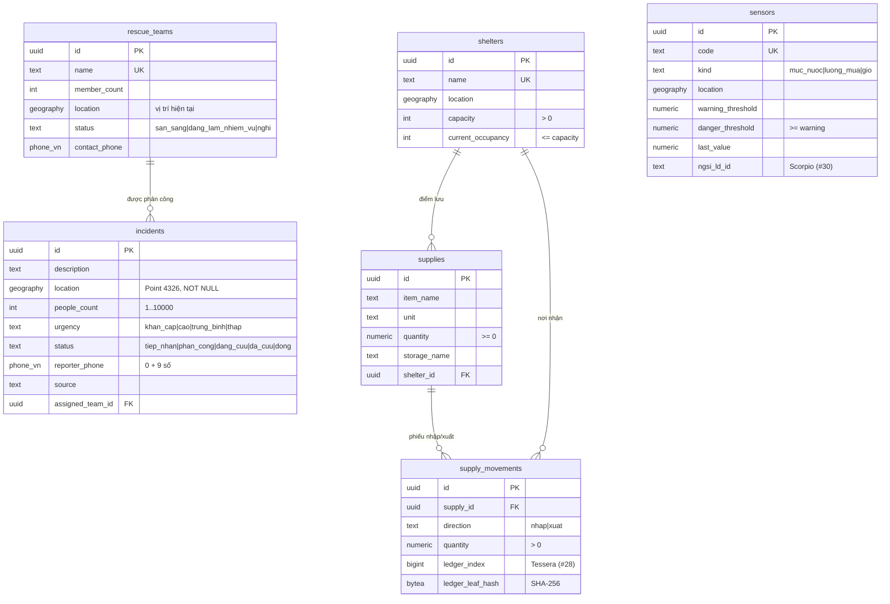

<!-- SPDX-License-Identifier: Apache-2.0 -->
# apps/cuu-tro — Ứng phó thiên tai & cứu trợ cộng đồng

Ứng dụng Tầng 2 cho chính quyền xã (điều phối), đội cứu hộ, tình nguyện viên và người dân cần cứu.

| Thư mục | Nội dung | Trạng thái |
|---|---|---|
| `keycloak/realm.json` | Realm `disaster`: vai trò `dieu-phoi`, `cuu-ho`, `tinh-nguyen`; client `dxos-gateway`, `dxos-web`, `dxos-dev-cli` (chỉ dev); 3 người dùng mẫu, mật khẩu lấy từ `.env` | Có |
| `db/migrations/` | Schema `cuu_tro`: `incidents`, `rescue_teams`, `shelters`, `supplies`, `supply_movements`, `sensors` (PostGIS) | Có (#25) |
| `db/seed/` | Dữ liệu giả xã An Lạc (giả định) | Có (#25) |
| `db/tests/` | 26 ca kiểm thử ràng buộc (Poka-yoke, CHECK, quyền theo search_path) | Có (#25) |
| `workflows/` | Kêu cứu: tiếp nhận → phân công → xác nhận → đóng | Tuần 3 |
| `web/` | Web điều phối Nuxt 3 + MapLibre | Tuần 3 |
| `mobile/` | App hiện trường Flutter | Tuần 5 |

## Dữ liệu (`db/`, #25)

Schema `cuu_tro`, chủ sở hữu role `cuu_tro_owner` (`NOLOGIN`). Role `hasura` chỉ có quyền DML. Cơ chế migration là của lõi (`core/postgres/migrate.sh`, `docs/architecture.md` mục 7.1); thư mục này chỉ chứa SQL.



Mọi bảng có `created_at`, `updated_at` (trigger tự cập nhật), khóa chính UUID, chỉ mục GiST trên cột vị trí.

### Poka-yoke ở tầng dữ liệu
| Ràng buộc | Cách làm | Lỗi trả về |
|---|---|---|
| Tin kêu cứu phải có tọa độ | `location ... NOT NULL` | `23502` not_null_violation |
| Chặn tin trùng: cùng SĐT, cách tin còn mở (chưa `da_cuu`/`dong`) ≤ 200 m, trong 6 giờ | Trigger `incidents_no_duplicate` (INSERT và UPDATE vị trí/SĐT), khóa advisory theo SĐT để hai yêu cầu đồng thời không cùng lọt. Tham số trong bảng một dòng `incident_dedup_config` | `23505` unique_violation, constraint `incidents_no_duplicate`, DETAIL `incident_id=… distance_m=…`, HINT cập nhật tin cũ |
| Đã phân công / đang cứu phải có đội | CHECK `incidents_team_required` | `23514` |
| Điểm trú ẩn không quá sức chứa | CHECK `shelters_not_over_capacity` | `23514` |
| Xuất kho không quá tồn | Phiếu `supply_movements` cộng/trừ `supplies.quantity` trong cùng transaction, CHECK `quantity >= 0` | `23514` |
| Phiếu nhập/xuất không sửa/xóa (chỉ điền `ledger_*` một lần) | Trigger `supply_movements_immutable` | `23001` restrict_violation |

Vì sao trigger mà không phải exclusion constraint: điều kiện "trong 6 giờ" và "tin cũ còn mở" phụ thuộc thời điểm và trạng thái, exclusion constraint (GiST) chỉ so được giá trị cố định của hai dòng.

Phiếu nhập/xuất và leaf sổ cái (#28) không chứa dữ liệu cá nhân (D-007). Chuỗi đo cảm biến theo thời gian để ở #30.

### Chạy
```bash
make up        # tự chạy migration (container migrate) trước Hasura
make seed      # nạp dữ liệu giả, chạy lại được
make test-db   # 26 ca kiểm thử ràng buộc, ROLLBACK sau khi chạy (cũng nằm trong make smoke)
make migrate   # chạy lại migration bằng tay (không có file mới thì không làm gì)
```

Thêm thay đổi schema: tạo file mới `db/migrations/0002_<tên>.sql`, không sửa file đã chạy (migrate báo lỗi checksum). Cả file chạy trong một transaction nên không dùng `CREATE INDEX CONCURRENTLY`. Reset từ volume trống: `docs/architecture.md` mục 7.1.

Truy vấn mẫu: đội sẵn sàng gần mỗi tin kêu cứu mới nhất (KNN trên chỉ mục GiST):

```sql
SELECT i.description, t.name, round(ST_Distance(t.location, i.location)) AS met
  FROM cuu_tro.incidents i
  CROSS JOIN LATERAL (SELECT name, location FROM cuu_tro.rescue_teams
                       WHERE status = 'san_sang' AND location IS NOT NULL
                       ORDER BY location <-> i.location LIMIT 1) t
 WHERE i.status = 'tiep_nhan';
```
