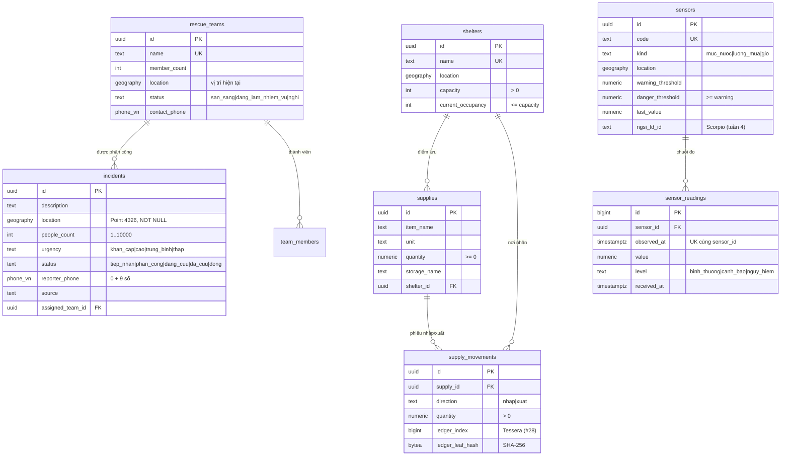
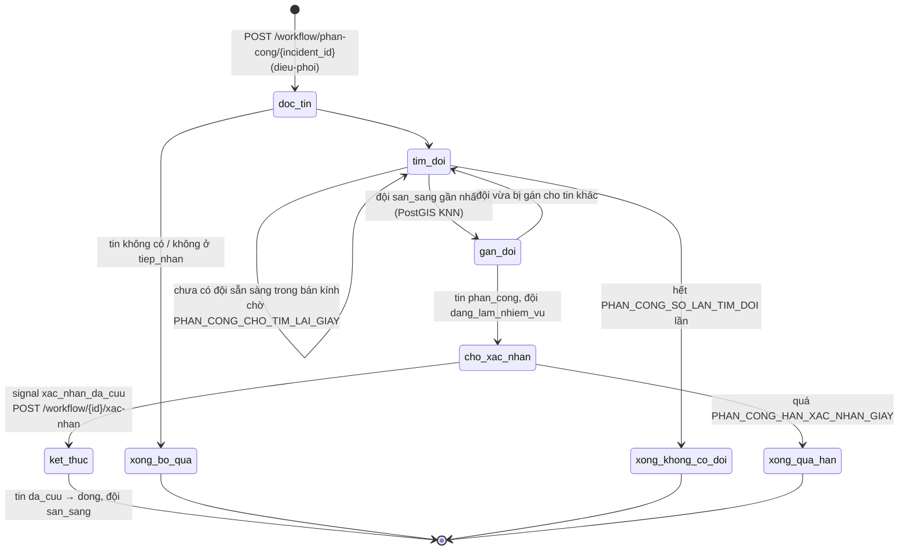
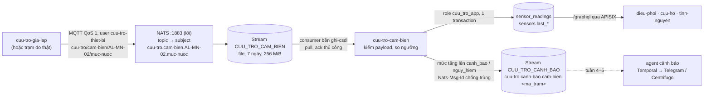

<!-- SPDX-License-Identifier: Apache-2.0 -->
# apps/cuu-tro — Ứng phó thiên tai & cứu trợ cộng đồng

Ứng dụng Tầng 2 cho chính quyền xã (điều phối), đội cứu hộ, tình nguyện viên và người dân cần cứu.

| Thư mục | Nội dung | Trạng thái |
|---|---|---|
| `keycloak/realm.json` | Realm `disaster`: vai trò `dieu-phoi`, `cuu-ho`, `tinh-nguyen`; client `dxos-gateway`, `dxos-web`, `dxos-dev-cli` (chỉ dev); 3 người dùng mẫu, mật khẩu lấy từ `.env` | Có |
| `db/migrations/` | Schema `cuu_tro`: `incidents`, `rescue_teams`, `shelters`, `supplies`, `supply_movements`, `sensors` (PostGIS); `team_members` (#26); `sensor_readings` chuỗi đo cảm biến (#30) | Có (#25, #26, #30) |
| `db/seed/` | Dữ liệu giả xã An Lạc (giả định) | Có (#25) |
| `db/tests/` | Kiểm thử ràng buộc (Poka-yoke, CHECK, quyền theo search_path, quyền role `cuu_tro_app`, chuỗi đo cảm biến) | Có (#25, #26, #29, #30) |
| `hasura/metadata/` | Metadata Hasura: bảng track, quan hệ, quyền theo vai trò JWT | Có (#26) |
| `workflow/` | Backend Python: Temporal worker (`PhanCongCuuHo`, `Hello`) + API FastAPI khởi chạy workflow qua gateway `/workflow/*` (#29); consumer cảm biến NATS JetStream + bộ giả lập trạm đo MQTT (#30); pytest | Có (#29, #30) |
| `compose.yaml` | Dịch vụ `cuu-tro-worker`, `cuu-tro-api`, `cuu-tro-cam-bien`, `bao-agent-cuu-tro` (profile `app`), `cuu-tro-gia-lap` (profile `gia-lap`), lõi nạp bằng `include` | Có (#29, #30) |
| `openbao/` | Policy + template bao agent cho backend (mật khẩu role `cuu_tro_app`, NATS/MQTT) | Có (#29, #30) |
| `nats/streams.json` | Khai báo stream/consumer JetStream của ứng dụng (tạo khi `cuu-tro-cam-bien` khởi động) | Có (#30) |
| `web/` | Web điều phối Nuxt 3 + MapLibre | Tuần 3 |
| `mobile/` | App hiện trường Flutter | Tuần 5 |

## Dữ liệu (`db/`, #25)

Schema `cuu_tro`, chủ sở hữu role `cuu_tro_owner` (`NOLOGIN`). Role `hasura` chỉ có quyền DML. Cơ chế migration là của lõi (`core/postgres/migrate.sh`, `docs/architecture.md` mục 7.1); thư mục này chỉ chứa SQL.



Mọi bảng có `created_at`, `updated_at` (trigger tự cập nhật), khóa chính UUID, chỉ mục GiST trên cột vị trí.

### Poka-yoke ở tầng dữ liệu
| Ràng buộc | Cách làm | Lỗi trả về |
|---|---|---|
| Tin kêu cứu phải có tọa độ | `location ... NOT NULL` | `23502` not_null_violation |
| Chặn tin trùng: cùng SĐT, cách tin còn mở (chưa `da_cuu`/`dong`) ≤ 200 m, trong 6 giờ | Trigger `incidents_no_duplicate` (INSERT và UPDATE vị trí/SĐT), khóa advisory theo SĐT để hai yêu cầu đồng thời không cùng lọt. Tham số trong bảng một dòng `incident_dedup_config` | `23505` unique_violation, constraint `incidents_no_duplicate`, DETAIL `incident_id=… distance_m=…`, HINT cập nhật tin cũ |
| Đã phân công / đang cứu phải có đội | CHECK `incidents_team_required` | `23514` |
| Điểm trú ẩn không quá sức chứa | CHECK `shelters_not_over_capacity` | `23514` |
| Xuất kho không quá tồn | Phiếu `supply_movements` cộng/trừ `supplies.quantity` trong cùng transaction, CHECK `quantity >= 0` | `23514` |
| Phiếu nhập/xuất không sửa/xóa (chỉ điền `ledger_*` một lần) | Trigger `supply_movements_immutable` | `23001` restrict_violation |

Vì sao trigger mà không phải exclusion constraint: điều kiện "trong 6 giờ" và "tin cũ còn mở" phụ thuộc thời điểm và trạng thái, exclusion constraint (GiST) chỉ so được giá trị cố định của hai dòng.

Phiếu nhập/xuất và leaf sổ cái (#28) không chứa dữ liệu cá nhân (D-007). Chuỗi đo cảm biến: bảng `sensor_readings` (#30, mục "Cảm biến" bên dưới).

### Chạy
```bash
make up        # tự chạy migration (container migrate) trước Hasura
make seed      # nạp dữ liệu giả, chạy lại được
make test-db   # 29 ca kiểm thử ràng buộc, ROLLBACK sau khi chạy (cũng nằm trong make smoke)
make migrate   # chạy lại migration bằng tay (không có file mới thì không làm gì)
```

Thêm thay đổi schema: tạo file mới `db/migrations/0003_<tên>.sql` (số tiếp theo), không sửa file đã chạy (migrate báo lỗi checksum). Cả file chạy trong một transaction nên không dùng `CREATE INDEX CONCURRENTLY`. Reset từ volume trống: `docs/architecture.md` mục 7.1.

## API GraphQL và phân quyền (`hasura/metadata/`, #26)

Tầng 2 gọi `POST http://<gateway>:9080/graphql` với `Authorization: Bearer <access token Keycloak>`. Vai trò lấy từ claim `x-hasura-default-role` của token (client có thể xin vai trò khác bằng header `X-Hasura-Role` nếu nằm trong `x-hasura-allowed-roles`). Luồng JWT → Hasura → lọc theo hàng: `docs/architecture.md` mục 3.4; cách metadata được áp khi khởi động: mục 7.2.

Tên field gốc trùng tên bảng (không tiền tố schema): `incidents`, `insert_incidents_one`, `update_incidents`, `incidents_aggregate`… Cột vị trí là kiểu `geography`, nhập/xuất bằng GeoJSON `{"type":"Point","coordinates":[kinh độ, vĩ độ]}`.

### Bảng quyền theo vai trò

R = đọc, C = tạo, U = sửa, D = xóa, – = không có (bảng không xuất hiện trong schema GraphQL của vai trò). Không vai trò nào được xóa tin kêu cứu, đội, điểm trú ẩn, hàng, phiếu (đóng/ngừng bằng trạng thái). `anonymous` (không có JWT) không có quyền gì, và APISIX đã chặn 401 trước đó.

| Bảng | `dieu-phoi` (cán bộ xã) | `cuu-ho` (thành viên đội) | `tinh-nguyen` |
|---|---|---|---|
| `incidents` | R mọi tin, mọi cột · C · U nội dung, `status`, `assigned_team_id` | R chỉ tin của **đội mình**, có SĐT để liên lạc · U chỉ cột `status`: từ `phan_cong`/`dang_cuu` sang `dang_cuu`/`da_cuu` | C (luôn `tiep_nhan`, chưa có đội) · R chỉ tin **mình tạo**, **không có** `reporter_phone`, `reporter_name`, `created_by` |
| `rescue_teams` | R · C · U | R đội mình · U vị trí, trạng thái đội mình | – |
| `team_members` | R · C (gán) · U (chuyển đội) · D (gỡ khỏi đội) | R dòng của mình | – |
| `shelters` | R · C · U | R | R |
| `supplies` | R · C · U thông tin mặt hàng (**không** sửa `quantity`) | – | R |
| `supply_movements` | R · C (phiếu bất biến, không U/D) | – | – |
| `sensors` | R · U tên, ngưỡng, bật/tắt | R | R thông tin công khai của trạm (#30) |
| `sensor_readings` | R (quan hệ `sensor`, `sensors.readings`) | R | R (tối đa 500 dòng/truy vấn) |
| `incident_dedup_config` | không track: không vai trò nào thấy | | |

Cột hệ thống gán từ token, client không tự đặt được: `incidents.created_by`, `supply_movements.created_by` = `X-Hasura-User-Id` (sub Keycloak). Tồn kho chỉ đổi qua phiếu nhập/xuất (trigger, sổ cái #28); cột `ledger_*` và giá trị đo cảm biến do dịch vụ nội bộ ghi (#28, #30), không qua vai trò người dùng.

**Thành viên đội:** `cuu-ho` thấy tin nhờ bảng `team_members (user_id = sub Keycloak, team_id)`: filter `assigned_team.members.user_id = X-Hasura-User-Id`. Điều phối gán/chuyển đội trong ứng dụng, có hiệu lực ngay ở truy vấn sau (không chờ token mới):

```graphql
mutation GanDoi($u: String!, $t: uuid!) {
  insert_team_members_one(object: {user_id: $u, team_id: $t},
    on_conflict: {constraint: team_members_pkey, update_columns: [team_id]}) { user_id team_id }
}
```

User mẫu có `id` cố định trong `keycloak/realm.json` nên seed gán sẵn `cuuho01` vào "Đội ca nô Biên phòng" trên volume trống. Realm import từ trước #26 có `sub` ngẫu nhiên: gán lại bằng mutation trên (`scripts/smoke-hasura.sh` làm vậy).

Truy vấn mẫu: tin kêu cứu trong bán kính 500 m (PostGIS qua Hasura, vẫn áp quyền của vai trò):

```graphql
query GanToi($p: geography!) {
  incidents(where: {location: {_st_d_within: {from: $p, distance: 500}}}) { id description status }
}
# biến: {"p": {"type": "Point", "coordinates": [108.1035, 15.8502]}}
```

Sửa quyền: sửa file bảng trong `hasura/metadata/databases/default/tables/`, `docker compose restart hasura`, chạy `bash scripts/smoke-hasura.sh`. Lệch DB (bảng/cột không có) thì Hasura dừng khởi động, xem `docker compose logs hasura`.

Truy vấn SQL mẫu: đội sẵn sàng gần mỗi tin kêu cứu mới nhất (KNN trên chỉ mục GiST):

```sql
SELECT i.description, t.name, round(ST_Distance(t.location, i.location)) AS met
  FROM cuu_tro.incidents i
  CROSS JOIN LATERAL (SELECT name, location FROM cuu_tro.rescue_teams
                       WHERE status = 'san_sang' AND location IS NOT NULL
                       ORDER BY location <-> i.location LIMIT 1) t
 WHERE i.status = 'tiep_nhan';
```

## Workflow (`workflow/`, #29)

Backend nghiệp vụ của ứng dụng (D-008), không thuộc lõi. Hai dịch vụ dùng chung một image (`python:3.12-slim`, phụ thuộc cài từ `requirements.txt` có hash, sinh từ `uv.lock`):

| Dịch vụ | Lệnh | Gọi tới |
|---|---|---|
| `cuu-tro-worker` | `python -m cuu_tro_workflow.worker` | Temporal (task queue `cuu-tro`), PostgreSQL bằng role `cuu_tro_app` (`APP_DB_URL` từ OpenBao qua `bao-agent-cuu-tro`) |
| `cuu-tro-api` | `uvicorn cuu_tro_workflow.api:app --root-path /workflow` | Temporal (start/signal/query), Hasura qua gateway `/graphql` bằng JWT người dùng. Không có bí mật, không mở cổng ra host |

Cách backend gọi lõi và vì sao: `docs/architecture.md` mục 7.3.

### `PhanCongCuuHo`: tiếp nhận → phân công → xác nhận → đóng



| Bước | Activity (I/O) | Ghi chú |
|---|---|---|
| `doc_tin` | `SELECT` tin | Chỉ phân công tin `tiep_nhan` |
| `tim_doi` | `tim_doi_ung_vien`: tối đa 10 đội `san_sang` có vị trí trong `PHAN_CONG_BAN_KINH_M` (mặc định 20 km), xếp theo `location <-> incident.location` | Chọn đội: `logic.chon_doi_gan_nhat` (gần nhất; hòa thì đội đông người hơn, rồi theo id), logic thuần có test |
| `gan_doi` | Một transaction: khóa tin (`FOR UPDATE`), kiểm chuyển trạng thái, `UPDATE` đội chỉ khi còn `san_sang` | Hai luồng giành cùng một đội: luồng thua nhận `False`, chọn đội kế tiếp |
| `cho_xac_nhan` | – | Signal `xac_nhan_da_cuu` (người, vai trò, ghi chú); quá hạn mặc định 6 giờ thì kết thúc `qua_han_xac_nhan`, chưa đổi CSDL (tuần 3: báo điều phối, phân công lại) |
| `ket_thuc` | Tin `da_cuu` → `dong`, đội về `san_sang` | Mọi activity chạy lại được (Temporal thử lại 5 lần); lỗi nghiệp vụ (chuyển trạng thái sai) không thử lại |

Luồng trạng thái tin hợp lệ (`logic.CHUYEN_TRANG_THAI`): `tiep_nhan → phan_cong | dong`, `phan_cong → dang_cuu | da_cuu`, `dang_cuu → da_cuu`, `da_cuu → dong`. `cuu-ho` vẫn tự chuyển `phan_cong → dang_cuu` qua GraphQL (#26) khi bắt đầu cứu, workflow chấp nhận cả hai.

`Hello`: workflow một activity, kiểm đường đi gateway → API → Temporal → worker.

### API (qua gateway, `Authorization: Bearer <access token Keycloak>`)

| Phương thức, đường dẫn | Vai trò | Kết quả |
|---|---|---|
| `POST /workflow/hello` body `{"ten": "…"}` (tùy chọn) | mọi vai trò | `200 {"workflow_id", "ket_qua", "nguoi_goi"}` |
| `POST /workflow/phan-cong/{incident_id}` | `dieu-phoi` | `202 {"workflow_id": "phan-cong-<incident_id>", "run_id", "incident_id"}` · `404` tin không có · `409` tin không ở `tiep_nhan` hoặc luồng đang chạy |
| `GET /workflow/{workflow_id}` | `dieu-phoi`; `cuu-ho` của đội được gán | `200 {"workflow_id", "trang_thai": "RUNNING\|COMPLETED\|…", "chi_tiet": {buoc, doi_id, doi_ten, khoang_cach_m, so_lan_tim, xac_nhan, ket_qua, lich_su}}` |
| `POST /workflow/{workflow_id}/xac-nhan` body `{"ghi_chu": "…"}` (tùy chọn) | `dieu-phoi`; `cuu-ho` của đội được gán | `202` · `409` workflow không ở bước chờ xác nhận |

Không token → `401` ở APISIX; vai trò không đủ → `403` ở API; `cuu-ho` đội khác → `403` (API hỏi `incidents_by_pk` qua `/graphql` bằng JWT người dùng, luật lọc theo đội của Hasura trả `null`).

```bash
TOKEN=$(curl -s -X POST http://localhost:8080/realms/disaster/protocol/openid-connect/token \
  -d grant_type=password -d client_id=dxos-dev-cli -d username=dieuphoi01 \
  --data-urlencode password="$KC_DEMO_USER_PASSWORD" | python3 -c 'import sys,json; print(json.load(sys.stdin)["access_token"])')
curl -s -X POST -H "Authorization: Bearer $TOKEN" http://localhost:9080/workflow/phan-cong/b0000000-0000-4000-8000-000000000004
curl -s -H "Authorization: Bearer $TOKEN" http://localhost:9080/workflow/phan-cong-b0000000-0000-4000-8000-000000000004
```

Theo dõi trong Temporal không cần UI: `docker compose exec temporal temporal workflow list --address temporal:7233`.

### Phát triển

```bash
cd apps/cuu-tro/workflow
uv sync                 # tạo .venv theo uv.lock
uv run pytest -q        # hoặc từ gốc repo: make test-py
# Đổi phụ thuộc: sửa pyproject.toml rồi
uv lock && uv export --frozen --no-dev --no-emit-project -o requirements.txt
```

Test: logic thuần (chọn đội, chuyển trạng thái), workflow trên máy chủ test của `temporalio` (tự tua thời gian để thử quá hạn; activity thay bằng bản giả trong bộ nhớ), kiểm JWT/vai trò của API bằng khóa RSA sinh tại chỗ. Lần chạy đầu `temporalio` tải máy chủ test về thư mục tạm. Kiểm thử thật qua gateway: `scripts/smoke-workflow.sh` (trong `make smoke`).

## Cảm biến mực nước (`workflow/cuu_tro_workflow/cam_bien*.py`, `gia_lap.py`, #30)

Luồng IT/OT của ứng dụng: thiết bị (ở đây là bộ giả lập) gửi MQTT vào NATS của lõi, consumer của ứng dụng ghi chuỗi đo vào PostgreSQL và phát cảnh báo khi nước vượt ngưỡng. Lõi chỉ cung cấp NATS có xác thực (user `cuu-tro-thiet-bi` chỉ gửi được vào `cuu-tro.>`, chỉ qua MQTT), không biết topic nào. Vì sao làm vậy và ánh xạ nguyên lý B2: `docs/architecture.md` mục 7.4.



### Topic và payload

| | Giá trị |
|---|---|
| Topic MQTT | `cuu-tro/cam-bien/<ma_tram>/<dai_luong>`, `<dai_luong>` ∈ `muc-nuoc` (cm), `luong-mua` (mm), `gio` (m/s); `<ma_tram>` theo `sensors.code` (`^[A-Z0-9][A-Z0-9_-]{1,31}$`) |
| Subject NATS | như topic, `/` thành `.`: `cuu-tro.cam-bien.AL-MN-02.muc-nuoc` |
| Payload | `{"ma_tram": "AL-MN-02", "gia_tri": 215.3, "don_vi": "cm", "thoi_diem": "2026-10-20T08:00:00.000+07:00"}` |
| Sự kiện cảnh báo | subject `cuu-tro.canh-bao.cam-bien.<ma_tram>`, payload `{"loai": "vuot_nguong", "ma_tram", "ten_tram", "dai_luong", "muc", "muc_truoc", "gia_tri", "nguong", "don_vi", "thoi_diem"}` |

Kiểm tra bản tin (`cam_bien.phan_tich`, có pytest): `ma_tram` trùng topic; `don_vi` đúng đại lượng; `gia_tri` là số hữu hạn trong [-1000, 100000], làm tròn 2 chữ số; `thoi_diem` ISO 8601 **có múi giờ**, không sớm hơn 7 ngày, không muộn hơn 5 phút so với lõi; tối đa 4 KiB; trạm phải có trong `sensors`, đang bật, đúng loại/đơn vị. Sai thì consumer bỏ bản tin (`term`, không giao lại) và ghi log cảnh báo; lỗi CSDL thì `nak` để JetStream giao lại sau 5 giây (tối đa 5 lần).

Mức: `nguy_hiem` khi `gia_tri >= danger_threshold`, `canh_bao` khi `>= warning_threshold`, ngược lại `binh_thuong` (ngưỡng NULL thì bỏ qua mức đó). Chỉ phát cảnh báo khi mức **tăng** so với lần đo liền trước và bản tin là lần đo mới nhất: nước vẫn trên ngưỡng hay rút xuống không phát lại, bản tin gửi bù cũ không phát. Bản tin giao lại (chưa kịp ack) không tạo dòng trùng (`UNIQUE (sensor_id, observed_at)`) và không phát cảnh báo trùng (`Nats-Msg-Id` trong cửa sổ 2 phút).

Stream và consumer khai báo ở `nats/streams.json`; `cuu-tro-cam-bien` tạo hoặc cập nhật khi khởi động.

### Chạy bộ giả lập

```bash
make up                     # lõi + app: NATS có xác thực, consumer cuu-tro-cam-bien
make gia-lap                # một bản tin bình thường cho mỗi trạm mẫu (AL-MN-01, AL-MN-02, AL-LM-01)
make gia-lap-vuot-nguong    # một bản tin trên ngưỡng nguy hiểm cho mỗi trạm → sự kiện cảnh báo
# Chạy liên tục (mỗi 10 giây; kịch bản vuot-nguong: nước lên dần trong 6 chu kỳ rồi giữ)
GIA_LAP_KICH_BAN=vuot-nguong docker compose --profile core --profile app --profile gia-lap up -d cuu-tro-gia-lap
docker compose --profile core --profile app run --rm --no-deps cuu-tro-gia-lap python -m cuu_tro_workflow.gia_lap --help
```

Bộ giả lập chạy trong container chỉ có mật khẩu thiết bị (`bao-agent-cuu-tro` render vào volume tmpfs riêng `secrets-cuu-tro-thiet-bi`). Chạy từ máy host thì dùng cổng `127.0.0.1:${NATS_MQTT_PORT}` (thiết bị trong LAN: `NATS_MQTT_BIND=0.0.0.0`, chưa TLS):

```bash
export MQTT_PASSWORD=$(curl -s -H "X-Vault-Token: $(cat .data/openbao/root.token)" \
  http://127.0.0.1:8200/v1/secret/data/app/cuu-tro/nats | python3 -c 'import sys,json; print(json.load(sys.stdin)["data"]["data"]["device_password"])')
cd apps/cuu-tro/workflow && MQTT_HOST=127.0.0.1 MQTT_USERNAME=cuu-tro-thiet-bi uv run python -m cuu_tro_workflow.gia_lap --mot-lan
```

Xem kết quả:

```bash
docker compose logs -f cuu-tro-cam-bien     # "cảnh báo AL-MN-02: binh_thuong → nguy_hiem (420.0 cm)"
docker compose exec cuu-tro-cam-bien bash /opt/dxos/env-from-files.sh /run/secrets/dxos \
  python -m cuu_tro_workflow.cam_bien_consumer canh-bao-cuoi AL-MN-02
```

```graphql
query ChuoiDo { sensors { code last_value last_observed_at
  readings(order_by: {observed_at: desc}, limit: 10) { observed_at value level } } }
```

Kiểm thử thật: `scripts/smoke-cam-bien.sh` (trong `make smoke`). NGSI-LD (Scorpio, bản sao số trạm đo) nối vào luồng này ở tuần 4: consumer thứ hai trên cùng stream cập nhật thực thể `sensors.ngsi_ld_id`, không đổi thiết bị hay topic.
