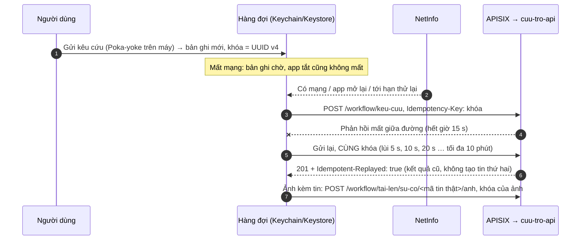

<!-- SPDX-License-Identifier: Apache-2.0 -->
# App hiện trường (`apps/cuu-tro/mobile`)

App điện thoại (Tầng 2) cho **tình nguyện viên** và **đội cứu hộ**. Lúc bão lũ mạng chập chờn, nên mọi thao tác ghi đều vào một hàng đợi trên máy rồi mới gửi.

App làm được:
- **gửi kêu cứu**: điền form, hoặc dán tin SMS/Zalo để AI điền sẵn;
- **chuyển tin cho điều phối duyệt**;
- **cập nhật hiện trường**: gửi ảnh, gửi vị trí đội.

Mỗi bản ghi trong hàng đợi có một **khóa idempotency**: gửi lại bao nhiêu lần cũng không tạo trùng trên máy chủ.

React Native bare 0.80 (New Architecture) và TypeScript strict, theo quyết định D-011. App chỉ gọi lõi qua API Gateway.

| Thành phần | Dùng cho | Giấy phép |
|---|---|---|
| React Native 0.80.3, React 19.1 | Khung app | MIT |
| React Navigation 7 (native-stack, bottom-tabs) | Điều hướng | MIT |
| TanStack Query 5 + axios | Đọc dữ liệu qua gateway (`/graphql`), gọi `/workflow/*` | MIT |
| Zustand 5 | Trạng thái: phiên, cài đặt, hàng đợi, bản nháp | MIT |
| i18next, react-i18next, react-native-localize | Tiếng Việt (mặc định), tiếng Anh | MIT |
| @react-native-community/netinfo | Biết khi nào có mạng để gửi hàng đợi | MIT |
| @react-native-async-storage/async-storage | Cài đặt (không có dữ liệu cá nhân) | MIT |
| react-native-keychain | Token đăng nhập, hàng đợi (mã hóa bằng Keychain/Keystore) | MIT |
| react-native-app-auth | Đăng nhập Keycloak OIDC + PKCE | MIT |
| @maplibre/maplibre-react-native | Bản đồ chọn vị trí (MapLibre Native, BSD-2-Clause) | MIT |
| @react-native-community/geolocation | GPS | MIT |
| react-native-image-picker | Chụp/chọn ảnh hiện trường | MIT |
| react-native-blob-util | Giữ ảnh chờ gửi trong thư mục app, tải ảnh lên thẳng từ tệp | MIT |
| react-native-get-random-values | `crypto.getRandomValues` cho khóa idempotency | MIT |
| lucide-react-native + react-native-svg | Biểu tượng (cùng bộ Lucide với web) | ISC, MIT |

**Không dùng:** Firebase, Stripe, Google/Apple Sign-in, react-native-maps (D-011). Danh sách đầy đủ và kiểm giấy phép: `DEPENDENCIES.md` (mục App hiện trường) và `yarn licenses`.

## Chức năng

| Màn | Vai | Làm gì | API (qua gateway) |
|---|---|---|---|
| Đăng nhập | mọi vai | Mở trang Keycloak bằng trình duyệt hệ thống (Custom Tabs / ASWebAuthenticationSession), PKCE S256, client công khai `dxos-mobile`. Đổi máy chủ ngay tại đây | Keycloak `/realms/disaster` |
| Kêu cứu | `tinh-nguyen`, `dieu-phoi` | Form: SĐT, số người, mức khẩn, tình hình, địa chỉ, tên. Vị trí lấy bằng GPS hoặc chọn trên bản đồ. Ảnh kèm theo tin. Lỗi hiện ngay dưới từng ô, theo cùng luật Poka-yoke với API | `POST /workflow/keu-cuu` |
| Dán tin | `tinh-nguyen`, `dieu-phoi` | Dán tin SMS/Zalo. **Bóc tách bằng AI** (cần mạng): điền sẵn form để người dùng soát rồi mới gửi. **Chuyển cho điều phối duyệt** (không cần mạng): tin vào hàng chờ duyệt trên web (#104) | `POST /workflow/ai/boc-tach` (có hoặc không `vao_hang_cho`) |
| Hiện trường | `tinh-nguyen`: tin mình gửi; `cuu-ho`: nhiệm vụ của đội | Danh sách tin. Hasura lọc theo vai. Luôn ghi "Cập nhật … trước". Mất mạng vẫn hiện dữ liệu đã tải, kể cả sau khi mở lại app (bản sao mã hóa trong Keychain/Keystore, gắn người dùng + vai, tối đa 7 ngày, #113) | `POST /graphql` (`incidents`) |
| Chi tiết tin | như trên | Chụp hoặc chọn ảnh hiện trường | `POST /workflow/tai-len/su-co/{id}/anh` |
| Vị trí đội | `cuu-ho` | Gửi vị trí GPS của đội. Chỉ ghi khi mới hơn vị trí đang có | GraphQL `update_rescue_teams` |
| Hàng đợi | mọi vai | Mọi bản ghi kèm trạng thái (chờ gửi, đang gửi, đã gửi, lỗi), lý do lỗi, mã tin. Có nút Gửi ngay, Gửi lại, Xóa | |
| Cài đặt | mọi vai | Tài khoản, vai, ngôn ngữ, máy chủ, đăng xuất | |

Giao diện chỉ có bản sáng (dùng ngoài trời), chữ ≥ 17 sp, vùng chạm ≥ 52 dp, nhãn chữ luôn đi kèm biểu tượng.

Đã rà soát UX hiện trường theo 4 tiêu chí: một tay, mạng yếu, chữ lớn, tương phản. Kết quả và việc còn mở: [`docs/ra-soat-ux-hien-truong.md`](../../../docs/ra-soat-ux-hien-truong.md) (#113). Tóm tắt:
- nút chính ở chân màn, chừa vùng an toàn dưới; form sai thì tóm tắt lỗi hiện ngay trên nút Gửi, được đọc to, màn tự cuộn tới ô lỗi đầu tiên;
- chữ đọc chính đạt ≥ 7:1, mọi chữ khác ≥ 4,5:1, viền ô nhập ≥ 3:1. Nút cam dùng chữ tối. Mọi cặp màu khai báo ở `CAP_MAU` và được `__tests__/tuongPhan.test.ts` kiểm;
- tôn trọng cỡ chữ hệ thống: từ 1,3× thì hai nút cạnh nhau xếp dọc, hàng nhãn tự xuống dòng;
- GPS hiện sai số và cảnh báo khi từ 100 m trở lên. Mất mạng thì báo nền bản đồ có thể không hiện.

Màu và logo theo nhận diện Team 1:
- navy `#12355B`, cam cứu hộ `#F07B1D`, xanh nước `#1FA2C9` (`src/theme/mau.ts`);
- logo lấy thẳng từ `docs/images/logo/` qua alias `@logo`;
- biểu tượng app sinh bằng `yarn icons` (`scripts/tao-icon.sh`, cần ImageMagick).

## Hàng đợi offline và khóa idempotency



| Quy tắc | Cách làm |
|---|---|
| Khóa | UUID v4 sinh **một lần** khi bản ghi vào hàng đợi (`utils/khoaIdempotency.ts`). Gửi lại dùng đúng khóa đó. Máy chủ giữ khóa 72 giờ, theo từng người dùng (`cuu_tro_workflow/idempotency.py`, migration `0015`) |
| Thứ tự | Gửi theo thứ tự tạo (FIFO). Ảnh chụp kèm một tin chưa gửi sẽ chờ tin lên máy chủ rồi dùng mã tin thật. Tin đó lỗi vĩnh viễn thì ảnh cũng báo lỗi |
| Khi nào gửi | Có mạng trở lại (NetInfo), app trở lại foreground, sau khi đăng nhập, đúng lúc bản ghi tới hạn thử lại, hoặc khi bấm "Gửi ngay" |
| Lỗi tạm | Mất mạng, hết giờ, 5xx, 429: giữ bản ghi, lùi dần rồi tự gửi lại |
| Làm mới token | Chỉ xóa phiên khi Keycloak từ chối refresh token (`invalid_grant`: hết hạn, bị thu hồi, phiên SSO đã đóng; `src/utils/loiPhien.ts`). Mất mạng, Keycloak sập, lỗi chứng chỉ hay thông điệp lạ đều **giữ phiên** và tính là lỗi tạm: người dùng ngoài hiện trường không bị đăng xuất vì mạng (#108) |
| Hết phiên | 401: làm mới token một lần rồi gọi lại. Vẫn 401 thì bản ghi chờ, lùi dần như lỗi tạm (không thử lại mỗi giây). Đăng nhập lại thì các bản ghi này được gửi ngay |
| Lỗi vĩnh viễn | 422 (dữ liệu sai, kèm câu lỗi của API), 409 tin trùng (kèm mã tin đang mở), 403, 404, 413, 415: dừng bản ghi đó, không chặn các bản ghi sau. Người dùng bấm Gửi lại (vẫn cùng khóa) hoặc Xóa |
| App bị tắt giữa lúc gửi | Bản ghi "đang gửi" quay về "chờ gửi" khi mở lại, gửi lại an toàn nhờ khóa |
| Lưu ở đâu | Hàng đợi và token nằm trong Keychain (iOS) / Keystore (Android) qua react-native-keychain, vì có SĐT và tên người cần cứu. Không dùng AsyncStorage dạng rõ, không ghi log. Ảnh chép vào `DocumentDir/hang-doi/` (tệp tạm của camera có thể bị hệ điều hành dọn) và xóa khi gửi xong. Bản ghi đã gửi giữ 7 ngày để xem lại |

Logic hàng đợi là hàm thuần (`src/utils/hangDoi.ts`). Lưu trữ và gọi mạng nằm ở `src/stores/hangDoiStore.ts` và `src/services/guiBanGhi.ts`.

## Cấu trúc

Theo cách tổ chức của app VietEntry của nhóm (chỉ học cấu trúc, không chép mã; D-011):

```
src/
├── App.tsx          providers: SafeArea, i18n, TanStack Query, NavigationContainer, đồng bộ hàng đợi
├── components/      Nut, OVanBan, ChonMuc, BangMang (mất mạng / chờ gửi), BanDo (MapLibre), TheBanGhi, ManHinh
├── config/          env.ts (máy chủ mặc định), queryClient.ts (queryKeys)
├── hooks/           useDongBoHangDoi (NetInfo, AppState, hẹn giờ), useViTri (GPS + quyền), useDuLieuHienTruong
├── i18n/            index.ts, locales/vi.ts (mặc định), locales/en.ts
├── navigation/      RootNavigator (đăng nhập ↔ app), MainTabs, types.ts (route có kiểu), NavigationService
├── screens/         DangNhap, KeuCuu, DanTin, ChonViTri, HienTruong, ChiTietTin, HangDoi, CaiDat
├── services/        api.ts (axios qua gateway), xacThuc.ts (PKCE), guiBanGhi.ts, bocTach.ts, graphql.ts, chupAnh.ts, anhCucBo.ts
├── stores/          authStore, caiDatStore, hangDoiStore, mangStore, nhapTinStore (Zustand)
├── theme/           mau.ts (màu Team 1), kich-thuoc.ts, index.ts
├── types/           api.ts (kiểu dữ liệu API), global.d.ts
└── utils/           hangDoi.ts, khoaIdempotency.ts, kiemTra.ts (Poka-yoke), loiApi.ts, jwt.ts, thoiGian.ts
```

## Chạy và kiểm tra (không cần máy ảo)

Cần Node.js 22 (hoặc 24) và Corepack (đi kèm Node), không cần cài Yarn riêng:

```bash
cd apps/cuu-tro/mobile
corepack enable          # một lần; Yarn 4 theo trường packageManager
yarn install
yarn typecheck           # tsc --noEmit, strict + noUncheckedIndexedAccess
yarn lint                # ESLint của React Native + cấm mã màu ngoài src/theme, --max-warnings 0
yarn test                # Jest: hàng đợi, Poka-yoke, lỗi API, khóa, JWT, i18n, store, client API, màn hình, tương phản màu, bản sao offline
yarn licenses            # giấy phép mọi gói npm
```

Job CI `mobile` chạy cả năm lệnh này, không build native.

## Chạy app với stack trên máy dev

1. Ở gốc repo: `make up && make seed`. Realm có client `dxos-mobile`. Máy đã chạy realm từ trước #106 thì thêm client bằng tay: mục "Máy đã có realm cũ" bên dưới.
2. Mặc định app gọi `http://localhost:9080` (gateway) và `http://localhost:8080` (Keycloak). Issuer của token phải đúng `KEYCLOAK_PUBLIC_URL` của lõi, nên đừng dùng `10.0.2.2`:
   - **iOS Simulator** dùng chung localhost với máy Mac, không phải làm gì thêm.
   - **Android** (máy ảo hoặc máy thật cắm cáp):
     ```bash
     adb reverse tcp:8080 tcp:8080 && adb reverse tcp:9080 tcp:9080 && adb reverse tcp:8081 tcp:8081
     ```
   - **Máy thật qua Wi-Fi, VPS demo:** đổi địa chỉ trong màn Đăng nhập → "Đổi máy chủ". Lõi phải đặt `KEYCLOAK_PUBLIC_URL`, `GATEWAY_PUBLIC_URL` là địa chỉ HTTPS mà điện thoại mở được.
3. Đăng nhập bằng user mẫu: `tinhnguyen01` (tình nguyện viên) hoặc `cuuho01` (cứu hộ), mật khẩu `KC_DEMO_USER_PASSWORD` trong `.env`. `dieuphoi01` phải cài OTP.

HTTP thường (không TLS) chỉ được phép với localhost:
- Android: `usesCleartextTraffic` chỉ có ở bản debug (`android/app/src/debug/AndroidManifest.xml`);
- iOS: `NSAllowsLocalNetworking`;
- react-native-app-auth: `dangerouslyAllowInsecureHttpRequests` chỉ bật khi Keycloak là `http://`.

## Build Android

Cần JDK 17, Android SDK (API 35, build-tools 35, NDK 27.1.12297006; Android Studio tự cài khi mở `android/`), biến `ANDROID_HOME` hoặc tệp `android/local.properties` có `sdk.dir=…`. minSdk 24 (Android 7).

```bash
cd apps/cuu-tro/mobile
yarn install
yarn start                                   # Metro, cửa sổ riêng
yarn android                                 # build debug + cài lên máy ảo/máy thật (adb devices)
# Bản release (APK / AAB):
cd android && ./gradlew assembleRelease      # → app/build/outputs/apk/release/app-release.apk
cd android && ./gradlew bundleRelease        # → app/build/outputs/bundle/release/app-release.aab
```

**Ký bản phát hành.** Tạo khóa upload một lần, rồi đặt 4 thuộc tính trong `~/.gradle/gradle.properties` (không đưa vào repo). Thiếu 4 thuộc tính này thì bản release ký bằng khóa debug: chỉ dùng để thử, không đưa lên kho ứng dụng được.

```bash
keytool -genkeypair -v -storetype PKCS12 -keystore cuu-tro-upload.keystore -alias cuu-tro -keyalg RSA -keysize 2048 -validity 10000
```

```properties
CUU_TRO_UPLOAD_STORE_FILE=/đường/dẫn/cuu-tro-upload.keystore
CUU_TRO_UPLOAD_STORE_PASSWORD=…
CUU_TRO_UPLOAD_KEY_ALIAS=cuu-tro
CUU_TRO_UPLOAD_KEY_PASSWORD=…
```

Quyền khai trong `android/app/src/main/AndroidManifest.xml`. Vị trí và camera được xin lúc dùng:
- `INTERNET`, `ACCESS_NETWORK_STATE`;
- `ACCESS_FINE_LOCATION`, `ACCESS_COARSE_LOCATION`;
- `CAMERA`.

Bản đồ MapLibre dùng bộ định vị mặc định của Android, không cần Google Play Services.

## Build iOS

Cần macOS, Xcode 16 trở lên, CocoaPods (Ruby, `Gemfile`). iOS 15.1 trở lên.

```bash
cd apps/cuu-tro/mobile
yarn install
bundle install                               # một lần: CocoaPods theo Gemfile
cd ios && bundle exec pod install && cd ..   # MapLibre Native iOS cài qua Swift Package Manager
yarn ios                                     # build + chạy trên Simulator (Metro: yarn start)
```

Bản phát hành: mở `ios/CuuTroHienTruong.xcworkspace` trong Xcode, chọn Team ký (Signing & Capabilities), Product → Archive. Bundle id `org.disasterdxos.cuutro`.

Thiết lập riêng của app:
- `CFBundleURLTypes` (scheme `org.disasterdxos.cuutro`) và `AppDelegate.swift` nhận URL chuyển hướng OAuth cho react-native-app-auth (header `CuuTroHienTruong-Bridging-Header.h`);
- câu xin quyền vị trí, camera, thư viện ảnh trong `Info.plist`;
- `Podfile` gọi `$MLRN.post_install`.

Thiếu `pod install` sau khi đổi phụ thuộc native thì app không build được.

## Máy đã có realm cũ (trước #106)

Keycloak chỉ import `realm.json` khi tạo realm lần đầu. Máy đã chạy từ trước thì thêm client `dxos-mobile` bằng một trong hai cách:
- tạo lại realm trên volume trống;
- vào Keycloak Admin → realm `disaster` → Clients → Create, với cấu hình:
  - Client ID `dxos-mobile`, client công khai (Client authentication tắt);
  - Standard flow bật, Direct access grants tắt;
  - Valid redirect URIs: `org.disasterdxos.cuutro:/oauthredirect`;
  - Advanced → PKCE `S256`;
  - thêm 3 mapper giống client `dxos-web`: `hasura-allowed-roles`, `hasura-default-role`, `hasura-user-id`.

## Giới hạn hiện tại

- Chưa build native trên CI và chưa chạy thử trên máy thật trong lần dựng này: máy dựng không có Android SDK, Xcode. CI chỉ kiểm typecheck, lint, Jest, giấy phép. Đường gọi API của app đã kiểm bằng `scripts/smoke-mobile.sh`:
  - đăng nhập PKCE thật với client `dxos-mobile`;
  - đúng các request app gửi, kèm `Idempotency-Key`.
- Chưa thử UX trên máy thật (cỡ chữ lớn nhất, TalkBack/VoiceOver, ngoài nắng): xem mục "Chưa làm" của `docs/ra-soat-ux-hien-truong.md`.
- Chưa có bản đồ offline (gói ô bản đồ tải trước) và thông báo đẩy. Thông báo sẽ dùng Centrifugo hoặc polling, không dùng FCM (D-011).
- `yarn npm audit` còn cảnh báo ở công cụ dev của React Native 0.80 (ESLint 8, `image-size` trong Metro). Các gói này không vào bản app.
