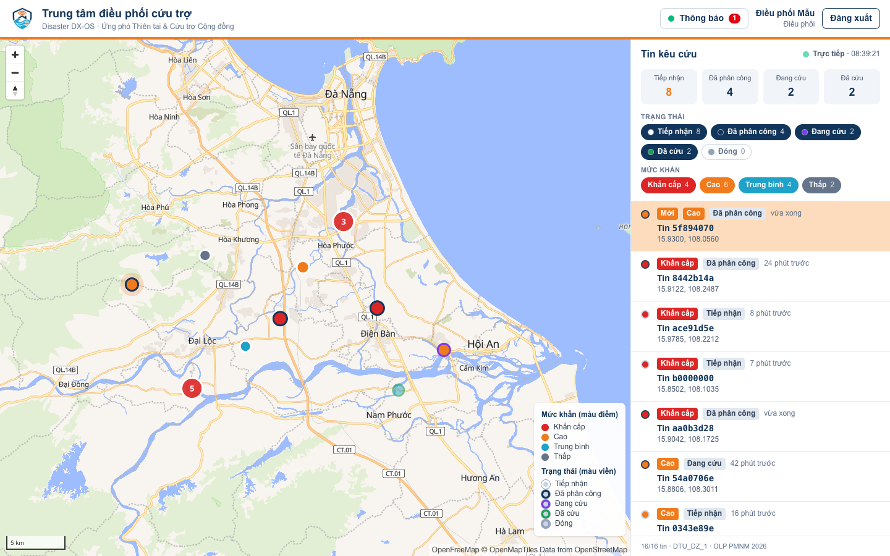
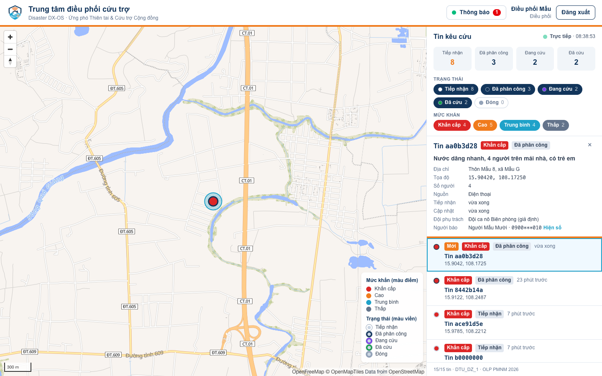
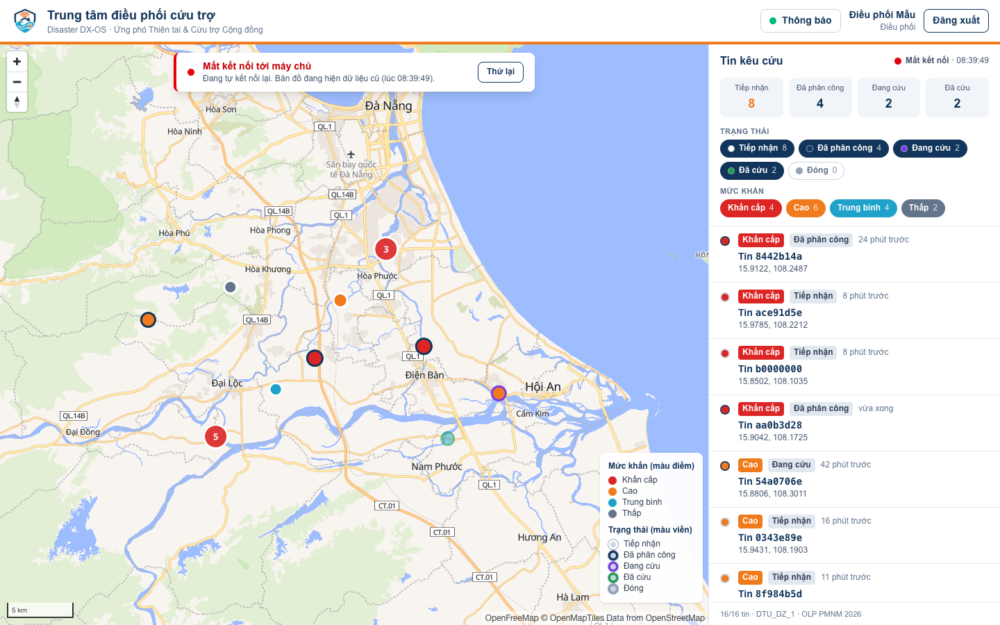

<!-- SPDX-License-Identifier: Apache-2.0 -->
# Web điều phối cứu trợ (`apps/cuu-tro/web`)

Ứng dụng Tầng 2 cho người điều phối của xã: bản đồ lớn + danh sách tin kêu cứu bên cạnh. Nuxt 3 + TypeScript + Tailwind CSS 4, bản đồ MapLibre GL JS. Chạy thuần phía trình duyệt (`ssr: false`), không có bí mật nào trong mã web.



> Trạng thái: khung web, đăng nhập Keycloak, bố cục, logo (#59); chạy trong stack qua gateway (#64); thông báo realtime qua Centrifugo (#68); bản đồ và danh sách tin kêu cứu **dữ liệu thật, thời gian thực** qua GraphQL subscription (#60). Việc tiếp theo: #61 (phân công), #62 (trạm đo), #63 (trang minh bạch).

## Đăng nhập: OIDC Authorization Code + PKCE

| Bước | Ở đâu |
|---|---|
| 1. Chưa có phiên → sinh `state`, `nonce`, `code_verifier` (64 ký tự ngẫu nhiên), `code_challenge = BASE64URL(SHA-256(verifier))`, lưu tạm trong `sessionStorage` rồi chuyển sang Keycloak | `middleware/auth.global.ts`, `composables/useAuth.ts`, `utils/pkce.ts` |
| 2. Keycloak realm `disaster`, client công khai `dxos-web` (`pkce.code.challenge.method = S256`, `apps/cuu-tro/keycloak/realm.json`). Vai `dieu-phoi` phải nhập OTP (luồng `browser-otp-dieu-phoi`, #13) | Keycloak |
| 3. `/auth/callback`: kiểm `state` (chống CSRF), đổi `code` + `code_verifier` lấy token ở token endpoint (không có `client_secret`), kiểm `nonce` trong `id_token` | `pages/auth/callback.vue`, `utils/oidc.ts` |
| 4. Token giữ trong `sessionStorage` (mất khi đóng tab), tự làm mới bằng `refresh_token` 60 giây trước khi hết hạn; đăng xuất gọi `end_session` của Keycloak | `utils/session.ts` |

Web không kiểm chữ ký JWT: token lấy trực tiếp từ Keycloak, còn APISIX (và Hasura) kiểm chữ ký mỗi lời gọi API. Mọi lời gọi lõi đi qua API Gateway (`NUXT_PUBLIC_GATEWAY_URL`, mặc định `http://localhost:9080`) kèm `Authorization: Bearer …` (`useAuth().authHeader()`); riêng trang đăng nhập/đăng xuất là của Keycloak (`NUXT_PUBLIC_KEYCLOAK_URL`). Trang công khai không cần đăng nhập: `/auth/*`, `/minh-bach*` (#63).

## Bản đồ nền

Kiểu vector OpenFreeMap `liberty` (dữ liệu © những người đóng góp OpenStreetMap, ODbL), nhãn đổi sang tên tiếng Việt (`name:vi`) và thêm nhãn Quần đảo Hoàng Sa, Trường Sa (Việt Nam); không tải được thì dùng ô ảnh OpenStreetMap. Đổi nguồn bằng `NUXT_PUBLIC_MAP_STYLE_URL`. Giấy phép: `DEPENDENCIES.md`.

## Chạy

**Trong stack (#64):** `make up` ở gốc repo build image từ `Dockerfile` (Node build → Nitro node server, user không phải root) và chạy dịch vụ `cuu-tro-web`, mở qua APISIX tại **http://localhost:9080/** (`GATEWAY_PUBLIC_URL`). Không mở cổng riêng ra host. Kiểm: `bash scripts/smoke-web.sh` (cũng trong `make smoke`).

Vì sao Nitro node server mà không phải trang tĩnh: với `ssr: false` Nitro vẫn chèn `runtimeConfig` (URL Keycloak, gateway lấy từ `NUXT_PUBLIC_*` lúc chạy) vào trang và đặt header bảo mật (`server/plugins/bao-mat.ts`: CSP có hash của script inline, `frame-ancestors 'none'`, `X-Frame-Options`, `nosniff`). Một image dùng cho mọi địa chỉ, không build lại.

**Phát triển:** cần Node.js ≥ 22.12. Lõi (`make up` ở gốc repo) phải chạy để có Keycloak ở `http://localhost:8080`; client `dxos-web` chấp nhận `redirect_uri` `http://localhost:3000/*` (dev) và `${GATEWAY_PUBLIC_URL}/*` (qua gateway).

```bash
cd apps/cuu-tro/web
npm ci
npm run dev                         # http://localhost:3000, đăng nhập dieuphoi01 (mật khẩu KC_DEMO_USER_PASSWORD trong .env, có OTP)
npm run build && node .output/server/index.mjs   # bản build, cổng PORT (mặc định 3000)
```

Biến môi trường `NUXT_PUBLIC_*`: xem `.env.example` ở gốc repo (mục "Web điều phối").

## Bản đồ tin kêu cứu thời gian thực (#60)

| Phần | Cách làm | Ở đâu |
|---|---|---|
| Nguồn dữ liệu | GraphQL subscription (live query) của Hasura trên bảng `cuu_tro.incidents`, qua API Gateway: WebSocket `ws(s)://<gateway>/graphql`, giao thức `graphql-transport-ws` (thư viện graphql-ws 6.3.0, MIT). Bảng đổi → Hasura gửi lại kết quả trong khoảng 1 giây, không tải lại trang | `composables/useTinKeuCuu.ts`, `utils/tin-graphql.ts` |
| Xác thực | Trình duyệt không gửi được header khi mở WebSocket: JWT Keycloak của người dùng nằm trong `connection_init` (`{"headers": {"Authorization": "Bearer …", "X-Hasura-Role": …}}`). Hasura kiểm chữ ký, hạn và áp quyền theo vai như với HTTP. APISIX có route riêng `graphql-ws` cho bắt tay WebSocket (WAF kiểm bắt tay, không kiểm JWT ở bước này; `docs/architecture.md` mục 3.3) | `core/apisix/apisix.yaml` |
| Dữ liệu tối thiểu | Subscription chỉ lấy `id`, `location`, `urgency`, `status`, `created_at`: không SĐT, tên người gọi, mô tả. Bấm một tin → query HTTP lấy chi tiết (mô tả, địa chỉ, số người, nguồn); SĐT, tên người gọi, đội phụ trách chỉ có trong query của vai `dieu-phoi`/`cuu-ho` (Hasura cho đọc), SĐT che giữa tới khi bấm "Hiện số". Vai `tinh-nguyen` chỉ thấy tin mình tạo | `components/ChiTietTin.vue` |
| Bản đồ | Màu điểm theo mức khẩn, màu viền theo trạng thái, tin đã cứu/đóng mờ đi; gom cụm khi nhiều điểm gần nhau (cụm đỏ nếu có tin khẩn cấp, bấm cụm → phóng to); tin vừa đến có vòng nhấp nháy 60 giây (tĩnh nếu người dùng chọn giảm chuyển động) | `components/BanDo.vue`, `utils/ban-do.ts` |
| Danh sách | Cùng bộ lọc với bản đồ (trạng thái, mức khẩn; mặc định ẩn tin đã đóng), tin mới nổi lên đầu với nhãn "Mới"; chọn dòng ↔ chọn điểm (bay tới, tách khỏi cụm) | `components/DanhSachTin.vue`, `components/BoLocTin.vue`, `utils/tin.ts` |
| Kết nối ổn định | Mất mạng, gateway/Hasura khởi động lại → tự kết nối lại (chờ 0,5 → 20 giây, có nhiễu) và đăng ký lại; ping 20 giây giữ kết nối. Token làm mới (60 giây trước hạn) → kết nối lại ngay bằng token mới. Hasura đóng vì JWT hết hạn/sai → làm mới token rồi nối lại; không làm mới được → "Phiên đăng nhập đã hết" kèm nút đăng nhập lại. Trạng thái luôn hiện ở đầu danh sách (Trực tiếp · giờ cập nhật); mất kết nối → băng đỏ trên bản đồ, nút "Thử lại", dữ liệu cũ vẫn hiện kèm giờ cập nhật cuối | `composables/useTinKeuCuu.ts`, `pages/index.vue` |





CSP `connect-src` đã có origin `ws(s)://` của gateway (#68), dùng chung cho `/graphql`. Kiểm trên stack thật: `bash scripts/smoke-ban-do.sh` (trong `make smoke`).

## Thông báo realtime (#68)

Người dùng vai `dieu-phoi` được kết nối Centrifugo khi mở trang (`composables/useThongBao.ts`, client centrifuge-js): xin token qua `GET <gateway>/workflow/realtime/token` kèm JWT, mở WebSocket `ws(s)://<gateway>/realtime/websocket`, nhận publication của kênh server-side `dieu-phoi` (không tự subscribe). Nút **Thông báo** (`components/ThongBaoRealtime.vue`) hiện trạng thái kết nối, số tin chưa đọc và 30 tin gần nhất. SDK tự kết nối lại và xin token mới; API trả 401/403 thì dừng hẳn. `utils/thong-bao.ts` dựng URL và chuyển dữ liệu sự kiện thành thông báo (hàm thuần, có test). CSP `connect-src` có thêm origin `ws(s)://` của gateway.

## Kiểm thử

```bash
npm test              # Vitest: PKCE (vector RFC 7636), URL OIDC, state/nonce, hạn token, GraphQL → tin → GeoJSON, bộ lọc, tin mới, CSP, thông báo realtime
npm run typecheck     # vue-tsc
npm run licenses      # giấy phép mọi gói npm trong package-lock.json
```

CI chạy cả bốn lệnh, `npm run build`, rồi build image Docker và chạy thử ở job `web` (`.github/workflows/ci.yml`).

## Cấu trúc

| Thư mục | Nội dung |
|---|---|
| `pages/` | `index.vue` (trang điều phối), `auth/callback.vue` |
| `server/` | Nitro: `plugins/bao-mat.ts` (header bảo mật), `utils/csp.ts` (dựng CSP, hàm thuần có test) |
| `components/` | `AppHeader.vue` (logo, người dùng, đăng xuất), `BanDo.vue` (MapLibre, #60), `DanhSachTin.vue`, `BoLocTin.vue`, `ChiTietTin.vue` (#60), `ThongBaoRealtime.vue` (#68) |
| `composables/` | `useAuth.ts` (phiên đăng nhập), `useTinKeuCuu.ts` (subscription tin kêu cứu, #60), `useThongBao.ts` (kết nối Centrifugo, #68), `useNow.ts` |
| `utils/` | Hàm thuần, có test: `pkce.ts`, `oidc.ts`, `session.ts`, `tin.ts`, `tin-graphql.ts`, `ban-do.ts`, `thong-bao.ts` |
| `tests/` | Vitest |
| `scripts/check-licenses.mjs` | Kiểm giấy phép npm |

Logo lấy thẳng từ `docs/images/logo/` của repo (phục vụ ở `/logo/…`, cấu hình trong `nuxt.config.ts`), không chép bản sao.
