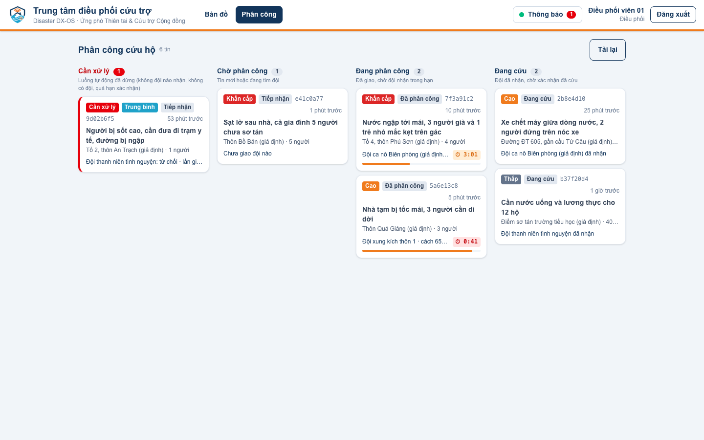
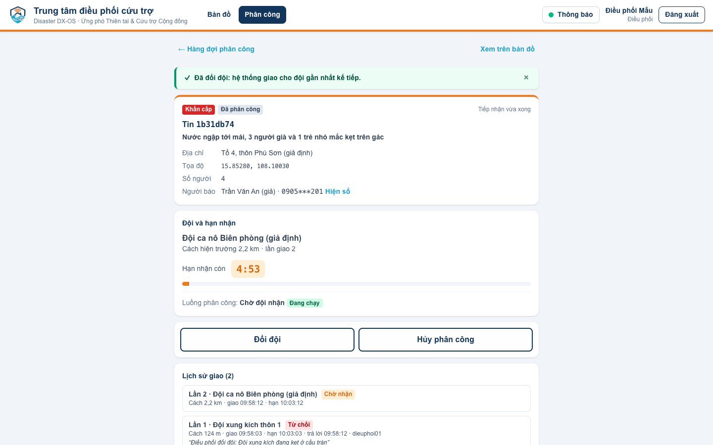
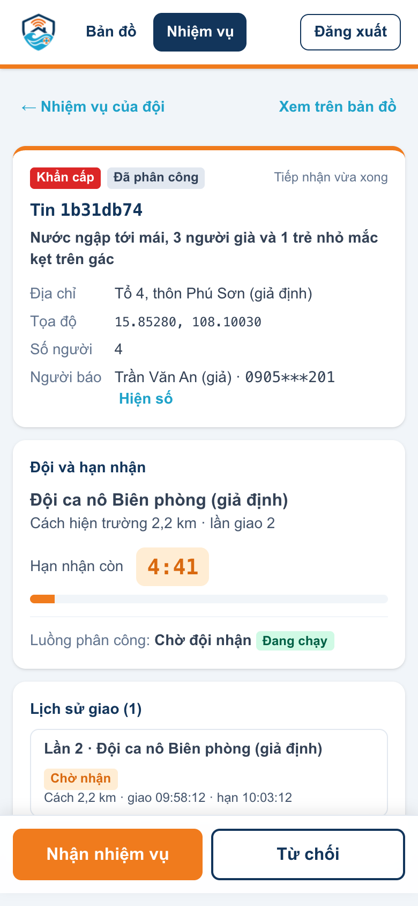
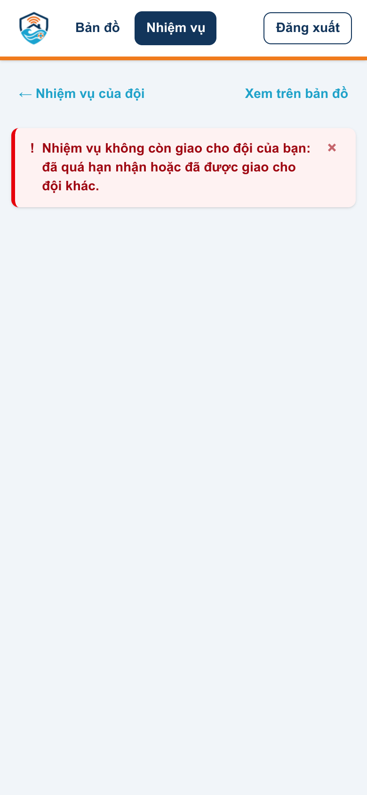

<!-- SPDX-License-Identifier: Apache-2.0 -->
# Web điều phối cứu trợ (`apps/cuu-tro/web`)

Ứng dụng Tầng 2 cho người điều phối của xã (bản đồ lớn + danh sách tin kêu cứu bên cạnh, màn phân công cứu hộ) và cho đội cứu hộ ngoài hiện trường (nhận nhiệm vụ, xác nhận đã cứu trên điện thoại). Nuxt 4 + TypeScript + Nuxt UI (Tailwind CSS 4), bản đồ MapLibre GL JS, font Be Vietnam Pro tự host. Chạy thuần phía trình duyệt (`ssr: false`), không có bí mật nào trong mã web.


> Trạng thái: khung web, đăng nhập Keycloak, bố cục, logo (#59); chạy trong stack qua gateway (#64); thông báo realtime qua Centrifugo (#68); bản đồ và danh sách tin kêu cứu **dữ liệu thật, thời gian thực** qua GraphQL subscription (#60); màn phân công cứu hộ cho 2 vai điều phối, cứu hộ (#61); lớp trạm đo mực nước trên bản đồ (#62). Việc tiếp theo: #63 (trang minh bạch).

## Đăng nhập: OIDC Authorization Code + PKCE

| Bước | Ở đâu |
|---|---|
| 1. Chưa có phiên → sinh `state`, `nonce`, `code_verifier` (64 ký tự ngẫu nhiên), `code_challenge = BASE64URL(SHA-256(verifier))`, lưu tạm trong `sessionStorage` rồi chuyển sang Keycloak | `middleware/auth.global.ts`, `composables/useAuth.ts`, `utils/pkce.ts` |
| 2. Keycloak realm `disaster`, client công khai `dxos-web` (`pkce.code.challenge.method = S256`, `apps/cuu-tro/keycloak/realm.json`). Vai `dieu-phoi` phải nhập OTP (luồng `browser-otp-dieu-phoi`, #13) | Keycloak |
| 3. `/auth/callback`: kiểm `state` (chống CSRF), đổi `code` + `code_verifier` lấy token ở token endpoint (không có `client_secret`), kiểm `nonce` trong `id_token` | `pages/auth/callback.vue`, `utils/oidc.ts` |
| 4. Token giữ trong `sessionStorage` (mất khi đóng tab), tự làm mới bằng `refresh_token` 60 giây trước khi hết hạn; đăng xuất gọi `end_session` của Keycloak | `utils/session.ts` |

Web không kiểm chữ ký JWT: token lấy trực tiếp từ Keycloak, còn APISIX (và Hasura) kiểm chữ ký mỗi lời gọi API. Mọi lời gọi lõi đi qua API Gateway (`NUXT_PUBLIC_GATEWAY_URL`, mặc định `http://localhost:9080`) kèm `Authorization: Bearer …` (`useAuth().authHeader()`); riêng trang đăng nhập/đăng xuất là của Keycloak (`NUXT_PUBLIC_KEYCLOAK_URL`). Trang công khai không cần đăng nhập: `/auth/*`, `/minh-bach*` (#63).

## Bản đồ nền

Kiểu vector OpenFreeMap `liberty` (dữ liệu © những người đóng góp OpenStreetMap, ODbL), nhãn đổi sang tên tiếng Việt (`name:vi`) và thêm nhãn Quần đảo Hoàng Sa, Trường Sa (Việt Nam); không tải được thì dùng ô ảnh OpenStreetMap. Đổi nguồn bằng `NUXT_PUBLIC_MAP_STYLE_URL`. Giấy phép: `DEPENDENCIES.md`.

## Chạy

**Trong stack (#64):** `make up` ở gốc repo build image từ `Dockerfile` (Node build → Nitro node server, user không phải root) và chạy dịch vụ `cuu-tro-web`, mở qua APISIX tại **http://localhost:9080/** (`GATEWAY_PUBLIC_URL`). Không mở cổng riêng ra host. Kiểm: `bash scripts/smoke-web.sh` (cũng trong `make smoke`).

Vì sao Nitro node server mà không phải trang tĩnh: với `ssr: false` Nitro vẫn chèn `runtimeConfig` (URL Keycloak, gateway lấy từ `NUXT_PUBLIC_*` lúc chạy) vào trang và đặt header bảo mật (`server/plugins/bao-mat.ts`: CSP có hash của script inline, `frame-ancestors 'none'`, `X-Frame-Options`, `nosniff`). Một image dùng cho mọi địa chỉ, không build lại.

**Phát triển:** cần Node.js ≥ 22.22.3 (hoặc 24.15+; Nuxt 4.6 đòi). Lõi (`make up` ở gốc repo) phải chạy để có Keycloak ở `http://localhost:8080`; client `dxos-web` chấp nhận `redirect_uri` `http://localhost:3000/*` (dev) và `${GATEWAY_PUBLIC_URL}/*` (qua gateway).

```bash
cd apps/cuu-tro/web
npm ci
npm run dev                         # http://localhost:3000, đăng nhập dieuphoi01 (mật khẩu KC_DEMO_USER_PASSWORD trong .env, có OTP)
npm run build && node .output/server/index.mjs   # bản build, cổng PORT (mặc định 3000)
```

Biến môi trường `NUXT_PUBLIC_*`: xem `.env.example` ở gốc repo (mục "Web điều phối").

## Bản đồ tin kêu cứu thời gian thực (#60)

| Phần | Cách làm | Ở đâu |
|---|---|---|
| Nguồn dữ liệu | GraphQL subscription (live query) của Hasura trên bảng `cuu_tro.incidents`, qua API Gateway: WebSocket `ws(s)://<gateway>/graphql`, giao thức `graphql-transport-ws` (thư viện graphql-ws 6.3.0, MIT). Bảng đổi → Hasura gửi lại kết quả trong khoảng 1 giây, không tải lại trang | `composables/useTinKeuCuu.ts`, `utils/tin-graphql.ts` |
| Xác thực | Trình duyệt không gửi được header khi mở WebSocket: JWT Keycloak của người dùng nằm trong `connection_init` (`{"headers": {"Authorization": "Bearer …", "X-Hasura-Role": …}}`). Hasura kiểm chữ ký, hạn và áp quyền theo vai như với HTTP. APISIX có route riêng `graphql-ws` cho bắt tay WebSocket (WAF kiểm bắt tay, không kiểm JWT ở bước này; `docs/architecture.md` mục 3.3) | `core/apisix/apisix.yaml` |
| Dữ liệu tối thiểu | Subscription chỉ lấy `id`, `location`, `urgency`, `status`, `created_at`: không SĐT, tên người gọi, mô tả. Bấm một tin → query HTTP lấy chi tiết (mô tả, địa chỉ, số người, nguồn); SĐT, tên người gọi, đội phụ trách chỉ có trong query của vai `dieu-phoi`/`cuu-ho` (Hasura cho đọc), SĐT che giữa tới khi bấm "Hiện số". Vai `tinh-nguyen` chỉ thấy tin mình tạo | `components/ChiTietTin.vue` |
| Bản đồ | Màu điểm theo mức khẩn, màu viền theo trạng thái, tin đã cứu/đóng mờ đi; gom cụm khi nhiều điểm gần nhau (cụm đỏ nếu có tin khẩn cấp, bấm cụm → phóng to); tin vừa đến có vòng nhấp nháy 60 giây (tĩnh nếu người dùng chọn giảm chuyển động) | `components/BanDo.vue`, `utils/ban-do.ts` |
| Danh sách | Cùng bộ lọc với bản đồ (trạng thái, mức khẩn; mặc định ẩn tin đã đóng), tin mới nổi lên đầu với nhãn "Mới"; chọn dòng ↔ chọn điểm (bay tới, tách khỏi cụm) | `components/DanhSachTin.vue`, `components/BoLocTin.vue`, `utils/tin.ts` |
| Kết nối ổn định | Mất mạng, gateway/Hasura khởi động lại → tự kết nối lại (chờ 0,5 → 20 giây, có nhiễu) và đăng ký lại; ping 20 giây giữ kết nối. Token làm mới (60 giây trước hạn) → kết nối lại ngay bằng token mới. Hasura đóng vì JWT hết hạn/sai → làm mới token rồi nối lại; không làm mới được → "Phiên đăng nhập đã hết" kèm nút đăng nhập lại. Trạng thái luôn hiện ở đầu danh sách (Trực tiếp · giờ cập nhật); mất kết nối → băng đỏ trên bản đồ, nút "Thử lại", dữ liệu cũ vẫn hiện kèm giờ cập nhật cuối | `composables/useTinKeuCuu.ts`, `pages/index.vue` |


CSP `connect-src` đã có origin `ws(s)://` của gateway (#68), dùng chung cho `/graphql`. Kiểm trên stack thật: `bash scripts/smoke-ban-do.sh` (trong `make smoke`).

## Lớp trạm đo mực nước (#62)

| Phần | Cách làm | Ở đâu |
|---|---|---|
| Nguồn dữ liệu | Bản sao số trạm đo NGSI-LD trên Scorpio (#85) qua API Gateway: `GET /ngsi-ld/v1/entities?type=WaterLevelStation&options=keyValues&limit=200`, `Accept: application/geo+json`, kèm JWT (mọi vai). Gateway tự đặt `@context` nên web dùng tên ngắn (`stationCode`, `waterLevel`, `alertLevel`, `warningThreshold`, `dangerThreshold`). Dữ liệu trạm không định danh | `composables/useTramDo.ts`, `utils/tram-do.ts` |
| Bản đồ | Hình thoi màu theo cấp báo động (xanh bình thường, vàng cảnh báo, đỏ nguy hiểm; nguy hiểm vẽ trên cùng), nằm dưới lớp tin kêu cứu (bấm trùng thì ưu tiên tin). Từ zoom 11 hiện nhãn `mã · mực nước`. Công tắc "Trạm đo" trong ô chú thích bật/tắt lớp, kèm số trạm từng cấp | `components/BanDo.vue`, `components/ChuThichBanDo.vue` |
| Popup | Bấm trạm → tên, mã, cấp báo động, mực nước mới nhất, còn bao nhiêu cm tới ngưỡng (hoặc đã vượt), biểu đồ nhỏ 24 giờ có vạch ngưỡng cảnh báo/nguy hiểm. Chuỗi đo lấy bằng GraphQL `sensor_readings` (tối đa 96 lần đo), chỉ khi mở popup; trạm có lần đo mới thì tự tải lại | `components/PopupTram.vue` |
| Cập nhật | Tải lại mỗi 60 giây (bỏ lượt khi tab ẩn, hiện lại thì tải ngay). Người điều phối nhận cảnh báo mực nước realtime qua Centrifugo (#68, #87) → tải lại ngay, màu trạm đổi cùng lúc với thông báo. Lỗi mạng: giữ dữ liệu cũ trên bản đồ, báo lỗi trong ô chú thích | `pages/index.vue` |

Kiểm thử: `tests/tram-do.test.ts` (đọc GeoJSON của Scorpio, màu, biểu đồ nhỏ, ngưỡng) và `scripts/smoke-tram-do.sh` (gọi đúng đường dẫn và query của web qua gateway cho cả 3 vai; màu/giá trị khớp lần đo mới nhất trong CSDL).

## Trang Minh bạch cứu trợ (#78, #63)

Trang công khai, không cần đăng nhập, không dùng khung điều phối: `/minh-bach/<mã phiếu>` (đường dẫn in trong mã QR trên phiếu; `/minh-bach?ma=<mã>` cũng tra sẵn). Người dân nhập mã → web kiểm dạng mã (UUID) → `GET /workflow/minh-bach/phieu/{mã}` qua gateway → hiện kết quả xác minh trên sổ cái Tessera: **Đã xác minh**, **Không khớp**, **Chưa ghi lên sổ cái**, **Tạm thời không kiểm được** (màu + biểu tượng khiên khác nhau), hàng gì, bao nhiêu, từ kho nào tới điểm nhận nào, giờ lập phiếu và giờ ghi sổ. Phần "Tự kiểm chứng" (SHA-256, checkpoint, lệnh `ledger-verify`) thu gọn cho người kỹ thuật. Lỗi 404, 429, 5xx, phản hồi sai dạng, mất mạng có câu riêng. Ánh xạ phản hồi → hiển thị: `utils/minh-bach.ts` (test `tests/minh-bach.test.ts`).

## Thông báo realtime (#68)

Người dùng vai `dieu-phoi` được kết nối Centrifugo khi mở trang (`composables/useThongBao.ts`, client centrifuge-js): xin token qua `GET <gateway>/workflow/realtime/token` kèm JWT, mở WebSocket `ws(s)://<gateway>/realtime/websocket`, nhận publication của kênh server-side `dieu-phoi` (không tự subscribe). Nút **Thông báo** (`components/ThongBaoRealtime.vue`) hiện trạng thái kết nối, số tin chưa đọc và 30 tin gần nhất. SDK tự kết nối lại và xin token mới; API trả 401/403 thì dừng hẳn. `utils/thong-bao.ts` dựng URL và chuyển dữ liệu sự kiện thành thông báo (hàm thuần, có test). CSP `connect-src` có thêm origin `ws(s)://` của gateway.

## Màn phân công cứu hộ (#61)

Hai đường mới, chỉ gọi lõi qua API Gateway bằng JWT của người dùng: query GraphQL HTTP `/graphql` (Hasura lọc theo vai) và REST `/workflow/*` của `cuu-tro-api` (workflow Temporal `PhanCongCuuHo`, `apps/cuu-tro/README.md` mục "Workflow"). Không thêm endpoint nào.

| Vai | `/phan-cong` (hàng đợi) | `/phan-cong/<id>` (chi tiết) |
|---|---|---|
| `dieu-phoi` | 4 nhóm: **Cần xử lý** (tin có thông báo `can_xu_ly` từ Centrifugo #68: hết lần giao, không có đội, quá hạn xác nhận) · **Chờ phân công** (`tiep_nhan`) · **Đang phân công** (`phan_cong`, chờ đội nhận) · **Đang cứu** (`dang_cuu`) | **Phân công tự động** (`POST /workflow/phan-cong/{id}`, tin `tiep_nhan` không có luồng đang chạy) · **Đổi đội** (`POST /workflow/phan-cong-<id>/tu-choi` do điều phối gửi: workflow gỡ đội, giao đội gần nhất kế tiếp) · **Hủy phân công** (`/huy`, trước khi đội nhận) · **Xác nhận đã cứu** (`/xac-nhan`) |
| `cuu-ho` | Nhiệm vụ đang giao cho đội mình: **Chờ đội bạn nhận**, **Đội bạn đang thực hiện** | **Nhận nhiệm vụ** (`/nhan`, tin → `dang_cuu`: đang đến / đang cứu) · **Từ chối** kèm ghi chú (`/tu-choi`) · **Xác nhận đã cứu** kèm ghi chú (`/xac-nhan`, tin → `dong`) |

- Mỗi tin có đội hiện tại, khoảng cách, đồng hồ đếm ngược hạn nhận (`incident_assignments.deadline_at`), lịch sử giao (đội, lần, kết quả, người, ghi chú) và nhật ký của workflow (`GET /workflow/phan-cong-<id>`). Bấm điểm trên bản đồ → "Mở phân công"; "Xem trên bản đồ" mở `/?tin=<id>`.
- Signal Temporal là bất đồng bộ (API trả `202`): sau thao tác, web chờ workflow sang bước mới (tối đa ~10 giây) rồi tải lại. Hàng đợi tải lại khi subscription bản đồ báo tin đổi trạng thái, và mỗi 15 giây (đội đổi, hạn nhận).
- **Quyền:** nút ẩn/hiện theo vai và bước (`utils/phan-cong.ts` `hanhDongDuoc`) chỉ để giao diện gọn. Kiểm quyền thật ở API (`cuu_tro_workflow/api.py`: đúng vai, cuu-ho chỉ của đội đang được giao, đúng bước) và Hasura (cuu-ho chỉ đọc tin, lịch sử giao của đội mình). Hàng đợi không hỏi SĐT; chi tiết chỉ hỏi SĐT/tên người báo với vai được Hasura cho đọc, SĐT che giữa tới khi bấm "Hiện số".
- **Lỗi** đổi thành câu tiếng Việt (`utils/workflow-api.ts` `thongBaoLoi`): đội cũ bấm nhận muộn / đã quá hạn (403 với cuu-ho, 409 "đã được giao cho đội khác"), nhiệm vụ đã sang bước khác (409), luồng đang chạy, hủy khi đội đã nhận, hết phiên (401), không có luồng (404), ghi chú quá 500 ký tự (422), 429, lỗi máy chủ, mất mạng.
- Điện thoại: thanh nút cố định cuối màn hình, nút cao ≥ 48 px, ô ghi chú cỡ chữ 16 px (không tự phóng to trên iOS).

| Điều phối: hàng đợi | Điều phối: đổi đội | Cứu hộ (điện thoại): chi tiết | Cứu hộ: đội cũ nhận muộn |
|---|---|---|---|
|  |  |  |  |

Ảnh chụp trên stack thật với tin mẫu là dữ liệu giả (`docs/images/README.md`). Kiểm trên stack thật: `bash scripts/smoke-phan-cong.sh` (trong `make smoke`), chạy nguyên văn query GraphQL của web.

## Kiểm thử

```bash
npm test              # Vitest: PKCE (vector RFC 7636), URL OIDC, state/nonce, hạn token, GraphQL → tin → GeoJSON, bộ lọc, tin mới, CSP, thông báo realtime, phân công (nút theo vai, gọi /workflow, mã lỗi), trạm đo (GeoJSON NGSI-LD, màu, biểu đồ nhỏ)
npm run typecheck     # vue-tsc
npm run licenses      # giấy phép mọi gói npm trong package-lock.json
```

CI chạy cả bốn lệnh, `npm run build`, rồi build image Docker và chạy thử ở job `web` (`.github/workflows/ci.yml`).

## Cấu trúc

| Thư mục | Nội dung |
|---|---|
| `app.vue`, `app.config.ts`, `layouts/default.vue`, `error.vue` | Khung Nuxt UI (#77): `UApp` (nhãn tiếng Việt), màu theme, thanh bên thu gọn được (trên điện thoại thành ngăn kéo), trang lỗi tiếng Việt |
| `assets/css/main.css` | Theme: bảng màu nhận diện (navy, cam, xanh nước, mức khẩn), chữ, chế độ tối, vòng focus, MapLibre theo theme (#77) |
| `public/fonts/be-vietnam-pro/` | Font Be Vietnam Pro (OFL-1.1) tự host, kèm SHA-256 (#77) |
| `pages/` | `index.vue` (trang điều phối), `phan-cong/index.vue`, `phan-cong/[id].vue` (màn phân công, #61), `minh-bach/[[ma]].vue` (trang minh bạch công khai, #78), `auth/callback.vue` (hai trang sau không dùng khung) |
| `server/` | Nitro: `plugins/bao-mat.ts` (header bảo mật), `utils/csp.ts` (dựng CSP, hàm thuần có test) |
| `components/` | `MenuNguoiDung.vue` (người dùng, vai, sáng/tối, đăng xuất), `NhanMucKhan.vue`, `NhanTrangThai.vue`, `DongHoHanNhan.vue` (thành phần dùng chung, #77), `BanDo.vue` (MapLibre, #60), `DanhSachTin.vue`, `BoLocTin.vue`, `ChiTietTin.vue` (#60), `ThongBaoRealtime.vue` (#68), `TheTinPhanCong.vue` (#61) |
| `composables/` | `useAuth.ts` (phiên đăng nhập), `useTinKeuCuu.ts` (subscription tin kêu cứu, #60), `useThongBao.ts` (kết nối Centrifugo, #68), `usePhanCong.ts` (hàng đợi, workflow, thao tác, #61), `useNow.ts`, `useToi.ts` (đang ở chế độ tối) |
| `utils/` | Hàm thuần, có test: `pkce.ts`, `oidc.ts`, `session.ts`, `tin.ts`, `tin-graphql.ts`, `ban-do.ts`, `thong-bao.ts`, `phan-cong.ts`, `workflow-api.ts`, `minh-bach.ts` |
| `tests/` | Vitest |
| `scripts/check-licenses.mjs` | Kiểm giấy phép npm |

**Quy ước giao diện (#77):** dùng thành phần Nuxt UI (`UButton`, `UBadge`, `UAlert`, `UCard`, `UDashboardPanel`…) và token màu của Nuxt UI (`text-muted`, `bg-elevated`, `primary`, `secondary` = nút hành động cam, `error`/`warning`/`info` = mức khẩn cấp/cao/trung bình), không dùng palette Tailwind trực tiếp (`red-600`, `slate-500`…); chữ nhỏ nhất `text-xs` = 13 px; biểu tượng Lucide `i-lucide-*` (đóng gói sẵn, không gọi mạng), không dùng emoji.

Logo lấy thẳng từ `docs/images/logo/` của repo (phục vụ ở `/logo/…`, cấu hình trong `nuxt.config.ts`), không chép bản sao.
