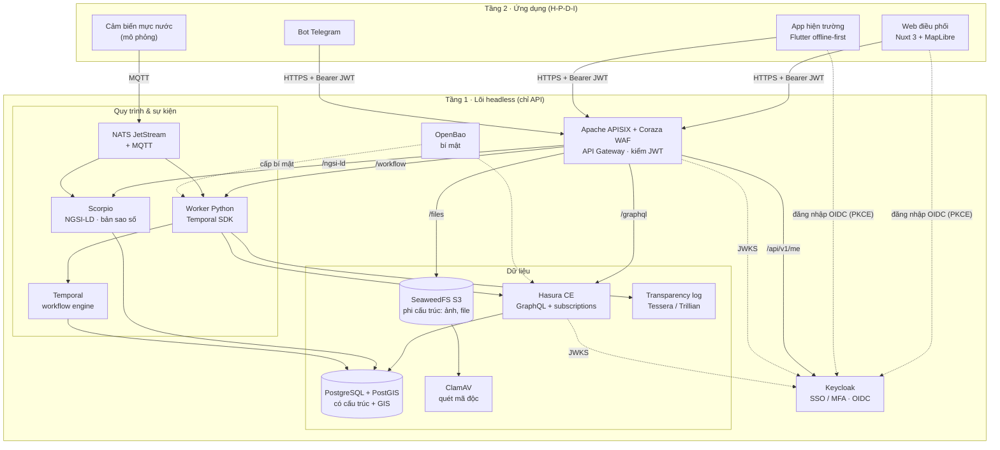
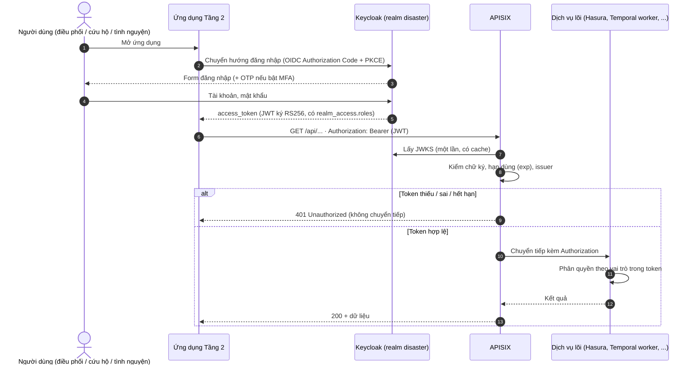
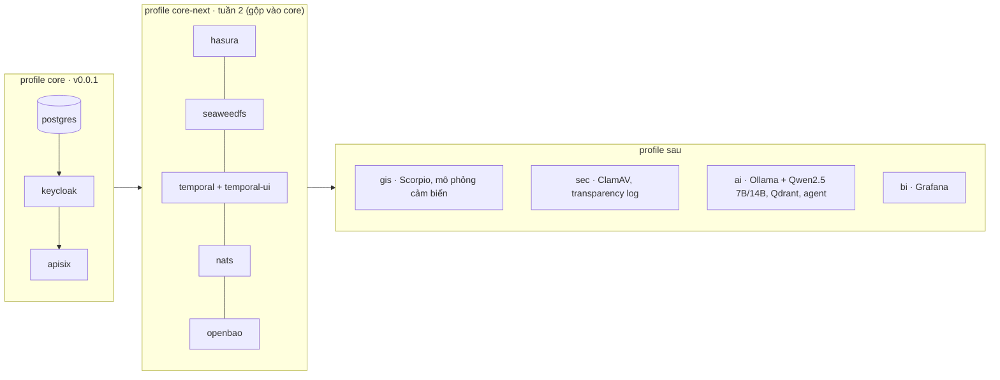

# Kiến trúc Disaster DX-OS

> Phiên bản tài liệu: v0.0.1 (17/10/2026). Stack theo D-003, giấy phép đã xác minh ở D-004.

Disaster DX-OS gồm hai tầng, đúng mô hình Open-Core của đề:

- **Tầng 1 – lõi headless**: chỉ có API, không có giao diện người dùng. Mọi dịch vụ chạy bằng image Docker gốc, cấu hình bằng file trong `deploy/` và biến trong `.env`.
- **Tầng 2 – ứng dụng**: web điều phối, app hiện trường, bot thông báo. Tầng 2 **chỉ** gọi lõi qua API Gateway (APISIX), không kết nối thẳng CSDL, kho file hay workflow.

## 1. Sơ đồ tổng thể

Đường liền: luồng dữ liệu. Đường đứt: xác thực, khóa và bí mật.
Ở v0.0.1 mới có `postgres`, `keycloak`, `apisix` và route `/api/v1/me`. Các route còn lại làm ở tuần 2–4 (xem `docs/PLAN.md`).

## 2. Ánh xạ 4 dịch vụ bắt buộc của đề

| Dịch vụ bắt buộc | Thành phần | Vai trò cụ thể | File cấu hình | Trạng thái |
|---|---|---|---|---|
| Identity / SSO (+MFA) | **Keycloak 26.8.1** | Realm `disaster`, OIDC, 3 vai trò `dieu-phoi`, `cuu-ho`, `tinh-nguyen`, client cho gateway, web và CLI dev. MFA (OTP) bật theo vai trò ở tuần 3 | `deploy/keycloak/realm-disaster.json` | Chạy được (v0.0.1) |
| API Gateway | **Apache APISIX 3.19** (+ Coraza WAF tuần 2) | Điểm vào duy nhất của Tầng 2. Kiểm chữ ký JWT bằng JWKS của Keycloak, giới hạn tần suất, gắn request-id. Chế độ standalone: route nằm trong git (GitOps) | `deploy/apisix/config.yaml`, `deploy/apisix/apisix.yaml` | Chạy được (v0.0.1) |
| Dữ liệu có cấu trúc | **PostgreSQL 17 + PostGIS 3.5**, **Hasura CE v2.51** | Sự cố, đội cứu hộ, điểm trú ẩn, kho hàng, cảm biến (có tọa độ). Hasura tự sinh GraphQL + subscription, phân quyền theo claim vai trò trong JWT | `docker-compose.yml` (`postgres`, `hasura`) | PostgreSQL chạy; Hasura khai báo (tuần 2) |
| Dữ liệu phi cấu trúc | **SeaweedFS 4.48** (S3) + ClamAV | Ảnh hiện trường, tệp đính kèm, file Parquet lịch sử. File tải lên được ClamAV quét trước khi công bố | `docker-compose.yml` (`seaweedfs`) | Khai báo (tuần 2) |
| Workflow engine | **Temporal 1.29** + Python SDK | Quy trình kêu cứu: tiếp nhận → phân công đội gần nhất → xác nhận → đóng. Cảnh báo vượt ngưỡng → thông báo | `docker-compose.yml` (`temporal`) | Khai báo (tuần 2) |

Thành phần hỗ trợ: OpenBao (bí mật), NATS JetStream + MQTT (sự kiện, IoT), Scorpio (NGSI-LD, bản sao số trạm đo), transparency log (sổ cái tiền/hàng cứu trợ).

## 3. Luồng xác thực JWT

Chi tiết cấu hình:

- Keycloak đặt `KC_HOSTNAME=${KEYCLOAK_PUBLIC_URL}` nên `iss` của token luôn là URL công khai, dù token lấy từ đâu. `KC_HOSTNAME_BACKCHANNEL_DYNAMIC=true` cho phép APISIX và Hasura tải JWKS qua mạng nội bộ `http://keycloak:8080`.
- APISIX dùng plugin `openid-connect` với `bearer_only: true`, `use_jwks: true`: kiểm token tại gateway, không gọi introspection mỗi request. Secret của client `dxos-gateway` lấy từ biến môi trường qua `$env://KC_GATEWAY_CLIENT_SECRET`, không ghi trong file.
- Hasura (tuần 2) kiểm lại cùng JWT bằng `HASURA_GRAPHQL_JWT_SECRET.jwk_url`, nên dịch vụ phía sau vẫn tự kiểm tra (Zero-Trust, không tin mù gateway).
- Client `dxos-dev-cli` (cho phép lấy token bằng mật khẩu) **chỉ dùng khi dev** để chạy `scripts/smoke-jwt.sh`. Phải xóa trước khi triển khai công khai.

Kiểm thử: `make up && bash scripts/smoke-jwt.sh` (không token → 401, token giả → 401, token Keycloak → 200).

## 4. Chia profile docker-compose

| Profile | Dịch vụ | Lệnh | RAM ước tính |
|---|---|---|---|
| `core` | postgres, keycloak, apisix | `make up` | ~0,8 GB (đo 17/10/2026: Keycloak 546 MB, APISIX 156 MB, PostgreSQL 103 MB) |
| `core-next` | core + hasura, seaweedfs, temporal, temporal-ui, nats, openbao | `make up-next` | ~1,4 GB lúc rỗi (đo 17/10/2026) |
| `gis` | Scorpio (dùng chung postgis), mô phỏng cảm biến | tuần 4 | |
| `sec` | ClamAV, transparency log | tuần 2–4 | ClamAV ~1,5 GB |
| `ai` | Ollama, Qdrant, agent | tuần 5 | Qwen2.5 7B ~5 GB |
| `bi` | Grafana | tuần 4 | |

Nguyên tắc:

- Mọi image ghim phiên bản cụ thể, lấy từ nhà phát hành gốc (Docker Hub, Quay). Không dùng `latest`, không vendor mã.
- Thành phần copyleft (PostGIS GPL-2.0, ClamAV GPL-2.0, Grafana AGPL-3.0) chạy như dịch vụ riêng bằng image gốc, không sửa, không liên kết vào mã dự án.
- Cổng của dịch vụ nội bộ chỉ mở trên `127.0.0.1`. Chỉ Keycloak (đăng nhập) và APISIX đối diện người dùng.
- `postgis/postgis` chỉ có image amd64. Trên Mac Apple Silicon, Docker chạy giả lập (biến `POSTGIS_PLATFORM`).

## 5. Sổ cái tiền/hàng cứu trợ: thay immudb

immudb chuyển sang BSL 1.1 từ 12/2023, không còn là giấy phép OSI (D-004), nên bị loại. Thay bằng transparency log của dự án transparency-dev / Google, đều Apache-2.0.

Yêu cầu: mỗi lần nhập/xuất hàng hoặc nhận/chi tiền được ghi một bản ghi chỉ-thêm (append-only). Ai cũng kiểm được bản ghi nằm trong log (inclusion proof) và log không bị sửa lùi (consistency proof). Chạy nhẹ trên laptop.

| Tiêu chí | Tessera | Trillian |
|---|---|---|
| Giấy phép | Apache-2.0 | Apache-2.0 |
| Tình trạng | Thế hệ mới, đang phát triển tích cực (v1.0.4, 07/2026) | **Chế độ bảo trì**. README khuyên log mới nên thử Tessera trước (v1.8.0, 09/2026) |
| Dạng | Thư viện Go. Đội viết một dịch vụ nhỏ ("personality") nhận bản ghi qua HTTP | Máy chủ gRPC có sẵn (log server + log signer). Đội viết personality gọi gRPC |
| Lưu trữ | POSIX (thư mục file), MySQL, AWS (MySQL + S3), GCP | MySQL/MariaDB (chính), có thư mục driver PostgreSQL, CockroachDB, Spanner |
| Độ nhẹ | 1 tiến trình Go + 1 volume. Không cần CSDL với driver POSIX | 2 tiến trình + CSDL. Driver PostgreSQL ít người dùng hơn MySQL |
| Kiểm chứng | API chuẩn tlog-tiles (C2SP): tile tĩnh, ai cũng tải về để tự kiểm. Hỗ trợ witness đồng ký checkpoint | API gRPC riêng, cần client gọi để lấy proof |
| Docker | Build image từ mã của đội (Dockerfile nhiều tầng, base distroless) | Image chính thức chủ yếu phục vụ CI. Nên build từ nguồn |
| Ngôn ngữ | Thêm Go vào repo (dịch vụ ~200–300 dòng) | Personality viết Python qua gRPC stub |

**Đề xuất (chờ đội chốt ở tuần 2): Tessera + driver POSIX.**
Lý do: nhẹ nhất (không thêm CSDL), đúng hướng mà chính nhóm Trillian khuyên dùng, và tile tĩnh cho phép người dân hoặc nhà tài trợ tự tải log về đối chiếu. Đây là điểm mạnh khi trình bày tính minh bạch cứu trợ. Dịch vụ Go nhỏ build từ nguồn trong repo cũng là bằng chứng "build từ mã nguồn" cho PoF. Chi phí: đội phải viết khoảng 200–300 dòng Go.
Phương án dự phòng: Trillian với driver PostgreSQL, nếu đội không muốn thêm Go. Khi đó cần chạy thử driver PostgreSQL trước khi chốt.

Luồng dự kiến (tuần 4): worker Temporal ghi giao dịch kho/tiền vào PostgreSQL → gửi băm bản ghi (SHA-256, kèm mã giao dịch) sang dịch vụ log → lưu `log_index` vào PostgreSQL → endpoint `/api/v1/ledger/verify/{id}` qua APISIX trả inclusion proof.

## 6. Luồng nghiệp vụ chính (đích tuần 3–5)

