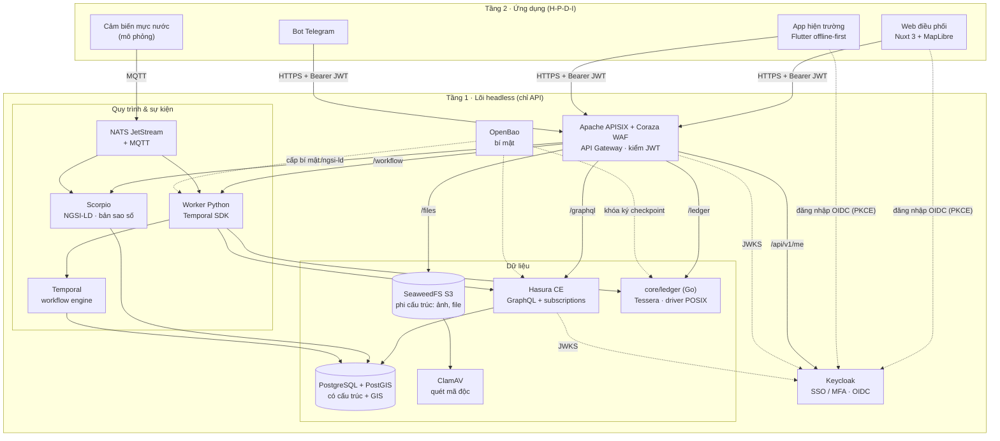
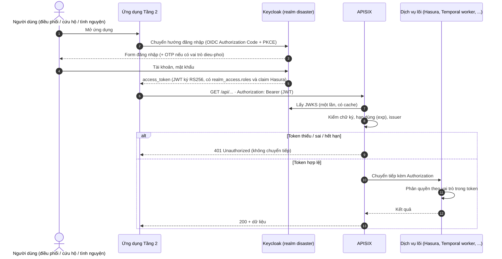
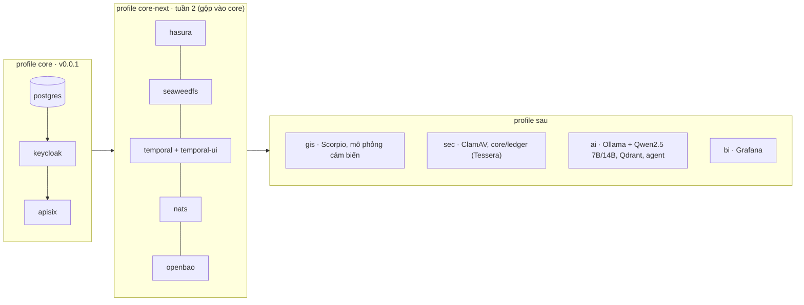
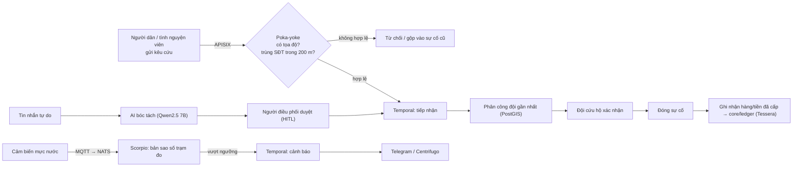
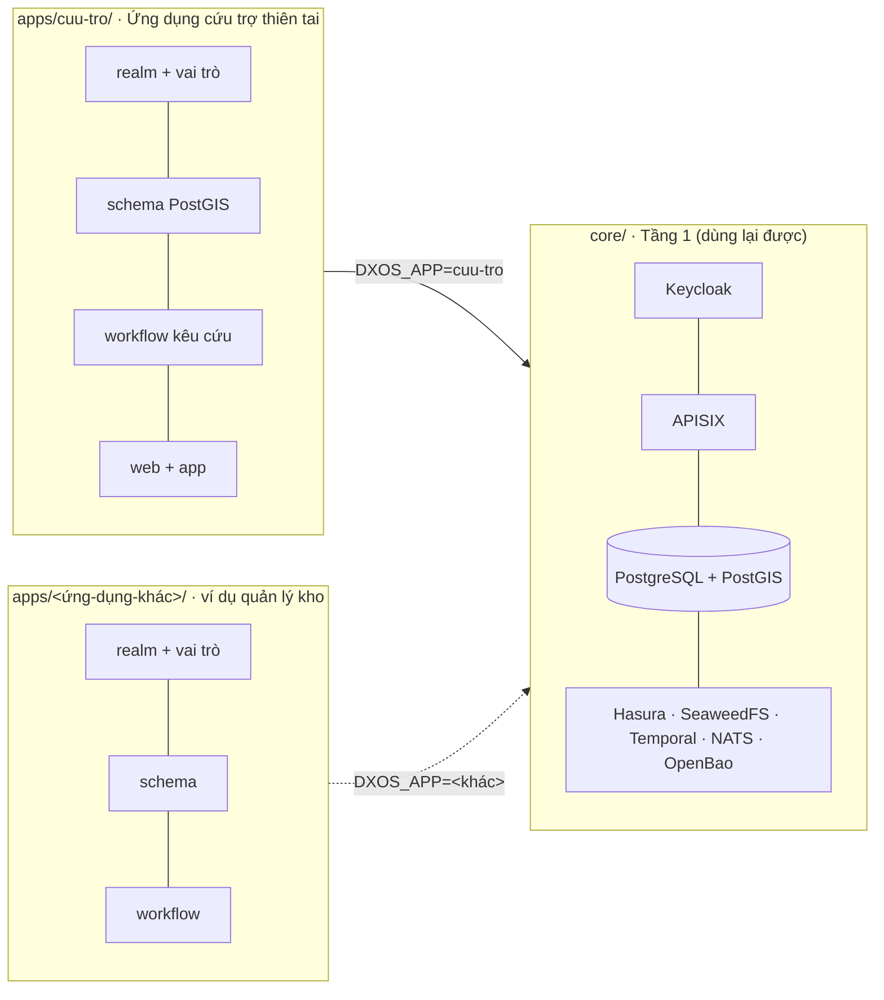

# Kiến trúc Disaster DX-OS

> Phiên bản tài liệu: v0.0.1 (cập nhật 19/10/2026). Giấy phép từng thành phần: `NOTICE`, `DEPENDENCIES.md`.

Disaster DX-OS gồm hai tầng, đúng mô hình Open-Core của đề:

- **Tầng 1 – lõi headless** (thư mục `core/`): chỉ có API, không có giao diện cho người dùng cuối. Giao diện quản trị của dịch vụ lõi (Keycloak Admin, Temporal UI) chỉ dành cho quản trị viên, đặt sau xác thực, không mở ra cổng công khai. Mọi dịch vụ chạy bằng image Docker gốc, cấu hình bằng file trong `core/` và biến trong `.env`. Lõi **không chứa nghiệp vụ thiên tai** (xem mục 7).
- **Tầng 2 – ứng dụng** (thư mục `apps/<tên>/`, hiện có `apps/cuu-tro/`): realm và vai trò, schema, workflow, dữ liệu mẫu, web điều phối, app hiện trường, bot thông báo. Tầng 2 **chỉ** gọi lõi qua API Gateway (APISIX), không kết nối thẳng CSDL, kho file hay workflow.

## 1. Sơ đồ tổng thể



Đường liền: luồng dữ liệu. Đường đứt: xác thực, khóa và bí mật.
Ở v0.0.1 mới có `postgres`, `keycloak`, `apisix` và route `/api/v1/me`. Các route còn lại làm ở tuần 2–4 (xem `docs/PLAN.md`).

## 2. Ánh xạ 4 dịch vụ bắt buộc của đề

| Dịch vụ bắt buộc | Thành phần | Vai trò cụ thể | File cấu hình | Trạng thái |
|---|---|---|---|---|
| Identity / SSO (+MFA) | **Keycloak 26.8.1** | Realm `disaster`, OIDC, 3 vai trò `dieu-phoi`, `cuu-ho`, `tinh-nguyen`, client cho gateway, web và CLI dev. Claim `https://hasura.io/jwt/claims` cho Hasura; OTP bắt buộc với vai trò `dieu-phoi` (#13) | `apps/cuu-tro/keycloak/realm.json` (vai trò, client của ứng dụng) | Chạy được (v0.0.1) |
| API Gateway | **Apache APISIX 3.19** (+ Coraza WAF tuần 2) | Điểm vào duy nhất của Tầng 2. Kiểm chữ ký JWT bằng JWKS của Keycloak, giới hạn tần suất, gắn request-id. Chế độ standalone: route nằm trong git (GitOps) | `core/apisix/config.yaml`, `core/apisix/apisix.yaml` | Chạy được (v0.0.1) |
| Dữ liệu có cấu trúc | **PostgreSQL 17 + PostGIS 3.5**, **Hasura CE v2.51** | Sự cố, đội cứu hộ, điểm trú ẩn, kho hàng, cảm biến (có tọa độ). Hasura tự sinh GraphQL + subscription, phân quyền theo claim vai trò trong JWT | `docker-compose.yml` (`postgres`, `hasura`) | PostgreSQL chạy; Hasura khai báo (tuần 2) |
| Dữ liệu phi cấu trúc | **SeaweedFS 4.48** (S3) + ClamAV | Ảnh hiện trường, tệp đính kèm, file Parquet lịch sử. File tải lên được ClamAV quét trước khi công bố | `docker-compose.yml` (`seaweedfs`) | Khai báo (tuần 2) |
| Workflow engine | **Temporal 1.29** + Python SDK | Quy trình kêu cứu: tiếp nhận → phân công đội gần nhất → xác nhận → đóng. Cảnh báo vượt ngưỡng → thông báo | `docker-compose.yml` (`temporal`) | Khai báo (tuần 2) |

Thành phần hỗ trợ: OpenBao (bí mật), NATS JetStream + MQTT (sự kiện, IoT), Scorpio (NGSI-LD, bản sao số trạm đo), sổ cái minh bạch `core/ledger` (transparency log Tessera, D-007) cho tiền/hàng cứu trợ.

## 3. Luồng xác thực JWT



Chi tiết cấu hình:

- Keycloak đặt `KC_HOSTNAME=${KEYCLOAK_PUBLIC_URL}` nên `iss` của token luôn là URL công khai, dù token lấy từ đâu. `KC_HOSTNAME_BACKCHANNEL_DYNAMIC=true` cho phép APISIX và Hasura tải JWKS qua mạng nội bộ `http://keycloak:8080`.
- APISIX dùng plugin `openid-connect` với `bearer_only: true`, `use_jwks: true`: kiểm token tại gateway, không gọi introspection mỗi request. Secret của client `dxos-gateway` lấy từ biến môi trường qua `$env://KC_GATEWAY_CLIENT_SECRET`, không ghi trong file.
- Hasura (tuần 2) kiểm lại cùng JWT bằng `HASURA_GRAPHQL_JWT_SECRET.jwk_url`, nên dịch vụ phía sau vẫn tự kiểm tra (Zero-Trust, không tin mù gateway).
- Client `dxos-dev-cli` (cho phép lấy token bằng mật khẩu) **chỉ dùng khi dev** để chạy `scripts/smoke-jwt.sh`. Phải xóa trước khi triển khai công khai.

### 3.1. Claim vai trò cho Hasura (#13)

Client `dxos-web` và `dxos-dev-cli` có 3 protocol mapper có sẵn của Keycloak (không viết SPI), sinh claim JSON lồng nhau trong access token:

```json
"https://hasura.io/jwt/claims": {
  "x-hasura-default-role": "dieu-phoi",
  "x-hasura-allowed-roles": ["offline_access", "dieu-phoi", "uma_authorization", "default-roles-disaster"],
  "x-hasura-user-id": "<sub>"
}
```

| Claim | Mapper | Nguồn |
|---|---|---|
| `x-hasura-allowed-roles` | `oidc-usermodel-realm-role-mapper` (multivalued) | Mọi vai trò realm hiệu lực của user. Vai trò không có quyền trong Hasura (`offline_access`, ...) vô hại |
| `x-hasura-default-role` | `oidc-usermodel-attribute-mapper` | Thuộc tính user `hasura_default_role` |
| `x-hasura-user-id` | `oidc-usermodel-property-mapper` (`id`) | Trùng `sub` |

- Tên claim có dấu chấm thì Keycloak tách thành JSON lồng nhau; dấu chấm trong `hasura.io` được thoát bằng `\.` (trong JSON viết `https://hasura\\.io/jwt/claims.x-hasura-default-role`).
- **Vì sao không dùng `realm_access.roles[0]`:** thứ tự mảng không cố định. Đo thật 19/10/2026: `roles[0]` của `dieuphoi01` là `offline_access`, của `cuuho01` là `cuu-ho`. Vai trò mặc định nay lấy từ thuộc tính `hasura_default_role`, khai báo trong user profile của realm (chỉ admin xem/sửa, giá trị chỉ được là `dieu-phoi`, `cuu-ho`, `tinh-nguyen`). Tạo user mới phải đặt thuộc tính này; thiếu thì token không có `x-hasura-default-role` và Hasura từ chối.
- Hasura đọc mặc định namespace `https://hasura.io/jwt/claims`, nên khi đưa Hasura vào profile `core` (#11) chỉ cần bỏ `claims_map` trong `HASURA_GRAPHQL_JWT_SECRET`.

### 3.2. MFA: OTP bắt buộc cho `dieu-phoi` (#13)

Realm dùng flow trình duyệt riêng `browser-otp-dieu-phoi` (khai báo trong `realm.json`, import lại được từ máy sạch):

```
browser-otp-dieu-phoi
├─ Cookie                                  ALTERNATIVE
└─ forms                                   ALTERNATIVE
   ├─ Username Password Form               REQUIRED
   └─ otp                                  CONDITIONAL
      ├─ Condition - user role = dieu-phoi REQUIRED
      └─ OTP Form                          REQUIRED
```

- User có vai trò `dieu-phoi` phải nhập OTP; chưa cài thì Keycloak chuyển sang trang cài ứng dụng xác thực (required action `CONFIGURE_TOTP`). `cuu-ho`, `tinh-nguyen` không bị hỏi. Điều kiện theo vai trò nên áp cho cả user `dieu-phoi` tạo sau này, không chỉ user mẫu.
- Không đặt sẵn `requiredActions: ["CONFIGURE_TOTP"]` cho user mẫu: làm vậy thì lấy token bằng mật khẩu (`dxos-dev-cli`) bị chặn "Account is not fully set up" và `make smoke` hỏng.
- Flow `direct grant` giữ mặc định: chỉ hỏi OTP khi user đã cài. Vì vậy `dxos-dev-cli` vẫn lấy được token của `dieuphoi01` chưa cài OTP; đây là lý do thêm để xóa client này trước khi triển khai công khai.

Kiểm thử: `make up && bash scripts/smoke-jwt.sh` (không token → 401, token giả → 401, token Keycloak → 200, claim Hasura đúng cho 3 user mẫu, đăng nhập web `dieuphoi01` bị bắt cài OTP còn `cuuho01` thì không).

## 4. Chia profile docker-compose



| Profile | Dịch vụ | Lệnh | RAM ước tính |
|---|---|---|---|
| `core` | postgres, keycloak, apisix | `make up` | ~0,8 GB (đo 17/10/2026: Keycloak 546 MB, APISIX 156 MB, PostgreSQL 103 MB) |
| `core-next` | core + hasura, seaweedfs, temporal, temporal-ui, nats, openbao | `make up-next` | ~1,4 GB lúc rỗi (đo 17/10/2026) |
| `gis` | Scorpio (dùng chung postgis), mô phỏng cảm biến | tuần 4 | |
| `sec` | ClamAV, `ledger` (Tessera) | tuần 2–4 | ClamAV ~1,5 GB; `ledger` nhỏ, giới hạn bằng `GOMEMLIMIT` |
| `ai` | Ollama, Qdrant, agent | tuần 5 | Qwen2.5 7B ~5 GB |
| `bi` | Grafana | tuần 4 | |

Nguyên tắc:

- Mọi image ghim phiên bản cụ thể, lấy từ nhà phát hành gốc (Docker Hub, Quay). Không dùng `latest`, không vendor mã.
- Thành phần copyleft (PostGIS GPL-2.0, ClamAV GPL-2.0, Grafana AGPL-3.0) chạy như dịch vụ riêng bằng image gốc, không sửa, không liên kết vào mã dự án.
- Cổng của dịch vụ nội bộ chỉ mở trên `127.0.0.1`. Chỉ Keycloak (đăng nhập) và APISIX đối diện người dùng.
- `postgis/postgis` chỉ có image amd64. Trên Mac Apple Silicon, Docker chạy giả lập (biến `POSTGIS_PLATFORM`).

## 5. Sổ cái tiền/hàng cứu trợ: Tessera (đã chốt – D-007)

immudb chuyển sang BSL 1.1 từ 12/2023, không còn là giấy phép OSI (D-004), nên bị loại. Thay bằng transparency log của dự án transparency-dev / Google, đều Apache-2.0.

Yêu cầu: mỗi lần nhập/xuất hàng hoặc nhận/chi tiền được ghi một bản ghi chỉ-thêm (append-only). Ai cũng kiểm được bản ghi nằm trong log (inclusion proof) và log không bị sửa lùi (consistency proof). Chạy nhẹ trên laptop.

| Tiêu chí | Tessera | Trillian |
|---|---|---|
| Giấy phép | Apache-2.0 | Apache-2.0 |
| Tình trạng | Thế hệ mới, đang phát triển tích cực (v1.0.4, 07/2026) | **Chế độ bảo trì**. README khuyên log mới nên thử Tessera trước (v1.8.0, 09/2026) |
| Dạng | Thư viện Go. Đội viết một dịch vụ nhỏ ("personality") nhận bản ghi qua HTTP | Máy chủ gRPC có sẵn (log server + log signer). Đội viết personality gọi gRPC |
| Lưu trữ | Driver GA: POSIX (thư mục file), AWS (S3), GCP. Driver MySQL đã bị gỡ sau v1.0.2 | MySQL/MariaDB (chính), có thư mục driver PostgreSQL, CockroachDB, Spanner |
| Độ nhẹ | 1 tiến trình Go + 1 volume. Không cần CSDL với driver POSIX | 2 tiến trình + CSDL. Driver PostgreSQL ít người dùng hơn MySQL |
| Kiểm chứng | API chuẩn tlog-tiles (C2SP): tile tĩnh, ai cũng tải về để tự kiểm. Hỗ trợ witness đồng ký checkpoint | API gRPC riêng, cần client gọi để lấy proof |
| Docker | Build image từ mã của đội (Dockerfile nhiều tầng, base distroless) | Image chính thức chủ yếu phục vụ CI. Nên build từ nguồn |
| Ngôn ngữ | Thêm Go vào repo (dịch vụ ~200–300 dòng) | Personality viết Python qua gRPC stub |

**Đã chốt (D-007, 19/10/2026): Tessera + driver POSIX.**
Lý do: nhẹ nhất (không thêm CSDL), đúng hướng mà chính nhóm Trillian khuyên dùng, và tile tĩnh cho phép người dân hoặc nhà tài trợ tự tải log về đối chiếu. Đây là điểm mạnh khi trình bày tính minh bạch cứu trợ. Dịch vụ Go nhỏ build từ nguồn trong repo cũng là bằng chứng "build từ mã nguồn" cho PoF. Chi phí: đội phải viết khoảng 200–300 dòng Go.
Phương án dự phòng: Trillian với driver PostgreSQL (dùng chung PostgreSQL), chỉ dùng nếu đội không theo được Go.

### 5.1. Dịch vụ lõi `core/ledger`

Sổ cái là dịch vụ **Tầng 1**, không gắn nghiệp vụ (theo mục 7): `core/ledger` viết bằng Go, nhúng thư viện Tessera (khai báo qua `go.mod`, không vendor, không chép mã mẫu). Ghi nội dung gì (phiếu nhập/xuất kho, khoản tiền cứu trợ) do `apps/cuu-tro` quyết định.

| API (qua APISIX) | Quyền | Mô tả |
|---|---|---|
| `POST /ledger/entries` | JWT Keycloak; vai trò được phép ghi do cấu hình quyết định | Thêm một lá vào log, trả về `index` |
| `GET /ledger/checkpoint`, `GET /ledger/tile/...` | Công khai | Checkpoint đã ký và tile tĩnh theo chuẩn [tlog-tiles](https://c2sp.org/tlog-tiles) (C2SP), cache được, ai cũng tải về tự kiểm |
| `GET /ledger/proof/{index}` | Công khai | Inclusion proof của lá tại `index` so với checkpoint hiện tại |

Nguyên tắc:

- **Không đưa dữ liệu cá nhân lên sổ cái công khai.** Lá chỉ chứa mã giao dịch + SHA-256 của bản ghi chuẩn hóa (JSON chuẩn tắc), loại giao dịch, số lượng/số tiền, thời điểm. Bản ghi đầy đủ (người nhận, SĐT…) nằm trong PostgreSQL của `apps/cuu-tro`. Xác minh = băm lại bản ghi trong CSDL, so với lá và kiểm proof.
- **Khóa ký checkpoint** (Ed25519, định dạng note) lưu trong OpenBao, nạp lúc khởi động; không nằm trong repo hay `.env.example`.
- **Lưu trữ:** driver POSIX trên Docker volume riêng (filesystem thật, không dùng s3fs/NFS). Chỉ một tiến trình ghi tại một thời điểm (lock file), đủ cho quy mô demo. Đặt `GOMEMLIMIT` để giới hạn bộ nhớ của phần chống trùng (BadgerDB).
- **Tầng 2:** trang công khai **"Minh bạch cứu trợ"** trong web điều phối: người dân nhập mã phiếu → hiển thị bản ghi đã băm và trạng thái "đã xác minh trong sổ cái".
- **Mở rộng (tuần 6, nếu kịp):** gửi checkpoint tới witness công khai của transparency.dev.

Luồng (tuần 4): worker Temporal ghi giao dịch kho/tiền vào PostgreSQL → gửi lá (mã giao dịch + SHA-256 bản ghi chuẩn hóa) tới `POST /ledger/entries` → lưu `index` vào PostgreSQL → trang "Minh bạch cứu trợ" lấy `GET /ledger/proof/{index}` và checkpoint để xác minh.

## 6. Luồng nghiệp vụ chính (đích tuần 3–5)



## 7. Vì sao lõi độc lập với nghiệp vụ (`core/` và `apps/`)

Đề yêu cầu dịch vụ Tầng 1 **độc lập hoàn toàn với nghiệp vụ cụ thể**, chỉ cung cấp dịch vụ cơ bản (xác thực, lưu trữ, workflow…) cho người phát triển ứng dụng Tầng 2. Vì vậy repo chia hai phần:

| Thư mục | Chứa | Không chứa |
|---|---|---|
| `core/` (Tầng 1) | Cấu hình dịch vụ dùng chung: gateway (`core/apisix/`), khởi tạo CSDL dùng chung + PostGIS (`core/postgres/init/`), sự kiện/MQTT (`core/nats/`); sau này: cơ chế tự sinh API, lưu trữ, workflow engine, sổ cái `core/ledger` | Bảng, vai trò, quy trình, dữ liệu mẫu hay giao diện của đề tài thiên tai |
| `apps/cuu-tro/` (Tầng 2) | Realm Keycloak với vai trò `dieu-phoi`, `cuu-ho`, `tinh-nguyen` (`keycloak/realm.json`); từ tuần 2: migration bảng `incidents`, `rescue_teams`, `shelters`, `supplies`, `sensors`, workflow Temporal, seed, web Nuxt, app Flutter | Cấu hình dịch vụ lõi |



Cách cắm ứng dụng vào lõi: đặt biến `DXOS_APP` trong `.env` là tên thư mục trong `apps/`. Lõi nạp cấu hình do ứng dụng cung cấp qua các điểm cắm cố định:

| Điểm cắm | Đường dẫn trong `apps/<DXOS_APP>/` | Lõi dùng nó thế nào | Trạng thái |
|---|---|---|---|
| Realm Keycloak | `keycloak/realm.json` | Keycloak import khi khởi động lần đầu | Có |
| Schema + quyền | `db/migrations/`, `hasura/metadata/` | Hasura áp migration và metadata | Tuần 2 |
| Workflow | `workflows/` (worker Python) | Worker đăng ký với Temporal | Tuần 2–3 |
| Route gateway | `gateway/routes.yaml` | Gộp với route lõi khi khởi động APISIX | Tuần 2 |
| Dữ liệu mẫu | `seed/` | `make seed` | Tuần 2 |

Lợi ích: cùng một lõi, cắm thêm ứng dụng khác chỉ bằng cấu hình, không sửa `core/`. Đây là bằng chứng lõi dùng lại được, sẽ trình bày trong phần demo.

Còn ràng buộc (tuần 2 xử lý):
- Tên realm (`KEYCLOAK_REALM`, mặc định `disaster`) là cấu hình triển khai, không phải nghiệp vụ. Nhưng APISIX chế độ standalone chưa đọc được biến môi trường trong URL, nên `core/apisix/apisix.yaml` đang ghi cứng tên realm. Tuần 2 sẽ sinh file này lúc khởi động từ mẫu của lõi + `apps/<DXOS_APP>/gateway/routes.yaml`.
- `scripts/smoke-jwt.sh` dùng người dùng mẫu của `apps/cuu-tro` để kiểm thử lõi.
