# Kiến trúc Disaster DX-OS

> Phiên bản tài liệu: v0.1.0 (cập nhật 22/10/2026). Giấy phép từng thành phần: `NOTICE`, `DEPENDENCIES.md`.

Disaster DX-OS gồm hai tầng, đúng mô hình Open-Core của đề:

- **Tầng 1 – lõi headless** (thư mục `core/`): chỉ có API, không có giao diện cho người dùng cuối. Giao diện quản trị của dịch vụ lõi (Keycloak Admin, Temporal UI) chỉ dành cho quản trị viên, đặt sau xác thực, không mở ra cổng công khai. Mọi dịch vụ chạy bằng image Docker gốc, cấu hình bằng file trong `core/` và biến trong `.env`; bí mật của dịch vụ lõi nằm trong OpenBao, không nằm trong `.env` (mục 8). Lõi **không chứa nghiệp vụ thiên tai** (xem mục 7).
- **Tầng 2 – ứng dụng** (thư mục `apps/<tên>/`, hiện có `apps/cuu-tro/`): realm và vai trò, schema, workflow, dữ liệu mẫu, web điều phối, app hiện trường, bot thông báo. Tầng 2 **chỉ** gọi lõi qua API Gateway (APISIX), không kết nối thẳng CSDL, kho file hay workflow.

## 1. Sơ đồ tổng thể

Sơ đồ dưới vẽ những gì đang chạy thật trong `make up`: Tầng 2 `apps/cuu-tro` chỉ đi qua APISIX, bốn dịch vụ bắt buộc của đề đánh số ①–④, cùng luồng JWT, cảm biến, sổ cái và bí mật. Sơ đồ Mermaid tiếp theo là kiến trúc đích, gồm cả thành phần tuần 3–5.

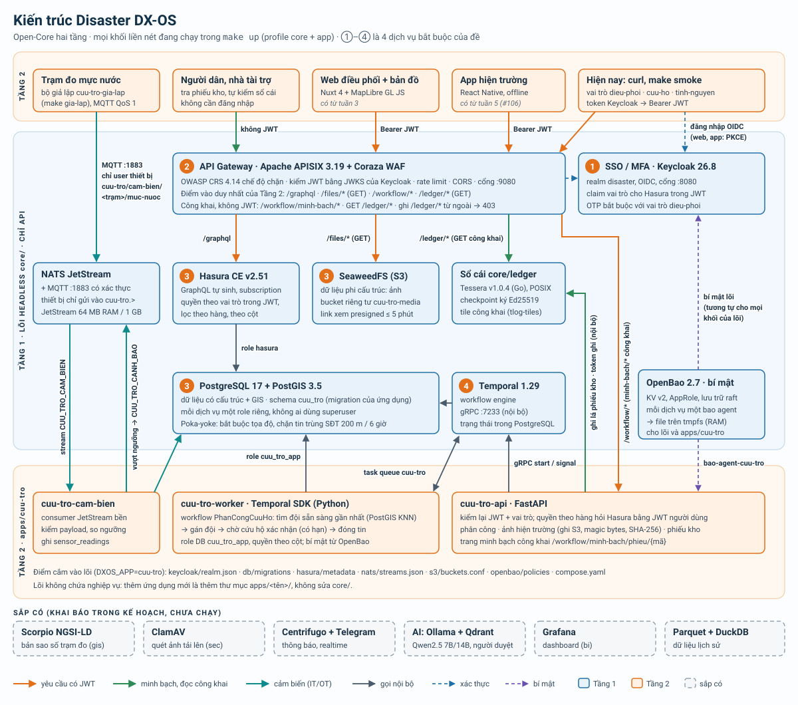

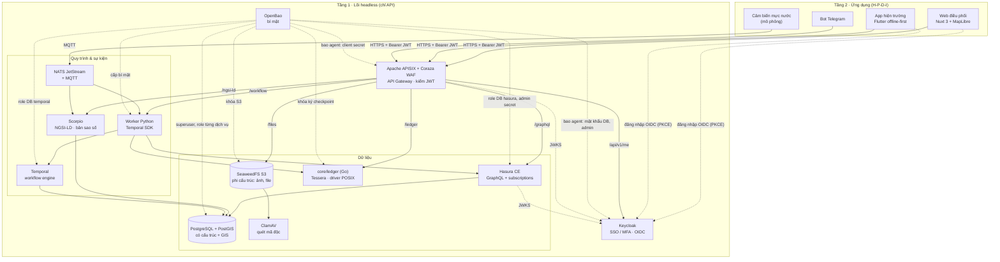

Đường liền: luồng dữ liệu. Đường đứt: xác thực, khóa và bí mật.
Hiện profile `core` có `openbao` (+ 8 bao agent), `postgres` (+ `postgres-roles`), `keycloak`, `apisix`, `hasura`, `seaweedfs`, `temporal` (+ `temporal-ui`), `nats` (#11; bắt buộc xác thực, MQTT cho thiết bị, #30), `ledger` (sổ cái Tessera, #28) và route gateway `/graphql`, `/files/*`, `/workflow/*`, `/ledger/*` (đọc công khai, #28), `/api/v1/me` sau Coraza WAF (#12, mục 3.3), route `/*` cho web điều phối `cuu-tro-web` (profile `app`, #64); các thành phần còn lại tuần 3–5 (xem `docs/PLAN.md`).

## 2. Ánh xạ 4 dịch vụ bắt buộc của đề

| Dịch vụ bắt buộc | Thành phần | Vai trò cụ thể | File cấu hình | Trạng thái |
|---|---|---|---|---|
| Identity / SSO (+MFA) | **Keycloak 26.8.1** | Realm `disaster`, OIDC, 3 vai trò `dieu-phoi`, `cuu-ho`, `tinh-nguyen`, client cho gateway, web và CLI dev. Claim `https://hasura.io/jwt/claims` cho Hasura; OTP bắt buộc với vai trò `dieu-phoi` (#13) | `apps/cuu-tro/keycloak/realm.json` (vai trò, client của ứng dụng) | Chạy được (v0.0.1) |
| API Gateway | **Apache APISIX 3.19** + **Coraza WAF** (coraza-proxy-wasm 0.6.0, OWASP CRS 4.14) | Điểm vào duy nhất của Tầng 2: `/graphql` → Hasura, `/files/*` → SeaweedFS S3, `/workflow/*` → API workflow của ứng dụng (#29, mục 7.3). WAF chặn ở biên, kiểm chữ ký JWT bằng JWKS của Keycloak, rate limit theo IP, CORS, gắn request-id. Chế độ standalone: route nằm trong git (GitOps) | `core/apisix/config.yaml`, `core/apisix/apisix.yaml`, `core/apisix/Dockerfile` | Chạy trong `core` (#12, mục 3.3) |
| Dữ liệu có cấu trúc | **PostgreSQL 17 + PostGIS 3.5**, **Hasura CE v2.51** | Sự cố, đội cứu hộ, điểm trú ẩn, kho hàng, cảm biến (có tọa độ). Hasura tự sinh GraphQL + subscription, phân quyền theo claim vai trò trong JWT | `docker-compose.yml` (`postgres`, `postgres-roles`, `hasura`), `core/postgres/sync-roles.sh` | Chạy trong `core` (#11); schema nghiệp vụ ở #25, #26 |
| Dữ liệu phi cấu trúc | **SeaweedFS 4.48** (S3) + ClamAV | Ảnh hiện trường (#27: tải lên qua API ứng dụng, xem bằng link presigned ngắn hạn qua `/files/*`, mục 7.5), tệp đính kèm, file Parquet lịch sử. File tải lên sẽ được ClamAV quét trước khi công bố | `docker-compose.yml` (`seaweedfs`, `s3-buckets`), `core/openbao/agent-seaweedfs.hcl`, `core/seaweedfs/create-buckets.sh` | S3 chạy trong `core`, khóa từ OpenBao (#11); bucket + API ảnh (#27); ClamAV sau |
| Workflow engine | **Temporal 1.29** + Python SDK | Quy trình kêu cứu: tin mới tự khởi chạy → phân công đội gần nhất (ưu tiên urgency) → đội nhận trong hạn, quá hạn thì phân công lại → xác nhận → đóng (#29, #67, mục 6.1). Cảnh báo vượt ngưỡng → thông báo | `docker-compose.yml` (`temporal`, `temporal-ui`) | Chạy trong `core` (#11); worker ở #29 |

Thành phần hỗ trợ: OpenBao (bí mật, chạy chế độ server trong profile `core` – mục 8), NATS JetStream + MQTT (sự kiện, IoT), Scorpio (NGSI-LD, bản sao số trạm đo), sổ cái minh bạch `core/ledger` (transparency log Tessera, D-007) cho tiền/hàng cứu trợ.

## 3. Luồng xác thực JWT

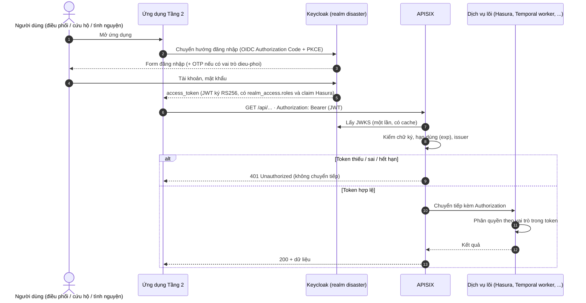

Chi tiết cấu hình:

- Keycloak đặt `KC_HOSTNAME=${KEYCLOAK_PUBLIC_URL}` nên `iss` của token luôn là URL công khai, dù token lấy từ đâu. `KC_HOSTNAME_BACKCHANNEL_DYNAMIC=true` cho phép APISIX và Hasura tải JWKS qua mạng nội bộ `http://keycloak:8080`.
- APISIX dùng plugin `openid-connect` với `bearer_only: true`, `use_jwks: true`: kiểm token tại gateway, không gọi introspection mỗi request. Secret của client `dxos-gateway` lấy từ biến môi trường qua `$env://KC_GATEWAY_CLIENT_SECRET`, không ghi trong file; biến này do `bao agent` đọc từ OpenBao (`secret/core/gateway`), không nằm trong `.env` (mục 8).
- Hasura kiểm lại cùng JWT bằng `HASURA_GRAPHQL_JWT_SECRET` (`jwk_url` nội bộ + `issuer` công khai, không `claims_map`), nên dịch vụ phía sau vẫn tự kiểm tra (Zero-Trust, không tin mù gateway). `make smoke` kiểm: token Keycloak → truy vấn được; token giả → `invalid-jwt`; xin `X-Hasura-Role: admin` ngoài `x-hasura-allowed-roles` → `access-denied`.
- Client `dxos-dev-cli` (cho phép lấy token bằng mật khẩu) **chỉ dùng khi dev** để chạy `scripts/smoke-jwt.sh`. Phải xóa trước khi triển khai công khai.

### 3.1. Claim vai trò cho Hasura (#13)

Client `dxos-web` và `dxos-dev-cli` có 3 protocol mapper có sẵn của Keycloak (không viết SPI), sinh claim JSON lồng nhau trong access token:

```json
"https://hasura.io/jwt/claims": {
  "x-hasura-default-role": "dieu-phoi",
  "x-hasura-allowed-roles": ["offline_access", "dieu-phoi", "uma_authorization", "default-roles-disaster"],
  "x-hasura-user-id": "<sub>"
}
```

| Claim | Mapper | Nguồn |
|---|---|---|
| `x-hasura-allowed-roles` | `oidc-usermodel-realm-role-mapper` (multivalued) | Mọi vai trò realm hiệu lực của user. Vai trò không có quyền trong Hasura (`offline_access`, ...) vô hại |
| `x-hasura-default-role` | `oidc-usermodel-attribute-mapper` | Thuộc tính user `hasura_default_role` |
| `x-hasura-user-id` | `oidc-usermodel-property-mapper` (`id`) | Trùng `sub` |

- Tên claim có dấu chấm thì Keycloak tách thành JSON lồng nhau; dấu chấm trong `hasura.io` được thoát bằng `\.` (trong JSON viết `https://hasura\\.io/jwt/claims.x-hasura-default-role`).
- **Vì sao không dùng `realm_access.roles[0]`:** thứ tự mảng không cố định. Đo thật 19/10/2026: `roles[0]` của `dieuphoi01` là `offline_access`, của `cuuho01` là `cuu-ho`. Vai trò mặc định nay lấy từ thuộc tính `hasura_default_role`, khai báo trong user profile của realm (chỉ admin xem/sửa, giá trị chỉ được là `dieu-phoi`, `cuu-ho`, `tinh-nguyen`). Tạo user mới phải đặt thuộc tính này; thiếu thì token không có `x-hasura-default-role` và Hasura từ chối.
- Hasura đọc mặc định namespace `https://hasura.io/jwt/claims`, nên `HASURA_GRAPHQL_JWT_SECRET` không có `claims_map` (#11).

### 3.2. MFA: OTP bắt buộc cho `dieu-phoi` (#13)

Realm dùng flow trình duyệt riêng `browser-otp-dieu-phoi` (khai báo trong `realm.json`, import lại được từ máy sạch):

```
browser-otp-dieu-phoi
├─ Cookie                                  ALTERNATIVE
└─ forms                                   ALTERNATIVE
   ├─ Username Password Form               REQUIRED
   └─ otp                                  CONDITIONAL
      ├─ Condition - user role = dieu-phoi REQUIRED
      └─ OTP Form                          REQUIRED
```

- User có vai trò `dieu-phoi` phải nhập OTP; chưa cài thì Keycloak chuyển sang trang cài ứng dụng xác thực (required action `CONFIGURE_TOTP`). `cuu-ho`, `tinh-nguyen` không bị hỏi. Điều kiện theo vai trò nên áp cho cả user `dieu-phoi` tạo sau này, không chỉ user mẫu.
- Không đặt sẵn `requiredActions: ["CONFIGURE_TOTP"]` cho user mẫu: làm vậy thì lấy token bằng mật khẩu (`dxos-dev-cli`) bị chặn "Account is not fully set up" và `make smoke` hỏng.
- Flow `direct grant` giữ mặc định: chỉ hỏi OTP khi user đã cài. Vì vậy `dxos-dev-cli` vẫn lấy được token của `dieuphoi01` chưa cài OTP; đây là lý do thêm để xóa client này trước khi triển khai công khai.

Kiểm thử: `make up && bash scripts/smoke-jwt.sh` (không token → 401, token giả → 401, token Keycloak → 200, claim Hasura đúng cho 3 user mẫu, đăng nhập web `dieuphoi01` bị bắt cài OTP còn `cuuho01` thì không).

### 3.4. Phân quyền dữ liệu theo vai trò: JWT → Hasura → lọc theo hàng (#26)

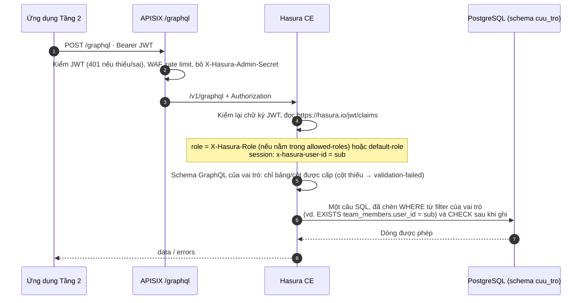

- **Ba lớp kiểm:** (1) APISIX từ chối request không có JWT hợp lệ; (2) Hasura chỉ sinh field cho bảng/cột vai trò được cấp (column-level), xin vai trò ngoài `x-hasura-allowed-roles` → `access-denied`; (3) điều kiện `filter`/`check` của vai trò thành mệnh đề SQL trong cùng câu truy vấn (row-level), giá trị lấy từ session variable trong JWT đã kiểm, client không tự đặt được.
- Đây là RLS ở tầng Hasura, không phải `ROW LEVEL SECURITY` của PostgreSQL: Hasura kết nối bằng một role `hasura` duy nhất. Ràng buộc nghiệp vụ không phụ thuộc vai trò (chặn tin trùng, sức chứa, phiếu bất biến) vẫn nằm trong DB (#25), nên Temporal worker, sổ cái gọi thẳng DB cũng không vượt qua được.
- **`cuu-ho` chỉ thấy tin của đội mình:** bảng `cuu_tro.team_members (user_id = sub Keycloak, team_id)` (migration `0002`), filter `assigned_team.members.user_id = X-Hasura-User-Id`. Chọn bảng trong DB thay vì claim `x-hasura-team-id` từ thuộc tính Keycloak: điều phối đổi đội cho thành viên ngay trong ứng dụng, có hiệu lực ở truy vấn kế tiếp, không chờ token mới, không cần quyền quản trị Keycloak.
- Không vai trò nào có quyền với `anonymous` (không có JWT); console và `/v1/metadata` không mở qua gateway. Bảng quyền đầy đủ: `apps/cuu-tro/README.md`.
- Kiểm thử thật qua gateway với token của 3 user mẫu: `scripts/smoke-hasura.sh` (33 ca, trong `make smoke`).

### 3.3. Route API Gateway, WAF, rate limit (#12)

Tầng 2 chỉ thấy cổng `9080` của APISIX. Hasura (`8081`), SeaweedFS S3 (`8333`), Temporal (`7233`) chỉ mở trên `127.0.0.1` cho quản trị và smoke test. Route khai báo trong `core/apisix/apisix.yaml`:

| Route | Phương thức | Upstream | JWT | WAF (Coraza + CRS) | Giới hạn | Ghi chú |
|---|---|---|---|---|---|---|
| `/graphql` | GET, POST, OPTIONS | `hasura:8080/v1/graphql` | Bắt buộc, chuyển nguyên token cho Hasura kiểm lần 2 | Bộ `api`: đọc body JSON | Body 1 MiB; `GW_RATE_LIMIT_COUNT`/`GW_RATE_LIMIT_WINDOW` theo IP (mặc định 300/60 s) | Bỏ header `X-Hasura-Admin-Secret` của client |
| `/graphql` WebSocket (#60) | GET kèm `Upgrade: websocket` (route `graphql-ws`, ưu tiên hơn) | `hasura:8080/v1/graphql`, giao thức `graphql-transport-ws` | **Không** ở gateway (trình duyệt không gửi header khi mở WebSocket); JWT nằm trong `connection_init`, Hasura kiểm chữ ký/hạn và áp quyền theo vai | Bộ `graphql-ws`: kiểm bắt tay (URI, tham số, header), không đọc khung WebSocket | `GW_REALTIME_RATE_LIMIT_COUNT` lần mở / `GW_RATE_LIMIT_WINDOW` (đếm riêng) | Bỏ header `X-Hasura-Admin-Secret` |
| `/v1/*`, `/v2/*`, `/console*` | mọi | không | – | – | – | Luôn 403: `/v1/metadata`, `/v2/query`, console Hasura không ra ngoài |
| `/files/*` | GET, HEAD, OPTIONS (**chỉ đọc**, #27) | `seaweedfs:8333` (bỏ tiền tố `/files`) | Bắt buộc, rồi **bỏ** header `Authorization` | Bộ `files`: không đọc body | Body `GW_FILES_MAX_BODY_BYTES`; rate limit như trên | S3 kiểm chữ ký SigV4 dạng presigned (tham số `X-Amz-*`) = quyền theo object, mục 7.5 |
| `/workflow/tai-len/*` (#27) | POST, OPTIONS | Như `/workflow/*`, ưu tiên hơn (`priority`) | Như `/workflow/*` | Bộ `upload`: không đọc body nhị phân, vẫn kiểm URI/tham số/header; chỉ nhận kiểu `image/jpeg\|png\|webp`, `application/octet-stream` | Body `GW_UPLOAD_MAX_BODY_BYTES` (mặc định 20 MiB, vượt → 413); rate limit như trên | Quy ước của lõi: đường dẫn nhận tệp nhị phân của API ứng dụng (ảnh hiện trường, mục 7.5) |
| `/workflow/minh-bach/*` (#28) | GET, OPTIONS | Như `/workflow/*`, ưu tiên hơn (`priority`) | **Không** (công khai), bỏ header `Authorization` | Bộ `api` | Body 1 MiB; rate limit như trên | Quy ước của lõi: đường công khai chỉ đọc của API ứng dụng (trang "Minh bạch cứu trợ", mục 5.1) |
| `/ledger/*` (#28) | GET, HEAD, OPTIONS | `ledger:8090` (sổ cái của lõi) | **Không** (công khai) | Bộ `api` | Rate limit như trên | checkpoint, tile, proof, verifier (mục 5.1) |
| `/ledger/*` (#28) | POST, PUT, PATCH, DELETE | – | – | – | – | **403**: ghi sổ cái chỉ từ dịch vụ nội bộ |
| `/workflow/*` | GET, POST, OPTIONS | API workflow của ứng dụng `<DXOS_APP>-api:8000` (`GW_WORKFLOW_UPSTREAM_HOST/PORT`), bỏ tiền tố `/workflow` | Bắt buộc, chuyển nguyên Bearer token (API kiểm lại) | Bộ `api` | Body 1 MiB; rate limit như trên | #29, mục 7.3 |
| `/realtime/websocket` (#68) | GET (bắt tay WebSocket) | `centrifugo:8000/connection/websocket` | **Không** ở gateway (trình duyệt không gửi header khi mở WebSocket); token ngắn hạn trong lệnh connect, Centrifugo kiểm, mục 3.5 | Bộ `realtime`: kiểm bắt tay (URI, tham số, header), không đọc khung WebSocket | `GW_REALTIME_RATE_LIMIT_COUNT` (mặc định 60) lần mở / `GW_RATE_LIMIT_WINDOW` | Đúng một đường; HTTP API `/api/*` của Centrifugo không có route ra ngoài |
| `/api/v1/me` | GET, OPTIONS | Keycloak userinfo | Bắt buộc | Bộ `api` | rate limit như trên | Route mẫu v0.0.1 |
| `/healthz` | GET | không (APISIX tự trả) | Không | – | 20 request / 10 s / IP | Healthcheck; smoke dùng để kiểm `limit-count` |
| `/`, `/*` (#64) | GET, HEAD | Web Tầng 2 của ứng dụng `<DXOS_APP>-web:3000` (`GW_WEB_UPSTREAM_HOST/PORT`) | Không (web tự đăng nhập OIDC + PKCE), bỏ header `Authorization` | Bộ `web`: không đọc body; tham số `iss` miễn nhóm luật SSRF/RFI | `GW_WEB_RATE_LIMIT_COUNT` (mặc định 600) / `GW_RATE_LIMIT_WINDOW` | Ưu tiên thấp nhất: mọi route trên có đường dẫn cụ thể hơn luôn thắng. CSP và header bảo mật do web đặt |

Thứ tự xử lý một request (priority của plugin trong APISIX):

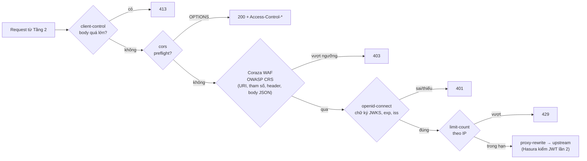

- **WAF ở chế độ chặn.** Image APISIX của đội (`core/apisix/Dockerfile`) = `apache/apisix:3.19.0-debian` + file `coraza-proxy-wasm.wasm` của bản phát hành 0.6.0 (zip tải từ GitHub Release, kiểm SHA-256 lúc build, không chép mã Coraza vào repo). OWASP CRS 4.14 nằm sẵn trong file wasm. Plugin chạy ở pha `rewrite` với priority 7999, trước `openid-connect` (2599): request độc bị chặn 403 trước cả bước kiểm token. Bộ luật: `@recommended-conf` + `SecRuleEngine On` + `@crs-setup-conf` + `@owasp_crs/*.conf`, paranoia 1, chặn theo điểm bất thường (anomaly score).
- **Body cho WAF.** APISIX chỉ đưa body cho plugin wasm khi biến `wasm_process_req_body` được bật, còn coraza-proxy-wasm (viết cho Envoy) không tự bật. Route API có `serverless-pre-function` bật biến này trước Coraza, nên body JSON/GraphQL được kiểm (smoke: XSS trong body, SQLi trong biến GraphQL → 403). Route `/files` và `/workflow/tai-len/*` cố ý không đọc body (ảnh nhị phân, tránh báo nhầm và tốn RAM); API của ứng dụng kiểm loại tệp bằng magic bytes, ClamAV quét ở biên là việc sau (#27).
- **Log WAF.** Coraza ghi mỗi luật khớp vào log lỗi APISIX ở mức `emerg` (`docker compose logs apisix | grep Coraza`), kèm id luật CRS để tinh chỉnh khi báo nhầm.
- **`/files` và chữ ký S3.** Header `Authorization` dành cho JWT ở gateway, S3 không nhận được. Client dùng URL presigned (chữ ký trên query string) do API của ứng dụng cấp theo quyền người dùng (#27, mục 7.5). SeaweedFS tính chữ ký theo `X-Forwarded-Host` APISIX gửi, nên URL được ký cho **host công khai của gateway** (vd `localhost:9080`) với path S3 `/<bucket>/<key>` (không có `/files`). Thiếu JWT → 401; có JWT mà không có chữ ký S3 → 403 từ S3.
- **Rate limit.** `limit-count` chạy ở pha `access`, sau kiểm JWT: request không token bị từ chối 401 ở gateway mà không tới upstream, request có token bị đếm theo IP. Các header `X-RateLimit-Limit/Remaining/Reset` được trả về (và mở cho CORS). Bộ đếm là `local` (mỗi node APISIX một bộ đếm); chạy nhiều node thì chuyển sang `redis`.
- **CORS.** Chỉ origin trong `GW_CORS_ALLOW_ORIGINS` (mặc định `http://localhost:3000`, dev server Nuxt) nhận `Access-Control-Allow-Origin`; origin lạ không có header này nên trình duyệt chặn. Không dùng `*`.
- **Biến môi trường trong route.** APISIX standalone thay `${{TÊN:=mặc định}}` trong `apisix.yaml` khi nạp file (biến phải khai báo ở `nginx_config.envs`). Tên realm (`KEYCLOAK_REALM`), CORS, rate limit, giới hạn body đều lấy theo cách này.
- **WebSocket.** Trình duyệt không đặt được header `Authorization` khi mở WebSocket, nên hai đường WebSocket không kiểm JWT ở bước bắt tay mà xác thực trong giao thức: thông báo realtime qua Centrifugo (`/realtime/websocket`, #68, mục 3.5: token trong lệnh connect) và subscription GraphQL của bản đồ (#60: route `graphql-ws` chỉ khớp `GET` + `Upgrade: websocket` trên `/graphql`; JWT Keycloak nằm trong `connection_init.payload.headers.Authorization`, Hasura kiểm như với HTTP). Không token → vai `anonymous` của Hasura, không thấy bảng nào; token sai/hết hạn → Hasura đóng kết nối; web làm mới token rồi kết nối lại. Query/mutation HTTP trên `/graphql` vẫn bắt buộc JWT ở gateway.

Kiểm thử: `make up && bash scripts/smoke-gateway.sh` (cũng trong `make smoke`): mỗi route không token/token giả → 401, token Keycloak → 200 (`/workflow/hello` chạy workflow Hello); `/v1/metadata`, `/v2/query`, `/v1/query`, `/console` → 403; GET/HEAD ảnh qua `/files` bằng URL presigned + JWT, PUT/DELETE không có route (404); vượt kích thước → 413 (`/graphql`; tải ảnh: `scripts/smoke-anh.sh`); SQLi/XSS trong query hoặc body → 403, request thường vẫn 200; CORS; 25 request vào `/healthz` trong 10 giây → 20 lần 200, 5 lần 429.

### 3.5. Thông báo realtime: Centrifugo OSS (#68)

Web điều phối nhận ba loại thông báo đẩy: **tin kêu cứu mới**, **cần xử lý** (workflow phân công dừng: hết lần giao, không có đội, quá hạn xác nhận, #67) và **vượt ngưỡng** mực nước/lượng mưa (#30). Centrifugo OSS 6.9.7 (Apache-2.0, **không** dùng bản PRO) là dịch vụ riêng của lõi; cầu nối NATS → Centrifugo và việc cấp token thuộc ứng dụng.

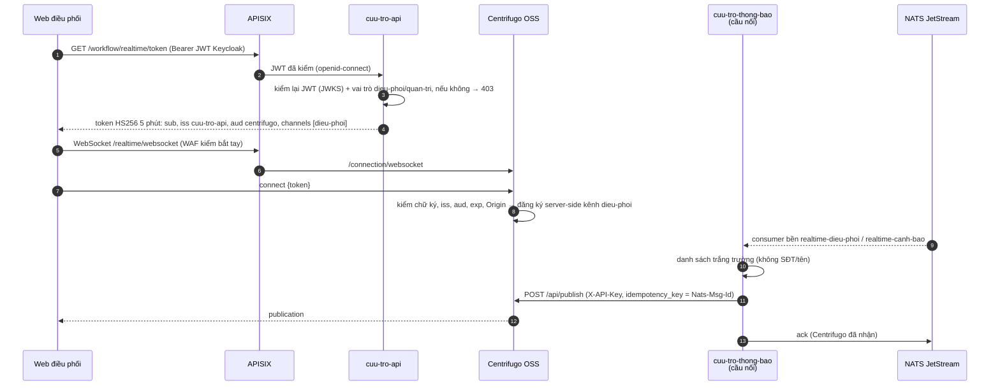

| Quyết định | Chọn | Vì sao |
|---|---|---|
| Xác thực kết nối | **Token riêng do API ứng dụng cấp** (HS256, hạn `REALTIME_TOKEN_HAN_GIAY` = 300 s, `iss` `<DXOS_APP>-api`, `aud` `centrifugo`), khóa trong OpenBao | (1) JWT Keycloak không mang quyền theo kênh; Centrifugo OSS chỉ đọc kênh từ claim `channels`/`subs`, muốn lọc theo vai trò thì phải thêm subscribe proxy. API đã kiểm JWT + vai trò cho mọi endpoint, giờ chỉ thêm một chỗ quyết định kênh. (2) Token chỉ có `sub` và kênh, không mang tên/email/vai trò như JWT Keycloak; lộ token cũng không dùng được cho `/graphql` hay `/workflow`. (3) `iss`/`aud` riêng: JWT Keycloak đưa thẳng vào Centrifugo bị từ chối (smoke kiểm). (4) Hạn ngắn: mất vai trò điều phối thì lần làm mới token kế tiếp bị 403 và kết nối bị đóng |
| Quyền theo kênh | Kênh **server-side** (claim `channels`); client không tự đăng ký được kênh nào (mặc định của Centrifugo: `allow_subscribe_for_client` tắt) | Quyền nằm hoàn toàn ở API (`thong_bao.kenh_cua`): chỉ `dieu-phoi` (và `quan-tri` khi realm có) nhận kênh `dieu-phoi` |
| Đường WebSocket | APISIX `/realtime/websocket` → `centrifugo:8000/connection/websocket`, Coraza WAF bật cho bắt tay, rate limit riêng; Centrifugo không mở cổng ra host; HTTP API chỉ mạng nội bộ | Một cửa vào duy nhất như mọi route khác. Khung WebSocket sau bắt tay không đi qua WAF (Coraza không phân tích); nội dung client gửi chỉ là lệnh giao thức, client không publish được |
| Origin | `CENTRIFUGO_CLIENT_ALLOWED_ORIGINS` = `GATEWAY_PUBLIC_URL` | Chặn trang lạ mở WebSocket bằng token bị lộ (bắt tay 403) |
| Bí mật | `secret/app/<DXOS_APP>/realtime` (`token_hmac_secret`, `api_key`): `bao-agent-centrifugo` render file cấu hình chỉ chứa 2 bí mật (tmpfs); `bao-agent-cuu-tro` render khóa ký cho `cuu-tro-api`, API key + `NATS_URL` cho cầu nối (volume riêng). Tùy chọn khác đặt bằng biến `CENTRIFUGO_*` | Không có bí mật trong `.env`, image hay web |
| Nguồn sự kiện | JetStream: `cuu-tro.dieu-phoi.can-xu-ly.<id>` (#67), `cuu-tro.dieu-phoi.tin-moi.<id>` (bộ khởi chạy phát sau khi khởi chạy phân công, cùng stream `CUU_TRO_DIEU_PHOI`), `cuu-tro.canh-bao.cam-bien.<trạm>` (#30) | Không thêm stream; tin mới đi theo outbox của #67 nên không phát cho tin bị rollback. Tắt phân công tự động (`PHAN_CONG_TU_DONG=0`) thì không có thông báo tin mới |
| Giao đúng một lần (với người xem) | Consumer bền `realtime-*` (`deliver_policy: new`, ack sau khi Centrifugo nhận, nak 5 s khi lỗi); `Nats-Msg-Id` chống trùng ở JetStream, `idempotency_key` chống trùng ở Centrifugo (5 phút); web bỏ trùng theo `id` | Cầu nối khởi động lại không mất tin, không đẩy lại sự kiện cũ lúc tạo consumer lần đầu |
| Dữ liệu cá nhân | Cầu nối chỉ chép trường trong danh sách trắng theo loại (id tin, mức khẩn, lý do, số lần giao; mã/tên trạm, giá trị, ngưỡng); chuỗi có dãy số dạng SĐT/CCCD bị bỏ | Web điều phối xem chi tiết tin qua `/graphql` theo quyền Hasura, không qua kênh đẩy |
| Kết nối lại | centrifuge-js tự kết nối lại (backoff 0,5–20 s), tự xin token mới; kênh giữ 50 tin / 10 phút (`force_recovery`) để lấy bù tin lỡ khi mất kết nối ngắn | Engine `memory` một nút: Centrifugo khởi động lại thì mất lịch sử kênh (chấp nhận được với thông báo; dữ liệu gốc vẫn ở PostgreSQL/JetStream) |

RAM đo 22/10/2026 sau `make smoke`: centrifugo ~33 MiB (`mem_limit` 128 MiB, `GOMEMLIMIT=80MiB`), cầu nối `cuu-tro-thong-bao` ~30 MiB (`mem_limit` 96 MiB). Kiểm thử: `scripts/smoke-realtime.sh` (26 ca, trong `make smoke`), pytest `tests/test_cuu_tro_thong_bao.py`, Vitest `tests/thong-bao.test.ts`.

## 4. Chia profile docker-compose

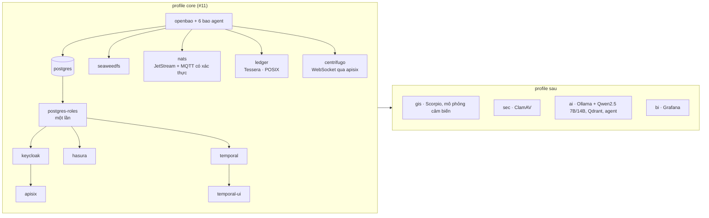

| Profile | Dịch vụ | Lệnh | RAM |
|---|---|---|---|
| `core` | openbao, openbao-unseal (dev), 8 bao agent, postgres, postgres-roles (chạy một lần rồi thoát), keycloak, apisix, hasura, seaweedfs, temporal, temporal-ui, nats, ledger (#28), centrifugo (#68) | `make up` | **Đo 19/10/2026** (`docker stats --no-stream`, Mac Apple Silicon, PostGIS chạy giả lập amd64): ~1,5 GB ngay sau khi mọi dịch vụ healthy; ~2,1 GB sau `make smoke` (bảng dưới; APISIX đo lại sau #12) |
| `gis` | Scorpio (dùng chung postgis), mô phỏng cảm biến | tuần 4 | |
| `sec` | ClamAV | tuần 2–4 | ClamAV ~1,5 GB. `ledger` (Tessera) đã vào `core` (#28) |
| `ai` | Ollama, Qdrant, agent | tuần 5 | Qwen2.5 7B ~5 GB |
| `bi` | Grafana | tuần 4 | |

RAM từng dịch vụ của `core` (MiB; "sau smoke" = sau khi chạy `make smoke` khoảng 10 phút):

| Dịch vụ | Sau khởi động | Sau smoke | Giới hạn | Cách giới hạn |
|---|---|---|---|---|
| keycloak | 537 | 525 | 1536 | `mem_limit`, heap `-XX:MaxRAMPercentage=70` |
| postgres | 240 | 315 | 1024 | `mem_limit`, `shared_buffers=128MB`, `max_connections=100`; Hasura 10 + Temporal 15 kết nối |
| hasura | 72 | 185 | 512 | `mem_limit`, pool 10 kết nối (`pool_settings` trong metadata của ứng dụng, #26) |
| temporal | 76 | 238 | 512 | `mem_limit`, `GOMEMLIMIT=400MiB`, `SQL_MAX_CONNS=10`, `SQL_VIS_MAX_CONNS=5` |
| seaweedfs | 153 | 193 | 384 | `mem_limit`, `GOMEMLIMIT=300MiB`, volume 256 MB |
| apisix (+ Coraza WAF, #12) | 242 | 352 | 768 | `mem_limit`, `worker_processes: 2` (mỗi worker giữ một bản Coraza + CRS); ~370 sau thêm 560 request |
| openbao | 33 | 145 | 256 | `mem_limit` |
| nats | 12 | 25 | 256 | `mem_limit`, `GOMEMLIMIT=200MiB`, JetStream bộ nhớ 64 MB, ổ 1 GB (`NATS_JS_MAX_MEMORY`, `NATS_JS_MAX_FILE`, #30) |
| temporal-ui | 11 | 33 | 128 | `mem_limit`, `GOMEMLIMIT=100MiB` |
| centrifugo (#68, đo 22/10) | ~30 | 33 | 128 | `mem_limit`, `GOMEMLIMIT=80MiB`, engine `memory` |
| 6 bao agent + openbao-unseal | ~100 | ~115 | 64 mỗi cái | `mem_limit` |
| **Tổng** | **~1478** | **~2125** | | |

Đo lại 19/10/2026 sau #12 (sau `make smoke` và 560 request qua gateway): tổng ~1,7 GB, APISIX ~376 MiB. Cột "Sau khởi động"/"Sau smoke" của các dịch vụ khác giữ số đo của #11.

Image của profile `core` chiếm khoảng 5,4 GB ổ (Keycloak, APISIX, PostGIS, Hasura, Temporal lớn nhất). Chạy xong trên laptop ít ổ: `make down` (giữ volume) rồi `docker image prune -a -f`.

Nguyên tắc:

- Mọi image ghim phiên bản cụ thể, lấy từ nhà phát hành gốc (Docker Hub, Quay). Không dùng `latest`, không vendor mã.
- Thành phần copyleft (PostGIS GPL-2.0, ClamAV GPL-2.0, Grafana AGPL-3.0) chạy như dịch vụ riêng bằng image gốc, không sửa, không liên kết vào mã dự án.
- Cổng của dịch vụ nội bộ chỉ mở trên `127.0.0.1`. Chỉ Keycloak (đăng nhập) và APISIX đối diện người dùng.
- `postgis/postgis` chỉ có image amd64. Trên Mac Apple Silicon, Docker chạy giả lập (biến `POSTGIS_PLATFORM`).

## 5. Sổ cái tiền/hàng cứu trợ: Tessera (đã chốt – D-007)

immudb chuyển sang BSL 1.1 từ 12/2023, không còn là giấy phép OSI (D-004), nên bị loại. Thay bằng transparency log của dự án transparency-dev / Google, đều Apache-2.0.

Yêu cầu: mỗi lần nhập/xuất hàng hoặc nhận/chi tiền được ghi một bản ghi chỉ-thêm (append-only). Ai cũng kiểm được bản ghi nằm trong log (inclusion proof) và log không bị sửa lùi (consistency proof). Chạy nhẹ trên laptop.

| Tiêu chí | Tessera | Trillian |
|---|---|---|
| Giấy phép | Apache-2.0 | Apache-2.0 |
| Tình trạng | Thế hệ mới, đang phát triển tích cực (v1.0.4, 07/2026) | **Chế độ bảo trì**. README khuyên log mới nên thử Tessera trước (v1.8.0, 09/2026) |
| Dạng | Thư viện Go. Đội viết một dịch vụ nhỏ ("personality") nhận bản ghi qua HTTP | Máy chủ gRPC có sẵn (log server + log signer). Đội viết personality gọi gRPC |
| Lưu trữ | Driver GA: POSIX (thư mục file), AWS (S3), GCP. Driver MySQL đã bị gỡ sau v1.0.2 | MySQL/MariaDB (chính), có thư mục driver PostgreSQL, CockroachDB, Spanner |
| Độ nhẹ | 1 tiến trình Go + 1 volume. Không cần CSDL với driver POSIX | 2 tiến trình + CSDL. Driver PostgreSQL ít người dùng hơn MySQL |
| Kiểm chứng | API chuẩn tlog-tiles (C2SP): tile tĩnh, ai cũng tải về để tự kiểm. Hỗ trợ witness đồng ký checkpoint | API gRPC riêng, cần client gọi để lấy proof |
| Docker | Build image từ mã của đội (Dockerfile nhiều tầng, base distroless) | Image chính thức chủ yếu phục vụ CI. Nên build từ nguồn |
| Ngôn ngữ | Thêm Go vào repo (dịch vụ ~200–300 dòng) | Personality viết Python qua gRPC stub |

**Đã chốt (D-007, 19/10/2026): Tessera + driver POSIX.**
Lý do: nhẹ nhất (không thêm CSDL), đúng hướng mà chính nhóm Trillian khuyên dùng, và tile tĩnh cho phép người dân hoặc nhà tài trợ tự tải log về đối chiếu. Đây là điểm mạnh khi trình bày tính minh bạch cứu trợ. Dịch vụ Go nhỏ build từ nguồn trong repo cũng là bằng chứng "build từ mã nguồn" cho PoF. Chi phí: đội phải viết khoảng 200–300 dòng Go.
Phương án dự phòng: Trillian với driver PostgreSQL (dùng chung PostgreSQL), chỉ dùng nếu đội không theo được Go.

### 5.1. Dịch vụ lõi `core/ledger` (#28)

Sổ cái là dịch vụ **Tầng 1**, không gắn nghiệp vụ (theo mục 7): `core/ledger` viết bằng Go (~600 dòng kèm CLI), nhúng thư viện Tessera v1.0.4 (khai báo qua `go.mod`, không vendor, không chép mã mẫu `cmd/conformance/posix`). Ghi nội dung gì (phiếu nhập/xuất kho, sau này khoản tiền cứu trợ) do `apps/cuu-tro` quyết định. Image build từ nguồn (`core/ledger/Dockerfile`: Go ở bước build, image chạy `scratch` chỉ có 2 file nhị phân tĩnh).

| API | Quyền | Mô tả |
|---|---|---|
| `POST /ledger/entries` | **Chỉ mạng nội bộ** + `Authorization: Bearer <token ghi>` của ứng dụng (OpenBao `secret/app/<APP>/ledger`). APISIX chặn mọi phương thức ghi `/ledger/*` (403), ledger không mở cổng ra máy host | Body `{"type","ref","sha256","attrs"}` (không định danh) → lá chuẩn tắc; chờ checkpoint đã ký chứa lá rồi trả `index`, `leaf_hash`, `duplicate` |
| `GET /ledger/checkpoint`, `GET /ledger/tile/...` | Công khai qua APISIX (WAF, rate limit) | Checkpoint đã ký và tile hash / entry bundle tĩnh theo [tlog-tiles](https://c2sp.org/tlog-tiles) (C2SP). Tile đầy đủ `Cache-Control: immutable` |
| `GET /ledger/proof/{index}` | Công khai | Lá, leaf hash, inclusion proof và checkpoint đang công bố (dựng bằng gói `client` của Tessera) |
| `GET /ledger/verifier` | Công khai | Khóa công khai (verifier key dạng note) để ai cũng kiểm chữ ký checkpoint |

**Vì sao ghi bằng token dịch vụ, không bằng JWT người dùng:** lõi không biết vai trò nghiệp vụ. Ứng dụng kiểm JWT + vai trò (`dieu-phoi`) rồi mới ghi, và chính ứng dụng là nơi lưu `ledger_index`. Token ghi sinh ngẫu nhiên 32 byte cho từng ứng dụng, chỉ `cuu-tro-api` và ledger đọc được (policy riêng); đổi token trong OpenBao có hiệu lực sau lần render kế tiếp của bao agent, không cần khởi động lại. Ba lớp chặn: không có route ghi qua gateway, không có cổng host, sai/thiếu token → 401.

**Lá** (gói `core/ledger/leaf`): JSON chuẩn tắc `{"attrs":{…},"ref":"<mã giao dịch>","sha256":"<64 hex>","type":"<loại>","v":1}`, tối đa 1 KiB. Thuộc tính chỉ nhận chữ/số không dấu, không khoảng trắng (không ghi được họ tên) và từ chối dãy số dạng SĐT/CCCD (bắt đầu bằng 0, từ 9 chữ số). Gửi lại đúng lá cũ → chống trùng (in-memory + BadgerDB bền vững) trả index cũ, nên ứng dụng gọi lại an toàn.

**Khóa ký checkpoint** Ed25519 dạng note (`golang.org/x/mod/sumdb/note`), tên khóa = origin của sổ cái (`LEDGER_ORIGIN`). `scripts/openbao-init.sh` sinh **một lần** bằng openssl khi `secret/core/ledger` còn trống (khóa đi qua file tạm 0600 rồi stdin, không lên dòng lệnh, không in ra màn hình), lưu `signing_key` và `verifier_key`. `bao-agent-ledger` render vào volume tmpfs chỉ ledger mount; ledger đọc file trực tiếp (image không có shell), không bao giờ ghi khóa vào log.

**Lưu trữ:** driver POSIX trên volume `ledgerdata` (`/data/log`: `checkpoint`, `tile/`, `.state/`; `/data/antispam`: BadgerDB). Ledger chỉ phục vụ `checkpoint` và `tile/` (qua `os.Root`, không thoát thư mục, không liệt kê), không phục vụ `.state/`. Một tiến trình ghi (lock file). `GOMEMLIMIT=150MiB`, `mem_limit` 256 MB.

```mermaid
sequenceDiagram
  autonumber
  actor DP as dieu-phoi
  participant GW as APISIX
  participant API as cuu-tro-api
  participant PG as PostgreSQL (cuu_tro)
  participant L as core/ledger (Tessera)
  actor ND as Người dân / nhà tài trợ
  DP->>GW: POST /workflow/kho/phieu (JWT)
  GW->>API: kiểm JWT + WAF → chuyển tiếp
  API->>PG: INSERT supply_movements (role cuu_tro_app; trigger cộng/trừ tồn)
  API->>API: bản ghi chuẩn hóa (không created_by) → JSON chuẩn tắc → SHA-256
  API->>L: POST /ledger/entries {type, ref=mã phiếu, sha256, attrs} + token ghi (mạng nội bộ)
  L-->>API: index, leaf_hash (sau khi checkpoint đã ký chứa lá)
  API->>PG: UPDATE ledger_index, ledger_leaf_hash (một lần, trigger chặn sửa lại)
  ND->>GW: GET /workflow/minh-bach/phieu/{mã} (không đăng nhập)
  GW->>API: chuyển tiếp (bỏ Authorization)
  API->>PG: đọc phiếu → băm lại
  API->>L: GET /ledger/proof/{index}
  API-->>ND: bản ghi + "da_xac_minh" / "khong_khop" (kiểm chữ ký checkpoint, lá, leaf hash, proof)
  ND->>GW: GET /ledger/checkpoint, /ledger/tile/... (công khai)
  Note over ND: ledger-verify tự kiểm chữ ký bằng khóa công khai,<br/>tự dựng proof từ tile, băm lại bản ghi đã lưu
```

**Ba cách kiểm chứng**, từ tin máy chủ nhiều đến ít:

1. Trang công khai `GET /workflow/minh-bach/phieu/{mã}`: API băm lại bản ghi trong CSDL, kiểm chữ ký checkpoint, nội dung lá, leaf hash và inclusion proof (RFC 9162). Sửa tay một phiếu trong CSDL → `khong_khop`.
2. `ledger-verify` (`core/ledger/cmd/ledger-verify`, có sẵn trong image `ledger`): chỉ dùng checkpoint + tile công khai qua gateway, tự dựng proof (không dùng `/ledger/proof`), kiểm chữ ký bằng khóa công khai do người dùng đưa vào, băm lại bản ghi đã lưu từ trang công khai.
3. Tự viết: định dạng là chuẩn mở (tlog-tiles, tlog-checkpoint, signed note), mọi thư viện tương thích đều kiểm được.

Giới hạn hiện tại: khóa công khai lấy từ chính máy chủ thì chỉ chứng minh toàn vẹn so với khóa đang công bố; triển khai thật cần công bố khóa ở nơi độc lập (tài liệu phát hành) và đặt `LEDGER_VERIFIER_KEY`. Consistency proof (log không bị viết lại) và witness công khai của transparency.dev để tuần 6.

## 6. Luồng nghiệp vụ chính (đích tuần 3–5)

Hai luồng đã chạy được: kêu cứu → phân công đội gần nhất → xác nhận, và phiếu nhập/xuất kho → sổ cái → kiểm chứng công khai. API và lệnh mẫu của từng bước nằm trong `apps/cuu-tro/README.md`.

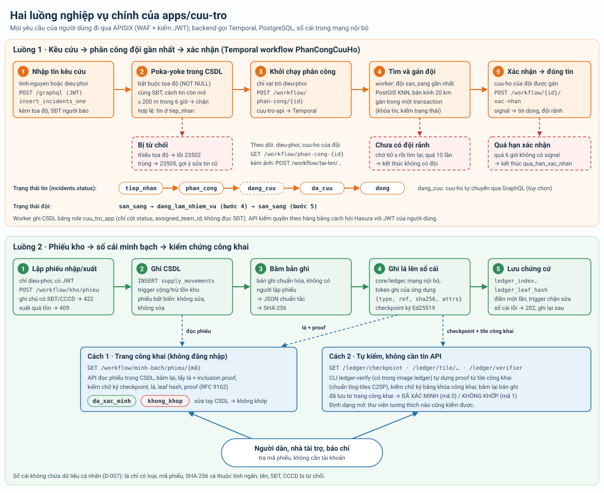

Luồng đích đầy đủ, thêm AI bóc tách tin có người duyệt, bản sao số trạm đo và thông báo:

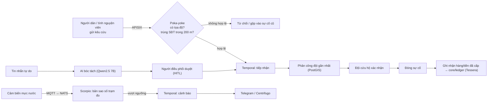

### 6.1. Phân công tự động (#67)

Từ #67 không ai phải bấm "phân công": tin kêu cứu mới tự khởi chạy workflow `PhanCongCuuHo`; đội không nhận trong hạn thì workflow tự giao đội kế tiếp; tin khẩn hơn được đội trước.

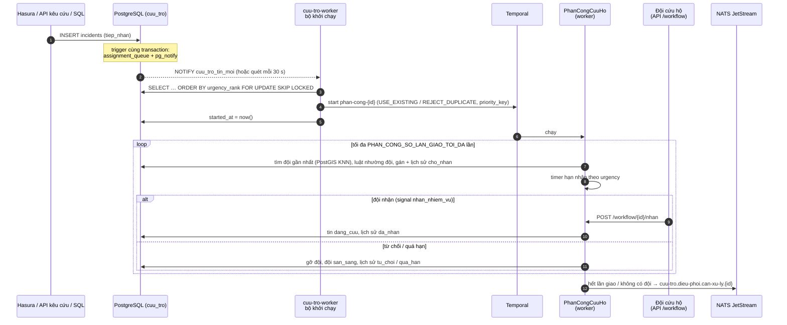

| Quyết định | Chọn | Vì sao |
|---|---|---|
| Nguồn sự kiện "có tin mới" | **Outbox trong PostgreSQL** (`assignment_queue`, trigger `AFTER INSERT` + `pg_notify`), bộ khởi chạy chạy trong worker | Ghi cùng transaction với tin: không mất tin khi Temporal/NATS/worker đang lỗi, không phát sự kiện cho tin bị rollback. Mọi đường tạo tin (GraphQL, API kêu cứu #66, SQL, nhập lô) đều qua, không phải sửa từng nơi. Hasura event trigger cần thêm webhook vào API và đặt trigger lên bảng bằng role `hasura` (role này cố ý không có DDL, mục 7.1); NATS thì PostgreSQL không tự phát được, vẫn cần outbox ở giữa |
| Không chạy trùng | Workflow id tất định `phan-cong-<incident_id>`; `USE_EXISTING` khi đang chạy, `REJECT_DUPLICATE` khi đã xong; `FOR UPDATE SKIP LOCKED` | Bộ khởi chạy chết giữa "start" và "đánh dấu" thì lần sau gọi lại vô hại; nhiều worker không lấy trùng dòng |
| Ưu tiên urgency | (1) thứ tự lấy hàng đợi; (2) `priority_key` Temporal; (3) luật SQL `team_reserved_for_more_urgent`: tin kém khẩn không lấy đội đang cần cho tin khẩn hơn đang chờ trong bán kính | (1)(2) chỉ giúp khi nhiều việc cùng lúc; (3) mới quyết định ai được đội khi đội khan hiếm. Không giành lại đội đã giao (không ngắt nhiệm vụ đang làm); `seeking_at` hết hạn tự động nên workflow chết không chặn tin khác |
| Quá hạn → phân công lại | `workflow.wait_condition` có `timeout` (timer bền) + signal `nhan_nhiem_vu` / `tu_choi` / `huy` | Không vòng lặp sleep/poll; worker khởi động lại vẫn giữ hạn; test bằng máy chủ test tua thời gian |
| Báo điều phối | Sự kiện JetStream `cuu-tro.dieu-phoi.can-xu-ly.<id>` (stream `CUU_TRO_DIEU_PHOI`, 30 ngày), `Nats-Msg-Id` chống trùng | Cầu nối `cuu-tro-thong-bao` đẩy lên web điều phối qua Centrifugo (#68, mục 3.5); Telegram đọc sau; sự kiện không có dữ liệu cá nhân |

## 7. Vì sao lõi độc lập với nghiệp vụ (`core/` và `apps/`)

Đề yêu cầu dịch vụ Tầng 1 **độc lập hoàn toàn với nghiệp vụ cụ thể**, chỉ cung cấp dịch vụ cơ bản (xác thực, lưu trữ, workflow…) cho người phát triển ứng dụng Tầng 2. Vì vậy repo chia hai phần:

| Thư mục | Chứa | Không chứa |
|---|---|---|
| `core/` (Tầng 1) | Cấu hình dịch vụ dùng chung: bí mật (`core/openbao/`), gateway (`core/apisix/`), khởi tạo CSDL dùng chung + PostGIS (`core/postgres/init/`), sự kiện/MQTT (`core/nats/`); sau này: cơ chế tự sinh API, lưu trữ, workflow engine, sổ cái `core/ledger` | Bảng, vai trò, quy trình, dữ liệu mẫu hay giao diện của đề tài thiên tai |
| `apps/cuu-tro/` (Tầng 2) | Realm Keycloak với vai trò `dieu-phoi`, `cuu-ho`, `tinh-nguyen` (`keycloak/realm.json`); từ tuần 2: migration bảng `incidents`, `rescue_teams`, `shelters`, `supplies`, `sensors`, workflow Temporal, seed, web Nuxt, app Flutter | Cấu hình dịch vụ lõi |

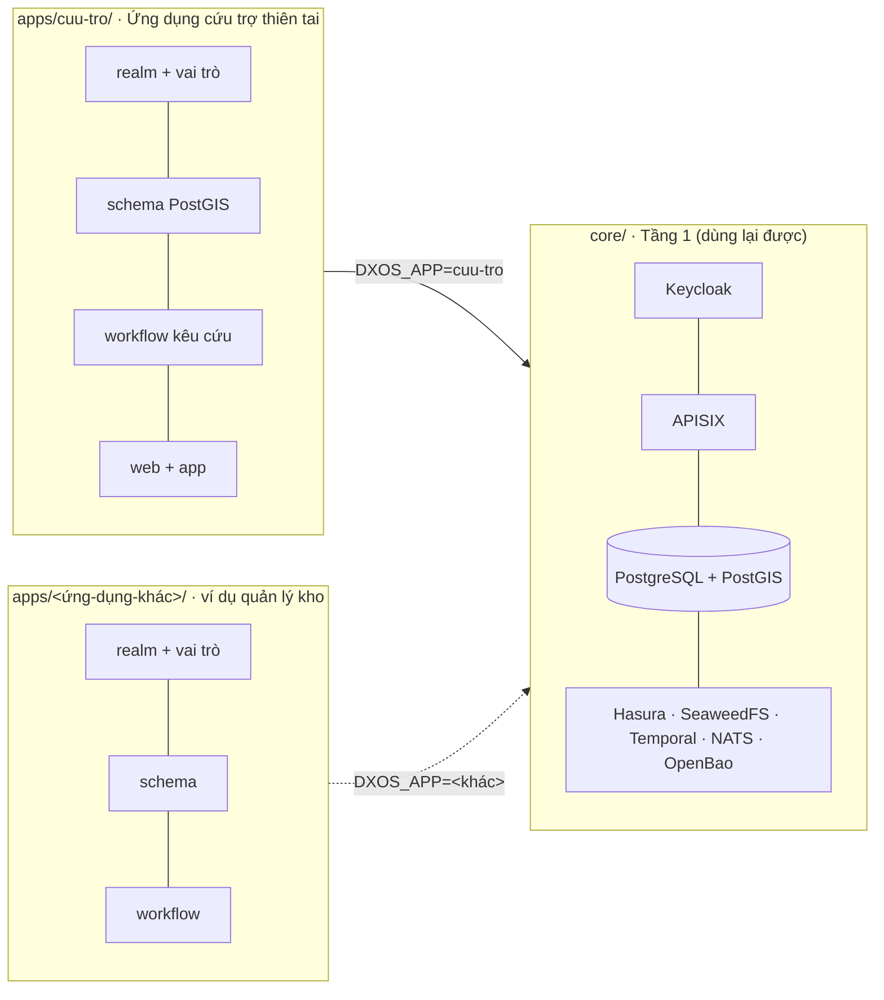

Cách cắm ứng dụng vào lõi: đặt biến `DXOS_APP` trong `.env` là tên thư mục trong `apps/`. Lõi nạp cấu hình do ứng dụng cung cấp qua các điểm cắm cố định:

| Điểm cắm | Đường dẫn trong `apps/<DXOS_APP>/` | Lõi dùng nó thế nào | Trạng thái |
|---|---|---|---|
| Realm Keycloak | `keycloak/realm.json` | Keycloak import khi khởi động lần đầu | Có |
| Schema | `db/migrations/` | Container một lần `migrate` áp SQL đánh số vào schema riêng của ứng dụng (mục 7.1) | Có (#25) |
| Quyền GraphQL | `hasura/metadata/` | Hasura nạp metadata (track bảng, quyền theo vai trò) | Có (#26) |
| Backend (worker + API) | `compose.yaml`, `workflow/` (Python) | `docker-compose.yml` nạp `apps/${DXOS_APP}/compose.yaml` bằng `include` (profile `app`); route `/workflow/*` trỏ vào `<DXOS_APP>-api:8000` (mục 7.3) | Có (#29) |
| Role DB dịch vụ | `db/migrations/` (GRANT) | `postgres-roles` tạo role `<schema>_app` không quyền gì; migration của ứng dụng cấp đúng bảng/cột (mục 7.3) | Có (#29) |
| Bí mật của ứng dụng | `openbao/policies/*.hcl` | `openbao-init` nạp thành policy + AppRole `app-<DXOS_APP>-<dịch vụ>` | Có (#29) |
| Route gateway riêng | `gateway/routes.yaml` | Gộp với route lõi khi khởi động APISIX | Chưa cần (tuần 3+) |
| Dữ liệu mẫu | `db/seed/` | `make seed` (`migrate seed`) | Có (#25) |

Lợi ích: cùng một lõi, cắm thêm ứng dụng khác chỉ bằng cấu hình, không sửa `core/`. Đây là bằng chứng lõi dùng lại được, sẽ trình bày trong phần demo.

Còn ràng buộc (tuần 2 xử lý):
- Tên realm (`KEYCLOAK_REALM`, mặc định `disaster`) là cấu hình triển khai, không phải nghiệp vụ. Từ #12, `core/apisix/apisix.yaml` đọc tên realm qua `${{KEYCLOAK_REALM:=disaster}}`, không còn ghi cứng. Từ #29, upstream của `/workflow/*` cũng là biến (`GW_WORKFLOW_UPSTREAM_HOST/PORT`, mặc định `<DXOS_APP>-api:8000`). Còn lại: gộp route riêng của ứng dụng (`apps/<DXOS_APP>/gateway/routes.yaml`) với route lõi lúc khởi động, khi ứng dụng cần route ngoài `/graphql`, `/files`, `/workflow`.
- `scripts/smoke-jwt.sh` dùng người dùng mẫu của `apps/cuu-tro` để kiểm thử lõi.

### 7.1. Tầng dữ liệu của ứng dụng (#25)

Lõi chỉ biết **quy ước thư mục**, không biết bảng nào của ứng dụng. Container một lần `migrate` (image `postgis/postgis` có sẵn, script `core/postgres/migrate.sh`) chạy sau `postgres-roles`, trước Hasura, mỗi lần `make up`:

| Thư mục trong `apps/<DXOS_APP>/db/` | Lệnh | Cách chạy |
|---|---|---|
| `migrations/NNNN_<tên>.sql` | tự động trong `make up`, hoặc `make migrate` | Theo thứ tự tên, mỗi file một lần, mỗi file một transaction. Lịch sử + SHA-256 ở `dxos_meta.app_migrations`; sửa file đã chạy thì báo lỗi, phải thêm file mới |
| `seed/NNNN_<tên>.sql` | `make seed` | Dữ liệu giả, viết idempotent (id cố định + `ON CONFLICT DO NOTHING`) |
| `tests/NNNN_<tên>.sql` | `make test-db` (cũng chạy trong `make smoke`) | `BEGIN … ROLLBACK`, ca sai thì `RAISE` |

Quy ước tên và quyền:

| Đối tượng | Giá trị (với `DXOS_APP=cuu-tro`) | Quyền |
|---|---|---|
| Schema | `cuu_tro` (= `DXOS_APP` đổi `-` thành `_`), không dùng `public` | `REVOKE ALL … FROM PUBLIC` |
| Chủ sở hữu | role `cuu_tro_owner` | `NOLOGIN`, không superuser/`CREATEDB`/`CREATEROLE`; chỉ sở hữu schema của mình. Script đăng nhập bằng superuser chỉ để tạo role/schema, rồi `SET ROLE cuu_tro_owner` trước mỗi file, nên mọi bảng/hàm thuộc role ứng dụng |
| Role API | `hasura` | `USAGE` schema, `SELECT, INSERT, UPDATE, DELETE` mọi bảng, `EXECUTE` hàm. Không `CREATE`, `TRUNCATE`, `DROP`; không đọc `dxos_meta`. Bảng/cột nào lộ ra GraphQL theo vai trò do Hasura metadata quyết định (#26) |

Vì sao SQL thuần + container một lần, không dùng migration của Hasura CLI: (1) migration Hasura chạy bằng role `hasura`, buộc role này có quyền DDL; (2) migration là việc của CSDL, không phụ thuộc Hasura: workflow Temporal (#29), sổ cái (#28) dùng cùng bảng; (3) dùng lại image postgis đã có, không thêm phụ thuộc; (4) chạy được bằng role sở hữu riêng thay vì role `hasura`, nên `hasura` không cần quyền DDL. Metadata Hasura (#26) vẫn để ở `apps/<app>/hasura/metadata/`.

### 7.2. Metadata Hasura của ứng dụng (#26)

Bảng nào lộ ra GraphQL, quan hệ, quyền theo vai trò là **của ứng dụng**, khai báo trong repo ở `apps/<DXOS_APP>/hasura/metadata/` (định dạng thư mục v3 của `hasura-cli`, mỗi bảng một file YAML). Lõi chỉ mount thư mục đó vào `/hasura-metadata`, giống cách `migrate` dùng `apps/<DXOS_APP>/db/`.

Cách áp dụng: dịch vụ `hasura` dùng image `hasura/graphql-engine:v2.51.0-ce.cli-migrations-v3` (cùng phiên bản, vẫn `-ce` theo D-004, Apache-2.0). Entrypoint của image chạy một server tạm chỉ bật metadata API, gọi `hasura-cli metadata apply`, rồi `exec graphql-engine serve`. `HASURA_GRAPHQL_DISALLOW_INCONSISTENT_METADATA=true`: metadata trỏ tới bảng/cột không có thì Hasura dừng khởi động thay vì chạy với quyền thiếu. Thứ tự trong `make up`: `migrate` (tạo bảng) → `hasura` (áp metadata) → APISIX.

Vì sao chọn image `cli-migrations` thay vì một container một lần gọi `replace_metadata`: định dạng thư mục YAML (dễ đọc, dễ review từng bảng trong PR) phải có `hasura-cli` mới gộp được thành JSON; image này đã có sẵn CLI đúng phiên bản và tự áp mỗi lần khởi động, không cần thêm container, không cần chờ Hasura sẵn sàng rồi mới gọi API. Không dùng `/hasura-migrations` của image: migration SQL vẫn do `migrate` làm (mục 7.1).

Sửa quyền: sửa YAML trong `apps/cuu-tro/hasura/metadata/databases/default/tables/`, rồi `docker compose restart hasura` (hoặc `make up`). Metadata trong DB luôn bị thay bằng bản trong repo, nên không sửa quyền bằng API/console (console tắt).

Hàm PL/pgSQL của ứng dụng khai báo `SET search_path FROM CURRENT` (= `cuu_tro, public` lúc migrate), vì Hasura kết nối với `search_path` mặc định không có `cuu_tro`.

Chạy lại từ volume trống (không xóa OpenBao): `make down && docker volume rm disaster-dxos_pgdata && make up`. Lệnh này xóa cả dữ liệu Keycloak, Hasura, Temporal trong PostgreSQL (realm import lại khi khởi động). Không dùng `docker compose down -v`: lệnh đó xóa cả `baodata` (dữ liệu OpenBao) trong khi key mở khóa vẫn ở `.data/openbao/`. Sơ đồ bảng của ứng dụng cứu trợ: `apps/cuu-tro/README.md`.

### 7.3. Backend nghiệp vụ của ứng dụng gọi lõi (#29)

Tầng 2 có backend riêng (D-008): worker Temporal và API mỏng khởi chạy workflow, mã ở `apps/cuu-tro/workflow/` (Python, `pyproject.toml` + `uv.lock`), dịch vụ khai báo ở `apps/cuu-tro/compose.yaml`. File compose của lõi không có tên dịch vụ nào của ứng dụng: nó chỉ `include` đường dẫn `apps/${DXOS_APP}/compose.yaml`.

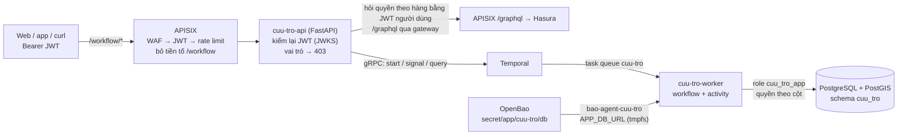

| Thành phần | Gọi lõi thế nào | Vì sao |
|---|---|---|
| Client → API | Chỉ qua APISIX `/workflow/*` (JWT + WAF + rate limit). API không mở cổng ra máy host | Tầng 2 chỉ gọi lõi qua gateway (D-008) |
| API kiểm vai trò | Kiểm lại chữ ký JWT bằng JWKS Keycloak (như Hasura), đọc `x-hasura-allowed-roles`: chỉ `dieu-phoi` khởi chạy phân công | Zero-Trust: cổng nội bộ của API không tin request chỉ vì đến từ mạng Docker |
| API kiểm quyền theo hàng | Hỏi `incidents_by_pk` qua gateway `/graphql` bằng **JWT của người dùng** (`X-Hasura-Role: cuu-ho`); `null` = không phải đội được gán → 403 | Không viết lại luật lọc theo đội: dùng đúng luật trong Hasura metadata (#26) |
| API → Temporal | gRPC nội bộ `temporal:7233` (start, signal, query, describe) | Temporal không có giao thức HTTP cho client; gRPC không qua APISIX. Temporal UI vẫn chỉ cho admin |
| Worker → PostgreSQL | Role `cuu_tro_app`: `SELECT` vài cột của `incidents`, `rescue_teams`; `UPDATE` chỉ `status`, `assigned_team_id`; không `INSERT/DELETE`, không đọc SĐT người báo, giới hạn 10 kết nối (migration `0003`, kiểm bằng `make test-db`) | Worker là dịch vụ nền tin cậy của ứng dụng, không có người dùng; không dùng token `dieu-phoi` của người dùng, không dùng admin secret Hasura |
| Worker → bí mật | `bao-agent-cuu-tro` (AppRole `app-cuu-tro-workflow`, chỉ đọc `secret/app/cuu-tro/db`) render `APP_DB_URL` lên tmpfs, `env-from-files.sh` export | Cùng mẫu với dịch vụ lõi (mục 8.3) |
| Worker → hàng đợi phân công (#67) | Cùng role `cuu_tro_app`: `SELECT` + `UPDATE` vài cột `assignment_queue`, `SELECT`/`INSERT` + `UPDATE` cột kết quả `incident_assignments`, không `DELETE` (migration `0007`); `LISTEN cuu_tro_tin_moi`. Trigger ghi outbox chạy `SECURITY DEFINER` nên role `hasura` không cần quyền trên hàng đợi | Mục 6.1 |
| Worker → NATS (#67) | User `cuu-tro-app` (`NATS_URL` từ OpenBao), chỉ phát `cuu-tro.dieu-phoi.>`; worker khai báo stream theo `apps/cuu-tro/nats/streams.json` khi khởi động | Báo điều phối khi hết lần giao / không có đội / quá hạn xác nhận |

Điểm lõi biết về ứng dụng chỉ là **quy ước tên** suy ra từ `DXOS_APP`: role `<schema>_app`, bí mật `secret/app/<DXOS_APP>/db`, policy `apps/<DXOS_APP>/openbao/policies/`, upstream `<DXOS_APP>-api:8000`. Lõi chạy một mình (không bật profile `app`) thì `/workflow/*` trả 502/503, các route khác không ảnh hưởng. Sơ đồ workflow `PhanCongCuuHo` và API: `apps/cuu-tro/README.md` mục "Workflow".

Vì sao `include` thay vì khai báo dịch vụ ứng dụng trong `docker-compose.yml` hay dùng `COMPOSE_FILE`: (1) file lõi không chứa tên nghiệp vụ; (2) `include` nằm trong file, không phụ thuộc `.env` của từng máy, `docker compose config` và job CI `build-from-source` tự thấy dịch vụ ứng dụng; (3) dịch vụ ứng dụng vẫn `depends_on` được dịch vụ lõi (Temporal, `migrate`, OpenBao).

### 7.4. Luồng IT/OT: cảm biến → NATS → dữ liệu nghiệp vụ (#30, nguyên lý B2)

Nguyên lý B2 của đề là hội tụ IT/OT: dữ liệu thiết bị hiện trường (OT, ở đây là trạm đo mực nước) đi vào cùng nền tảng với quy trình nghiệp vụ (IT), thành bản sao số thời gian thực. Lõi cung cấp **đường vào** chung cho thiết bị; ứng dụng quyết định ý nghĩa của dữ liệu.

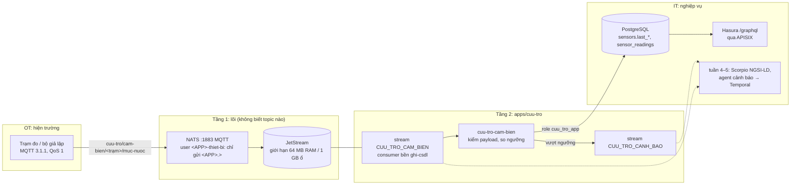

| Quyết định | Cách làm | Vì sao |
|---|---|---|
| Thiết bị nói MQTT, backend nói NATS | NATS bật MQTT trong cùng tiến trình; topic `a/b/c` là subject `a.b.c` | Thiết bị IoT phổ biến dùng MQTT; backend dùng JetStream (lưu bền, consumer bền, ack, giao lại). Một broker, không thêm Mosquitto/EMQX |
| Bắt buộc xác thực | `auth.conf` (render từ OpenBao) có 2 user theo quy ước `<DXOS_APP>-app`, `<DXOS_APP>-thiet-bi`; không `no_auth_user` | Không cho thiết bị lạ gửi dữ liệu giả hay đọc trộm. `allowed_connection_types` tách hẳn: mật khẩu thiết bị lộ cũng không dùng được ở cổng NATS thường, và ngược lại |
| Phạm vi subject theo ứng dụng | Thiết bị chỉ `publish` vào `<DXOS_APP>.>`, không `subscribe`; backend pub/sub `<DXOS_APP>.>`, gọi `$JS.API.>` | Lõi chỉ biết tên ứng dụng (như role `<schema>_app`, mục 7.3), không biết "cảm biến" hay "mực nước" |
| Ứng dụng tự khai báo stream | `apps/cuu-tro/nats/streams.json`, consumer tạo/cập nhật khi khởi động | Đổi giới hạn lưu trữ, thêm stream không cần sửa lõi |
| Ghi dữ liệu nghiệp vụ một chiều | Consumer dùng role `cuu_tro_app`: `INSERT` chuỗi đo, `UPDATE` đúng 2 cột `last_*` (migration 0004); người dùng chỉ đọc qua `/graphql` | Dữ liệu đo không đi qua quyền người dùng; điều phối chỉnh ngưỡng, không sửa số đo |
| Cảnh báo là sự kiện | Mức tăng lên `canh_bao`/`nguy_hiem` → subject `cuu-tro.canh-bao.cam-bien.<trạm>` (stream lưu 30 ngày, `Nats-Msg-Id` chống trùng) | Tách nguồn phát hiện khỏi kênh thông báo: agent cảnh báo (tuần 4–5) và Temporal tiêu thụ sau, không chặn đường ghi |
| Chưa TLS | Cổng MQTT mặc định chỉ `127.0.0.1` (`NATS_MQTT_BIND`) | Thiết bị thật qua Internet cần TLS + chứng chỉ (việc sau); mật khẩu NATS đang ở dạng rõ trong file tmpfs, bcrypt/nkey là việc sau |

Bản sao số đầy đủ (NGSI-LD trên Scorpio, D-004) nối vào ở tuần 4 bằng một consumer thứ hai trên cùng stream `CUU_TRO_CAM_BIEN`, cập nhật thực thể theo `sensors.ngsi_ld_id`; thiết bị, topic và consumer ghi CSDL giữ nguyên. Chi tiết topic, payload, cách chạy bộ giả lập: `apps/cuu-tro/README.md` mục "Cảm biến mực nước".

### 7.5. Dữ liệu phi cấu trúc: ảnh hiện trường (#27)

Lõi cung cấp kho đối tượng S3 (SeaweedFS) và hai quy ước; ứng dụng quyết định lưu gì, ai được xem.

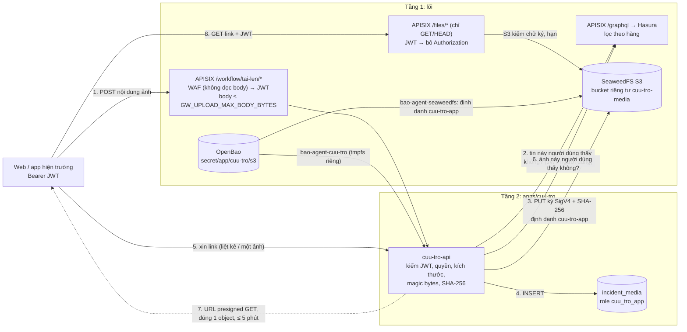

| Quyết định | Cách làm | Vì sao |
|---|---|---|
| Client không cầm khóa S3 | Khóa ứng dụng chỉ nằm trong tiến trình `cuu-tro-api` (volume tmpfs `secrets-cuu-tro-api`); khóa quản trị `secret/core/s3` không cấp cho ứng dụng | Khóa trên thiết bị người dùng là khóa đã lộ |
| Tải lên qua API (không presigned PUT) | API đọc body có giới hạn, nhận dạng loại bằng magic bytes (không tin `Content-Type`/đuôi), tính SHA-256, ghi S3 ký kèm SHA-256 (S3 tính lại), rồi `INSERT` | Kiểm nội dung bắt buộc phải thấy nội dung; presigned PUT để S3 nhận bất cứ gì client gửi. Một chỗ ghi duy nhất để gắn ClamAV sau |
| Xem bằng presigned GET qua `/files/*` | API kiểm quyền theo hàng (Hasura bằng JWT người dùng) rồi ký URL cho đúng một key, phương thức GET, hạn ngắn | Byte ảnh không đi qua API. Quyền theo object = chữ ký: gateway chỉ biết "đã đăng nhập", S3 chỉ biết "chữ ký hợp lệ, còn hạn, đúng key"; chỉ API ký được và chỉ ký sau khi kiểm quyền. Link lộ vẫn cần JWT và hết hạn nhanh |
| `/files/*` chỉ đọc | Route chỉ `GET`/`HEAD`/`OPTIONS`; PUT/DELETE → 404 ở gateway | Không có đường ghi/xóa S3 từ ngoài, kể cả khi có ai đó ký được URL PUT |
| Phạm vi khóa ứng dụng | Định danh `<DXOS_APP>-app` trên SeaweedFS: `Read/Write/List:<DXOS_APP>-*`, không `Admin` | Lộ khóa ứng dụng không đọc được bucket khác, không tạo/xóa bucket, không đổi chính sách |
| Bucket do ứng dụng khai báo | `apps/<DXOS_APP>/s3/buckets.conf`; container một lần `s3-buckets` (image SeaweedFS, `weed shell`) tạo bucket còn thiếu mỗi lần `make up`, từ chối tên không có tiền tố `<DXOS_APP>-` | Lõi không biết tên bucket nghiệp vụ (giống migration SQL, metadata Hasura, stream NATS) |
| Bucket riêng tư | SeaweedFS không có định danh nặc danh: request không ký → 403 | Không cần chính sách bucket riêng: mặc định là đóng |
| Siêu dữ liệu tách nội dung | Bảng `incident_media` (khóa object, loại, kích thước, SHA-256, người tải, vai trò, thời điểm, `scan_status`); GraphQL chỉ cho đọc | Không ai tự tạo được dòng trỏ tới object tùy ý; truy vấn/thống kê ảnh bằng GraphQL như dữ liệu khác |

API ghi S3 thẳng `seaweedfs:8333` trong mạng nội bộ, giống worker gọi Temporal/PostgreSQL thẳng (mục 7.3): đó là dịch vụ nền của ứng dụng, có định danh riêng, không dùng quyền người dùng. Mọi thứ người dùng gọi vẫn qua APISIX. Chi tiết API, bảng quyền: `apps/cuu-tro/README.md` mục "Ảnh hiện trường".

## 8. Quản lý bí mật: OpenBao (#14)

OpenBao 2.7.1 (MPL-2.0, nhánh nguồn mở của Vault) chạy như dịch vụ riêng bằng image gốc trong profile `core`, **chế độ server** (không `-dev`): lưu trữ raft trên volume `baodata`, tắt UI (Tầng 1 headless), chỉ mở cổng `127.0.0.1:8200`. Cấu hình: `core/openbao/openbao.hcl`. TLS tắt trên laptop; bật khi lên VPS (tuần 4).

### 8.1. Bí mật nằm ở đâu

| Đường dẫn KV v2 | Khóa | Dùng bởi | Trạng thái |
|---|---|---|---|
| `secret/core/postgres` | `password` | Superuser PostgreSQL: `initdb` lần đầu và `postgres-roles`. Không dịch vụ nào kết nối bằng superuser | ✔ (#11) |
| `secret/core/keycloak-db` | `password` | Keycloak (`KC_DB_PASSWORD`), `postgres-roles` (role `keycloak`) | ✔ (#14) |
| `secret/core/keycloak-admin` | `password` | Keycloak (`KC_BOOTSTRAP_ADMIN_PASSWORD`, chỉ khi tạo CSDL lần đầu) | ✔ (#14) |
| `secret/core/gateway` | `client_secret` | APISIX (`$env://KC_GATEWAY_CLIENT_SECRET`), Keycloak (realm import) | ✔ (#14) |
| `secret/core/hasura-db` | `password` | Hasura (`HASURA_GRAPHQL_DATABASE_URL` do agent ghép), `postgres-roles` (role `hasura`) | ✔ (#11) |
| `secret/core/hasura` | `admin_secret` | Hasura (`HASURA_GRAPHQL_ADMIN_SECRET`) | ✔ (#11) |
| `secret/core/temporal-db` | `password` | Temporal (`POSTGRES_PWD`), `postgres-roles` (role `temporal`) | ✔ (#11) |
| `secret/core/s3` | `access_key`, `secret_key` | SeaweedFS (`-s3.config` do agent render) | ✔ (#11) |
| `secret/core/ledger` | `signing_key`, `verifier_key` | `core/ledger` (khóa ký checkpoint Ed25519 dạng note, D-007); `scripts/openbao-init.sh` sinh một lần. `verifier_key` là khóa công khai, chỉ để tra cứu | ✔ (#28) |
| `secret/app/<DXOS_APP>/ledger` | `write_token` | `core/ledger` (file `writers`: dịch vụ được ghi) và `cuu-tro-api` (`LEDGER_WRITE_TOKEN`) | ✔ (#28) |
| `secret/app/<DXOS_APP>/s3` | `access_key`, `secret_key` | SeaweedFS (định danh `<DXOS_APP>-app`, chỉ bucket `<DXOS_APP>-*`, không Admin); `bao-agent-cuu-tro` render `S3_ACCESS_KEY`, `S3_SECRET_KEY` chỉ cho `cuu-tro-api` | ✔ (#27) |
| `secret/app/<DXOS_APP>/nats` | `app_password`, `device_password` | NATS (`auth.conf` do `bao-agent-nats` render): user `<DXOS_APP>-app` (backend, cổng NATS thường) và `<DXOS_APP>-thiet-bi` (thiết bị, chỉ MQTT); `bao-agent-cuu-tro` render `NATS_URL`, `MQTT_PASSWORD` cho ứng dụng | ✔ (#30) |
| `secret/app/<DXOS_APP>/realtime` | `token_hmac_secret`, `api_key` | Centrifugo (`client.token.hmac_secret_key`, `http_api.key` trong file cấu hình do `bao-agent-centrifugo` render); `bao-agent-cuu-tro` render `REALTIME_TOKEN_SECRET` cho `cuu-tro-api` (ký token kết nối) và `CENTRIFUGO_API_KEY` cho cầu nối `cuu-tro-thong-bao` | ✔ (#68) |

`.env` không còn bí mật của dịch vụ lõi. `KC_DEMO_USER_PASSWORD` là mật khẩu của user mẫu (dữ liệu giả của `apps/cuu-tro`, dùng cho `make smoke`), không phải bí mật của dịch vụ lõi.

**Superuser PostgreSQL** chỉ có tác dụng ở lần `initdb` đầu (volume `pgdata` trống): image `postgis/postgis` đặt mật khẩu superuser theo `POSTGRES_PASSWORD` lúc đó, về sau đổi giá trị trong OpenBao **không** đổi mật khẩu trong CSDL. Muốn đổi: `ALTER ROLE` bằng superuser rồi `bao kv put secret/core/postgres` cùng giá trị. Mật khẩu role `keycloak`, `hasura`, `temporal` thì khác: `postgres-roles` chạy `ALTER ROLE ... PASSWORD` mỗi lần `make up`, nên chỉ cần đổi trong OpenBao rồi `make up`.

### 8.1a. Role PostgreSQL của từng dịch vụ (#11)

Container một lần `postgres-roles` (image postgis có sẵn, script `core/postgres/sync-roles.sh`) chạy sau khi `postgres` healthy và trước Keycloak, Hasura, Temporal; chạy lại bao nhiêu lần cũng được:

| Role | Quyền | Ghi chú |
|---|---|---|
| `keycloak` | Chủ CSDL `keycloak` | Tạo lần đầu bởi `core/postgres/init/20-create-databases.sh` |
| `hasura` | Chủ schema `hdb_catalog` (metadata); `CONNECT, CREATE, TEMPORARY` trên CSDL `disaster`; `USAGE, CREATE` trên `public`; đọc `information_schema`, `pg_catalog`, `spatial_ref_sys` | Quyền tối thiểu theo tài liệu Hasura. Migration ứng dụng không chạy bằng role này (mục 7.1, #25): trên schema ứng dụng `hasura` chỉ có quyền DML. Bảng `hdb_catalog` có sẵn từ trước thì chuyển chủ sở hữu |
| `temporal` | Chủ CSDL `temporal`, `temporal_visibility` (script tạo sẵn) | Không cần `CREATEDB`: Temporal chạy với `SKIP_DB_CREATE=true`, auto-setup chỉ tạo schema |
| `<schema>_app` (`cuu_tro_app`) | `LOGIN`, `CONNECTION LIMIT 10`, lúc tạo **không có quyền gì** trên schema ứng dụng | Role dịch vụ cho backend của ứng dụng (#29). Mật khẩu `secret/app/<DXOS_APP>/db`. Migration của ứng dụng tự `GRANT` bảng/cột cần (mục 7.3) |

Không role nào là superuser hay có `CREATEROLE`. `make smoke` kiểm Hasura kết nối bằng `hasura` (`rolsuper = false`) và 2 CSDL Temporal thuộc `temporal`.

### 8.2. Policy và AppRole

Mỗi dịch vụ một AppRole, mỗi AppRole một policy **chỉ đọc** đúng đường dẫn nó cần (`core/openbao/policies/<dịch vụ>.hcl` → policy `core-<dịch vụ>`; policy nằm trong git, GitOps):

| AppRole | Policy | Đọc được |
|---|---|---|
| `keycloak` | `core-keycloak` | `core/keycloak-db`, `core/keycloak-admin`, `core/gateway` (#11: thôi render cho PostgreSQL) |
| `apisix` | `core-apisix` | `core/gateway` |
| `postgres` | `core-postgres` | `core/postgres`, `core/keycloak-db`, `core/hasura-db`, `core/temporal-db`, `app/+/db` (#29) |
| `hasura` | `core-hasura` | `core/hasura-db`, `core/hasura` |
| `temporal` | `core-temporal` | `core/temporal-db` |
| `seaweedfs` | `core-seaweedfs` | `core/s3`, `app/+/s3` (#27) |
| `ledger` | `core-ledger` | `core/ledger`, `app/+/ledger` (#28) |
| `nats` | `core-nats` | `app/+/nats` (#30) |
| `centrifugo` | `core-centrifugo` | `app/+/realtime` (#68) |
| `app-cuu-tro-workflow` | `app-cuu-tro-workflow` (`apps/cuu-tro/openbao/policies/workflow.hcl`) | `app/cuu-tro/db` (#29), `app/cuu-tro/nats` (#30), `app/cuu-tro/s3` (#27), `app/cuu-tro/ledger` (#28), `app/cuu-tro/realtime` (#68). Không đọc được `core/ledger` (khóa ký) |

`core-postgres` đọc thêm `app/+/db` (một đoạn đường dẫn bất kỳ) để `postgres-roles` đồng bộ mật khẩu role `<schema>_app` của ứng dụng đang chọn.

Token AppRole sống 1 giờ (tối đa 24 giờ), agent tự gia hạn hoặc đăng nhập lại. `secret_id` không hết hạn: chỉ chấp nhận trên máy dev; trên VPS cấp `secret_id` có hạn/giới hạn số lần dùng. `make smoke` kiểm AppRole `apisix` đọc được `core/gateway` nhưng bị từ chối (403) với `core/keycloak-db` và `core/s3`.

### 8.3. Dịch vụ nhận bí mật thế nào

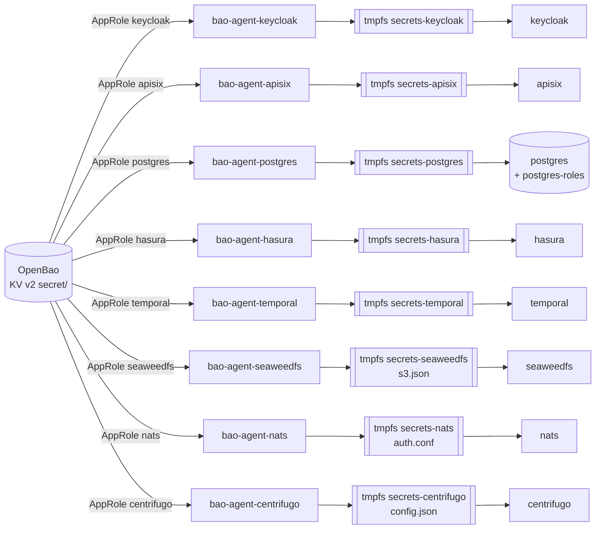

- Mỗi dịch vụ đọc bí mật có một `bao agent` riêng (`core/openbao/agent-<dịch vụ>.hcl`), đăng nhập bằng `role_id`/`secret_id` của AppRole tương ứng, render mỗi bí mật thành một file trên volume **tmpfs** (nằm trong RAM, mất khi dừng). Agent đọc lại KV mỗi 5 phút.
- Dịch vụ mount volume đó read-only. `core/openbao/env-from-files.sh` bọc lệnh khởi động gốc: chờ đủ file (`SECRETS_REQUIRED`), export mỗi file thành một biến (tên file = tên biến), rồi `exec` entrypoint gốc của image. Image vẫn là image gốc, không sửa.
- Hasura cần chuỗi kết nối chứa mật khẩu: agent ghép `HASURA_GRAPHQL_DATABASE_URL` từ `secret/core/hasura-db` và biến `HASURA_DB_USER`, `POSTGRES_DB` của agent. SeaweedFS đọc file định danh S3 (`s3.json`, cờ `-s3.config`) thay vì biến môi trường.
- Kết quả: `docker compose config` và `docker inspect` không còn chứa các bí mật đã chuyển; chúng chỉ có trong môi trường của tiến trình dịch vụ (hoặc file trên tmpfs với SeaweedFS).
- Đổi một bí mật: `bao kv put` giá trị mới → agent render lại trong ≤ 5 phút → khởi động lại dịch vụ (`docker compose restart keycloak`). Mật khẩu DB còn phải `ALTER ROLE` trong PostgreSQL; secret client còn phải đổi trong Keycloak (realm chỉ import lần đầu).

### 8.4. Khởi tạo và mở khóa

```mermaid
sequenceDiagram
  autonumber
  participant M as make up
  participant B as OpenBao
  participant S as scripts/openbao-init.sh
  participant A as bao agent
  participant D as postgres / keycloak / apisix
  M->>B: up -d openbao (sealed)
  M->>S: chạy script (idempotent)
  S->>B: chưa init? → sys/init (Shamir 3 mảnh, ngưỡng 2)
  S->>S: ghi unseal key, root token vào .data/openbao/ (ngoài git)
  S->>B: sys/unseal (2 key)
  S->>B: bật KV v2 secret/, nạp bí mật còn thiếu (cas=0, không ghi đè)
  S->>B: ghi policy, AppRole; lưu role_id/secret_id vào .data/openbao/approle/
  M->>A: up -d (chờ OpenBao healthy = đã mở khóa)
  A->>B: đăng nhập AppRole, đọc KV
  A->>D: render file trên tmpfs
  D->>D: env-from-files.sh → entrypoint gốc
```

- **Lần đầu:** `cp .env.example .env && make up`. Script sinh ngẫu nhiên mọi bí mật lõi (`openssl rand`), kể cả mật khẩu superuser PostgreSQL. Đã chạy thử từ volume trống (project compose riêng) 19/10/2026: `make up` + `make smoke` 41/41.
- **Nâng cấp từ bản cũ có volume `pgdata`:** để nguyên các biến cũ trong `.env` cho lần chạy đầu: trước #14 là `KEYCLOAK_DB_PASSWORD`, `KC_BOOTSTRAP_ADMIN_PASSWORD`, `KC_GATEWAY_CLIENT_SECRET`; trước #11 là `POSTGRES_PASSWORD` (bắt buộc, vì superuser trong `pgdata` đã đặt bằng giá trị này) và `HASURA_GRAPHQL_ADMIN_SECRET`. Script nạp đúng giá trị đó vào OpenBao (chỉ khi đường dẫn chưa có), sau đó xóa chúng khỏi `.env`. CSDL `temporal`/`temporal_visibility` cũ do superuser tạo: `postgres-roles` chuyển chủ CSDL cho `temporal`, nhưng bảng bên trong vẫn thuộc superuser; với dữ liệu dev thì xóa 2 CSDL đó để Temporal tạo lại.
- **Chạy lại:** `make up`/`make bao-init` bao nhiêu lần cũng được: chỉ tạo phần còn thiếu, không đổi key, bí mật hay `secret_id` đã có. Ghi KV dùng `cas=0` nên không bao giờ ghi đè.
- **Sau khi khởi động lại** (reboot, `make down` rồi `docker compose up`): OpenBao luôn khởi động ở trạng thái **sealed**, healthcheck báo unhealthy, các dịch vụ phụ thuộc chờ.
  - Dev: container `openbao-unseal` (`core/openbao/dev-auto-unseal.sh`) tự mở khóa bằng key trong `.data/openbao/unseal/` khi `OPENBAO_DEV_AUTO_UNSEAL=true`. **Chỉ dùng cho dev:** key nằm cùng máy với dữ liệu thì seal mất tác dụng.
  - VPS/production: đặt `OPENBAO_DEV_AUTO_UNSEAL=false`, mở khóa thủ công `make bao-unseal` (hoặc `docker compose exec openbao bao operator unseal` nhập từng mảnh key do người giữ khác nhau cầm), về sau dùng auto-unseal bằng KMS/transit.
- **Thư mục `.data/openbao/`** (đổi bằng `OPENBAO_LOCAL_DIR`): `init.json`, `unseal/unseal.keys`, `root.token`, `approle/<dịch vụ>/`. Đã nằm trong `.gitignore`. Mất thư mục này thì không mở khóa được volume `baodata`. Root token chỉ dùng quản trị trên máy dev; khi triển khai thật: thu hồi root token sau khi cấu hình, cần lại thì `bao operator generate-root`.
- **Kiểm tra:** `make bao-status`, `make smoke` (`scripts/smoke-openbao.sh`: không phải dev/raft, đã mở khóa, phân quyền AppRole, APISIX và Keycloak đang chạy bằng đúng bí mật trong OpenBao, compose không truyền bí mật qua `environment`).

- `scripts/smoke-core.sh` (#11, cũng trong `make smoke`): Hasura dùng admin secret từ OpenBao và role DB riêng; SeaweedFS chạy bằng khóa S3 từ OpenBao (so băm), ký SigV4 bằng khóa đó tạo bucket/ghi/đọc/xóa được, khóa sai → 403; compose không truyền mật khẩu DB, admin secret, khóa S3.

Việc còn lại: quyền S3 theo bucket và dịch vụ cấp URL presigned cho ứng dụng (#27); `secret_id` có hạn và TLS khi lên VPS (tuần 4).
