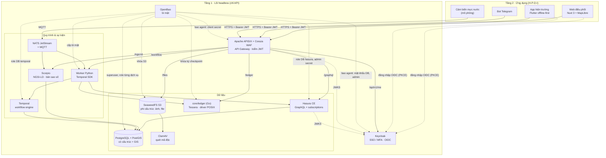
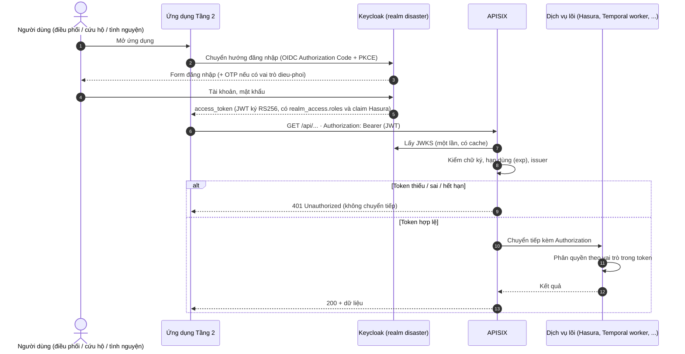
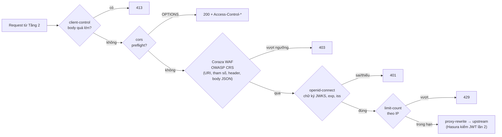
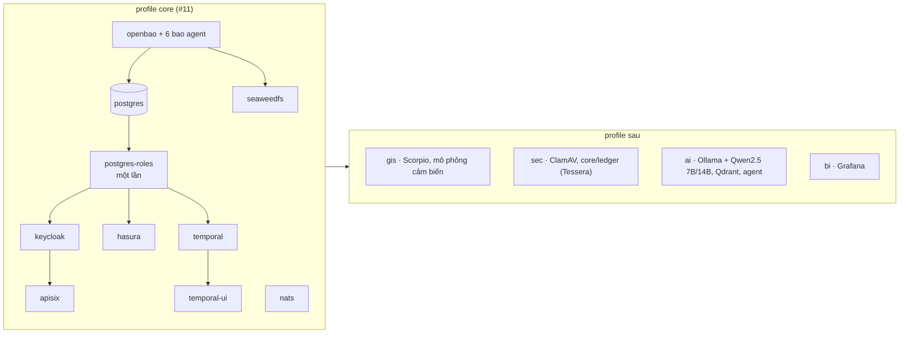
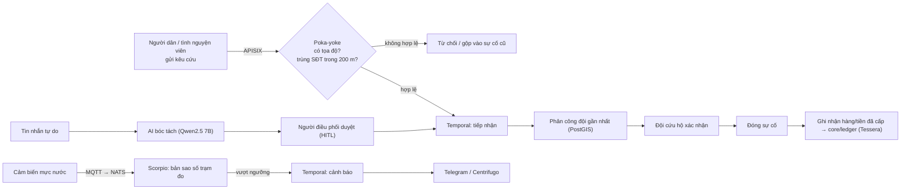
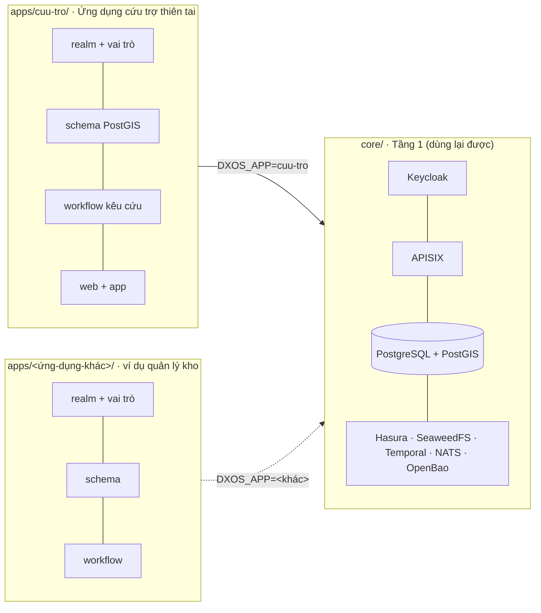
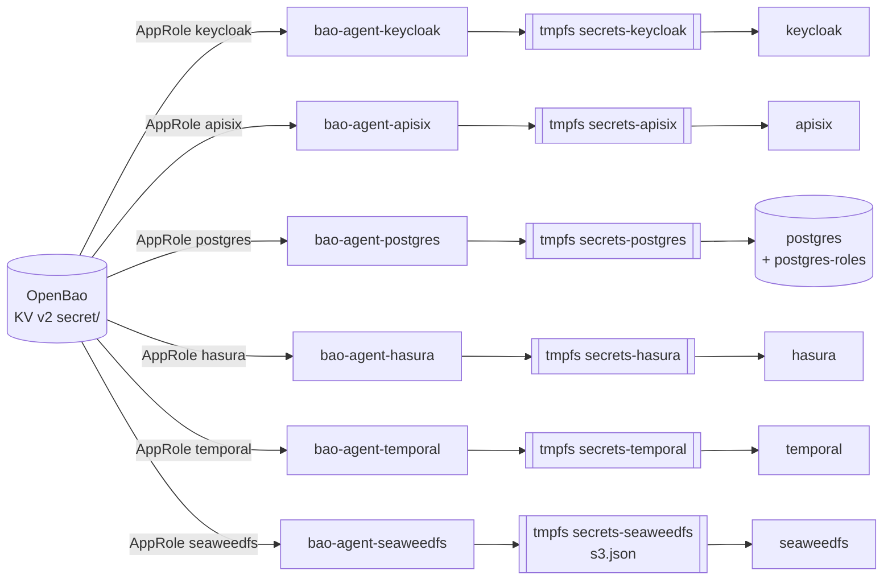

# Kiến trúc Disaster DX-OS

> Phiên bản tài liệu: v0.0.1 + #14, #11 (cập nhật 19/10/2026). Giấy phép từng thành phần: `NOTICE`, `DEPENDENCIES.md`.

Disaster DX-OS gồm hai tầng, đúng mô hình Open-Core của đề:

- **Tầng 1 – lõi headless** (thư mục `core/`): chỉ có API, không có giao diện cho người dùng cuối. Giao diện quản trị của dịch vụ lõi (Keycloak Admin, Temporal UI) chỉ dành cho quản trị viên, đặt sau xác thực, không mở ra cổng công khai. Mọi dịch vụ chạy bằng image Docker gốc, cấu hình bằng file trong `core/` và biến trong `.env`; bí mật của dịch vụ lõi nằm trong OpenBao, không nằm trong `.env` (mục 8). Lõi **không chứa nghiệp vụ thiên tai** (xem mục 7).
- **Tầng 2 – ứng dụng** (thư mục `apps/<tên>/`, hiện có `apps/cuu-tro/`): realm và vai trò, schema, workflow, dữ liệu mẫu, web điều phối, app hiện trường, bot thông báo. Tầng 2 **chỉ** gọi lõi qua API Gateway (APISIX), không kết nối thẳng CSDL, kho file hay workflow.

## 1. Sơ đồ tổng thể



Đường liền: luồng dữ liệu. Đường đứt: xác thực, khóa và bí mật.
Hiện profile `core` có `openbao` (+ 6 bao agent), `postgres` (+ `postgres-roles`), `keycloak`, `apisix`, `hasura`, `seaweedfs`, `temporal` (+ `temporal-ui`), `nats` (#11) và route gateway `/graphql`, `/files/*`, `/workflow/*`, `/api/v1/me` sau Coraza WAF (#12, mục 3.3); các thành phần còn lại tuần 3–5 (xem `docs/PLAN.md`).

## 2. Ánh xạ 4 dịch vụ bắt buộc của đề

| Dịch vụ bắt buộc | Thành phần | Vai trò cụ thể | File cấu hình | Trạng thái |
|---|---|---|---|---|
| Identity / SSO (+MFA) | **Keycloak 26.8.1** | Realm `disaster`, OIDC, 3 vai trò `dieu-phoi`, `cuu-ho`, `tinh-nguyen`, client cho gateway, web và CLI dev. Claim `https://hasura.io/jwt/claims` cho Hasura; OTP bắt buộc với vai trò `dieu-phoi` (#13) | `apps/cuu-tro/keycloak/realm.json` (vai trò, client của ứng dụng) | Chạy được (v0.0.1) |
| API Gateway | **Apache APISIX 3.19** + **Coraza WAF** (coraza-proxy-wasm 0.6.0, OWASP CRS 4.14) | Điểm vào duy nhất của Tầng 2: `/graphql` → Hasura, `/files/*` → SeaweedFS S3, `/workflow/*` → API workflow (giữ chỗ, #29). WAF chặn ở biên, kiểm chữ ký JWT bằng JWKS của Keycloak, rate limit theo IP, CORS, gắn request-id. Chế độ standalone: route nằm trong git (GitOps) | `core/apisix/config.yaml`, `core/apisix/apisix.yaml`, `core/apisix/Dockerfile` | Chạy trong `core` (#12, mục 3.3) |
| Dữ liệu có cấu trúc | **PostgreSQL 17 + PostGIS 3.5**, **Hasura CE v2.51** | Sự cố, đội cứu hộ, điểm trú ẩn, kho hàng, cảm biến (có tọa độ). Hasura tự sinh GraphQL + subscription, phân quyền theo claim vai trò trong JWT | `docker-compose.yml` (`postgres`, `postgres-roles`, `hasura`), `core/postgres/sync-roles.sh` | Chạy trong `core` (#11); schema nghiệp vụ ở #25, #26 |
| Dữ liệu phi cấu trúc | **SeaweedFS 4.48** (S3) + ClamAV | Ảnh hiện trường, tệp đính kèm, file Parquet lịch sử. File tải lên được ClamAV quét trước khi công bố | `docker-compose.yml` (`seaweedfs`), `core/openbao/agent-seaweedfs.hcl` | S3 chạy trong `core`, khóa từ OpenBao (#11); ClamAV sau |
| Workflow engine | **Temporal 1.29** + Python SDK | Quy trình kêu cứu: tiếp nhận → phân công đội gần nhất → xác nhận → đóng. Cảnh báo vượt ngưỡng → thông báo | `docker-compose.yml` (`temporal`, `temporal-ui`) | Chạy trong `core` (#11); worker ở #29 |

Thành phần hỗ trợ: OpenBao (bí mật, chạy chế độ server trong profile `core` – mục 8), NATS JetStream + MQTT (sự kiện, IoT), Scorpio (NGSI-LD, bản sao số trạm đo), sổ cái minh bạch `core/ledger` (transparency log Tessera, D-007) cho tiền/hàng cứu trợ.

## 3. Luồng xác thực JWT



Chi tiết cấu hình:

- Keycloak đặt `KC_HOSTNAME=${KEYCLOAK_PUBLIC_URL}` nên `iss` của token luôn là URL công khai, dù token lấy từ đâu. `KC_HOSTNAME_BACKCHANNEL_DYNAMIC=true` cho phép APISIX và Hasura tải JWKS qua mạng nội bộ `http://keycloak:8080`.
- APISIX dùng plugin `openid-connect` với `bearer_only: true`, `use_jwks: true`: kiểm token tại gateway, không gọi introspection mỗi request. Secret của client `dxos-gateway` lấy từ biến môi trường qua `$env://KC_GATEWAY_CLIENT_SECRET`, không ghi trong file; biến này do `bao agent` đọc từ OpenBao (`secret/core/gateway`), không nằm trong `.env` (mục 8).
- Hasura kiểm lại cùng JWT bằng `HASURA_GRAPHQL_JWT_SECRET` (`jwk_url` nội bộ + `issuer` công khai, không `claims_map`), nên dịch vụ phía sau vẫn tự kiểm tra (Zero-Trust, không tin mù gateway). `make smoke` kiểm: token Keycloak → truy vấn được; token giả → `invalid-jwt`; xin `X-Hasura-Role: admin` ngoài `x-hasura-allowed-roles` → `access-denied`.
- Client `dxos-dev-cli` (cho phép lấy token bằng mật khẩu) **chỉ dùng khi dev** để chạy `scripts/smoke-jwt.sh`. Phải xóa trước khi triển khai công khai.

### 3.1. Claim vai trò cho Hasura (#13)

Client `dxos-web` và `dxos-dev-cli` có 3 protocol mapper có sẵn của Keycloak (không viết SPI), sinh claim JSON lồng nhau trong access token:

```json
"https://hasura.io/jwt/claims": {
  "x-hasura-default-role": "dieu-phoi",
  "x-hasura-allowed-roles": ["offline_access", "dieu-phoi", "uma_authorization", "default-roles-disaster"],
  "x-hasura-user-id": "<sub>"
}
```

| Claim | Mapper | Nguồn |
|---|---|---|
| `x-hasura-allowed-roles` | `oidc-usermodel-realm-role-mapper` (multivalued) | Mọi vai trò realm hiệu lực của user. Vai trò không có quyền trong Hasura (`offline_access`, ...) vô hại |
| `x-hasura-default-role` | `oidc-usermodel-attribute-mapper` | Thuộc tính user `hasura_default_role` |
| `x-hasura-user-id` | `oidc-usermodel-property-mapper` (`id`) | Trùng `sub` |

- Tên claim có dấu chấm thì Keycloak tách thành JSON lồng nhau; dấu chấm trong `hasura.io` được thoát bằng `\.` (trong JSON viết `https://hasura\\.io/jwt/claims.x-hasura-default-role`).
- **Vì sao không dùng `realm_access.roles[0]`:** thứ tự mảng không cố định. Đo thật 19/10/2026: `roles[0]` của `dieuphoi01` là `offline_access`, của `cuuho01` là `cuu-ho`. Vai trò mặc định nay lấy từ thuộc tính `hasura_default_role`, khai báo trong user profile của realm (chỉ admin xem/sửa, giá trị chỉ được là `dieu-phoi`, `cuu-ho`, `tinh-nguyen`). Tạo user mới phải đặt thuộc tính này; thiếu thì token không có `x-hasura-default-role` và Hasura từ chối.
- Hasura đọc mặc định namespace `https://hasura.io/jwt/claims`, nên `HASURA_GRAPHQL_JWT_SECRET` không có `claims_map` (#11).

### 3.2. MFA: OTP bắt buộc cho `dieu-phoi` (#13)

Realm dùng flow trình duyệt riêng `browser-otp-dieu-phoi` (khai báo trong `realm.json`, import lại được từ máy sạch):

```
browser-otp-dieu-phoi
├─ Cookie                                  ALTERNATIVE
└─ forms                                   ALTERNATIVE
   ├─ Username Password Form               REQUIRED
   └─ otp                                  CONDITIONAL
      ├─ Condition - user role = dieu-phoi REQUIRED
      └─ OTP Form                          REQUIRED
```

- User có vai trò `dieu-phoi` phải nhập OTP; chưa cài thì Keycloak chuyển sang trang cài ứng dụng xác thực (required action `CONFIGURE_TOTP`). `cuu-ho`, `tinh-nguyen` không bị hỏi. Điều kiện theo vai trò nên áp cho cả user `dieu-phoi` tạo sau này, không chỉ user mẫu.
- Không đặt sẵn `requiredActions: ["CONFIGURE_TOTP"]` cho user mẫu: làm vậy thì lấy token bằng mật khẩu (`dxos-dev-cli`) bị chặn "Account is not fully set up" và `make smoke` hỏng.
- Flow `direct grant` giữ mặc định: chỉ hỏi OTP khi user đã cài. Vì vậy `dxos-dev-cli` vẫn lấy được token của `dieuphoi01` chưa cài OTP; đây là lý do thêm để xóa client này trước khi triển khai công khai.

Kiểm thử: `make up && bash scripts/smoke-jwt.sh` (không token → 401, token giả → 401, token Keycloak → 200, claim Hasura đúng cho 3 user mẫu, đăng nhập web `dieuphoi01` bị bắt cài OTP còn `cuuho01` thì không).

### 3.3. Route API Gateway, WAF, rate limit (#12)

Tầng 2 chỉ thấy cổng `9080` của APISIX. Hasura (`8081`), SeaweedFS S3 (`8333`), Temporal (`7233`) chỉ mở trên `127.0.0.1` cho quản trị và smoke test. Route khai báo trong `core/apisix/apisix.yaml`:

| Route | Phương thức | Upstream | JWT | WAF (Coraza + CRS) | Giới hạn | Ghi chú |
|---|---|---|---|---|---|---|
| `/graphql` | GET, POST, OPTIONS (+ WebSocket) | `hasura:8080/v1/graphql` | Bắt buộc, chuyển nguyên token cho Hasura kiểm lần 2 | Bộ `api`: đọc body JSON | Body 1 MiB; `GW_RATE_LIMIT_COUNT`/`GW_RATE_LIMIT_WINDOW` theo IP (mặc định 300/60 s) | Bỏ header `X-Hasura-Admin-Secret` của client |
| `/v1/*`, `/v2/*`, `/console*` | mọi | không | – | – | – | Luôn 403: `/v1/metadata`, `/v2/query`, console Hasura không ra ngoài |
| `/files/*` | GET, HEAD, PUT, POST, DELETE, OPTIONS | `seaweedfs:8333` (bỏ tiền tố `/files`) | Bắt buộc, rồi **bỏ** header `Authorization` | Bộ `files`: không đọc body, thêm PUT/DELETE và kiểu ảnh/tệp | Body `GW_FILES_MAX_BODY_BYTES` (mặc định 20 MiB, vượt → 413); rate limit như trên | S3 kiểm chữ ký SigV4 dạng presigned (tham số `X-Amz-*`) |
| `/workflow/*` | GET, POST, OPTIONS | **giữ chỗ**: trả 503 + `Retry-After` | Bắt buộc (không token vẫn 401) | Bộ `api` | Body 1 MiB; rate limit như trên | Thay bằng upstream API workflow khi #29 xong |
| `/api/v1/me` | GET, OPTIONS | Keycloak userinfo | Bắt buộc | Bộ `api` | rate limit như trên | Route mẫu v0.0.1 |
| `/healthz` | GET | không (APISIX tự trả) | Không | – | 20 request / 10 s / IP | Healthcheck; smoke dùng để kiểm `limit-count` |

Thứ tự xử lý một request (priority của plugin trong APISIX):



- **WAF ở chế độ chặn.** Image APISIX của đội (`core/apisix/Dockerfile`) = `apache/apisix:3.19.0-debian` + file `coraza-proxy-wasm.wasm` của bản phát hành 0.6.0 (zip tải từ GitHub Release, kiểm SHA-256 lúc build, không chép mã Coraza vào repo). OWASP CRS 4.14 nằm sẵn trong file wasm. Plugin chạy ở pha `rewrite` với priority 7999, trước `openid-connect` (2599): request độc bị chặn 403 trước cả bước kiểm token. Bộ luật: `@recommended-conf` + `SecRuleEngine On` + `@crs-setup-conf` + `@owasp_crs/*.conf`, paranoia 1, chặn theo điểm bất thường (anomaly score).
- **Body cho WAF.** APISIX chỉ đưa body cho plugin wasm khi biến `wasm_process_req_body` được bật, còn coraza-proxy-wasm (viết cho Envoy) không tự bật. Route API có `serverless-pre-function` bật biến này trước Coraza, nên body JSON/GraphQL được kiểm (smoke: XSS trong body, SQLi trong biến GraphQL → 403). Route `/files` cố ý không đọc body (ảnh nhị phân, tránh báo nhầm và tốn RAM); tệp tải lên sẽ do ClamAV quét (#27).
- **Log WAF.** Coraza ghi mỗi luật khớp vào log lỗi APISIX ở mức `emerg` (`docker compose logs apisix | grep Coraza`), kèm id luật CRS để tinh chỉnh khi báo nhầm.
- **`/files` và chữ ký S3.** Header `Authorization` dành cho JWT ở gateway, S3 không nhận được. Client dùng URL presigned (chữ ký trên query string) do dịch vụ của #27 cấp theo quyền người dùng. SeaweedFS tính chữ ký theo `X-Forwarded-Host` APISIX gửi, nên URL được ký cho **host công khai của gateway** (vd `localhost:9080`) với path S3 `/<bucket>/<key>` (không có `/files`). Thiếu JWT → 401; có JWT mà không có chữ ký S3 → 403 từ S3.
- **Rate limit.** `limit-count` chạy ở pha `access`, sau kiểm JWT: request không token bị từ chối 401 ở gateway mà không tới upstream, request có token bị đếm theo IP. Các header `X-RateLimit-Limit/Remaining/Reset` được trả về (và mở cho CORS). Bộ đếm là `local` (mỗi node APISIX một bộ đếm); chạy nhiều node thì chuyển sang `redis`.
- **CORS.** Chỉ origin trong `GW_CORS_ALLOW_ORIGINS` (mặc định `http://localhost:3000`, dev server Nuxt) nhận `Access-Control-Allow-Origin`; origin lạ không có header này nên trình duyệt chặn. Không dùng `*`.
- **Biến môi trường trong route.** APISIX standalone thay `${{TÊN:=mặc định}}` trong `apisix.yaml` khi nạp file (biến phải khai báo ở `nginx_config.envs`). Tên realm (`KEYCLOAK_REALM`), CORS, rate limit, giới hạn body đều lấy theo cách này.
- **WebSocket.** `/graphql` bật `enable_websocket` cho subscription của Hasura, nhưng `openid-connect` vẫn đòi header `Authorization` lúc bắt tay. Trình duyệt không đặt được header này cho WebSocket, nên realtime phía web sẽ đi qua Centrifugo (tuần 3) hoặc cấu hình riêng khi làm #26.

Kiểm thử: `make up && bash scripts/smoke-gateway.sh` (cũng trong `make smoke`): mỗi route không token/token giả → 401, token Keycloak → 200 (`/workflow` → 503 giữ chỗ); `/v1/metadata`, `/v2/query`, `/v1/query`, `/console` → 403; PUT/GET ảnh qua `/files` bằng URL presigned + JWT; vượt kích thước → 413; SQLi/XSS trong query hoặc body → 403, request thường vẫn 200; CORS; 25 request vào `/healthz` trong 10 giây → 20 lần 200, 5 lần 429.

## 4. Chia profile docker-compose



| Profile | Dịch vụ | Lệnh | RAM |
|---|---|---|---|
| `core` | openbao, openbao-unseal (dev), 6 bao agent, postgres, postgres-roles (chạy một lần rồi thoát), keycloak, apisix, hasura, seaweedfs, temporal, temporal-ui, nats | `make up` | **Đo 19/10/2026** (`docker stats --no-stream`, Mac Apple Silicon, PostGIS chạy giả lập amd64): ~1,5 GB ngay sau khi mọi dịch vụ healthy; ~2,1 GB sau `make smoke` (bảng dưới; APISIX đo lại sau #12) |
| `gis` | Scorpio (dùng chung postgis), mô phỏng cảm biến | tuần 4 | |
| `sec` | ClamAV, `ledger` (Tessera) | tuần 2–4 | ClamAV ~1,5 GB; `ledger` nhỏ, giới hạn bằng `GOMEMLIMIT` |
| `ai` | Ollama, Qdrant, agent | tuần 5 | Qwen2.5 7B ~5 GB |
| `bi` | Grafana | tuần 4 | |

RAM từng dịch vụ của `core` (MiB; "sau smoke" = sau khi chạy `make smoke` khoảng 10 phút):

| Dịch vụ | Sau khởi động | Sau smoke | Giới hạn | Cách giới hạn |
|---|---|---|---|---|
| keycloak | 537 | 525 | 1536 | `mem_limit`, heap `-XX:MaxRAMPercentage=70` |
| postgres | 240 | 315 | 1024 | `mem_limit`, `shared_buffers=128MB`, `max_connections=100`; Hasura 10 + Temporal 15 kết nối |
| hasura | 72 | 185 | 512 | `mem_limit`, `HASURA_GRAPHQL_PG_CONNECTIONS=10` |
| temporal | 76 | 238 | 512 | `mem_limit`, `GOMEMLIMIT=400MiB`, `SQL_MAX_CONNS=10`, `SQL_VIS_MAX_CONNS=5` |
| seaweedfs | 153 | 193 | 384 | `mem_limit`, `GOMEMLIMIT=300MiB`, volume 256 MB |
| apisix (+ Coraza WAF, #12) | 242 | 352 | 768 | `mem_limit`, `worker_processes: 2` (mỗi worker giữ một bản Coraza + CRS); ~370 sau thêm 560 request |
| openbao | 33 | 145 | 256 | `mem_limit` |
| nats | 12 | 25 | 256 | `mem_limit`, `GOMEMLIMIT=200MiB`, JetStream bộ nhớ 64 MB |
| temporal-ui | 11 | 33 | 128 | `mem_limit`, `GOMEMLIMIT=100MiB` |
| 6 bao agent + openbao-unseal | ~100 | ~115 | 64 mỗi cái | `mem_limit` |
| **Tổng** | **~1478** | **~2125** | | |

Đo lại 19/10/2026 sau #12 (sau `make smoke` và 560 request qua gateway): tổng ~1,7 GB, APISIX ~376 MiB. Cột "Sau khởi động"/"Sau smoke" của các dịch vụ khác giữ số đo của #11.

Image của profile `core` chiếm khoảng 5,4 GB ổ (Keycloak, APISIX, PostGIS, Hasura, Temporal lớn nhất). Chạy xong trên laptop ít ổ: `make down` (giữ volume) rồi `docker image prune -a -f`.

Nguyên tắc:

- Mọi image ghim phiên bản cụ thể, lấy từ nhà phát hành gốc (Docker Hub, Quay). Không dùng `latest`, không vendor mã.
- Thành phần copyleft (PostGIS GPL-2.0, ClamAV GPL-2.0, Grafana AGPL-3.0) chạy như dịch vụ riêng bằng image gốc, không sửa, không liên kết vào mã dự án.
- Cổng của dịch vụ nội bộ chỉ mở trên `127.0.0.1`. Chỉ Keycloak (đăng nhập) và APISIX đối diện người dùng.
- `postgis/postgis` chỉ có image amd64. Trên Mac Apple Silicon, Docker chạy giả lập (biến `POSTGIS_PLATFORM`).

## 5. Sổ cái tiền/hàng cứu trợ: Tessera (đã chốt – D-007)

immudb chuyển sang BSL 1.1 từ 12/2023, không còn là giấy phép OSI (D-004), nên bị loại. Thay bằng transparency log của dự án transparency-dev / Google, đều Apache-2.0.

Yêu cầu: mỗi lần nhập/xuất hàng hoặc nhận/chi tiền được ghi một bản ghi chỉ-thêm (append-only). Ai cũng kiểm được bản ghi nằm trong log (inclusion proof) và log không bị sửa lùi (consistency proof). Chạy nhẹ trên laptop.

| Tiêu chí | Tessera | Trillian |
|---|---|---|
| Giấy phép | Apache-2.0 | Apache-2.0 |
| Tình trạng | Thế hệ mới, đang phát triển tích cực (v1.0.4, 07/2026) | **Chế độ bảo trì**. README khuyên log mới nên thử Tessera trước (v1.8.0, 09/2026) |
| Dạng | Thư viện Go. Đội viết một dịch vụ nhỏ ("personality") nhận bản ghi qua HTTP | Máy chủ gRPC có sẵn (log server + log signer). Đội viết personality gọi gRPC |
| Lưu trữ | Driver GA: POSIX (thư mục file), AWS (S3), GCP. Driver MySQL đã bị gỡ sau v1.0.2 | MySQL/MariaDB (chính), có thư mục driver PostgreSQL, CockroachDB, Spanner |
| Độ nhẹ | 1 tiến trình Go + 1 volume. Không cần CSDL với driver POSIX | 2 tiến trình + CSDL. Driver PostgreSQL ít người dùng hơn MySQL |
| Kiểm chứng | API chuẩn tlog-tiles (C2SP): tile tĩnh, ai cũng tải về để tự kiểm. Hỗ trợ witness đồng ký checkpoint | API gRPC riêng, cần client gọi để lấy proof |
| Docker | Build image từ mã của đội (Dockerfile nhiều tầng, base distroless) | Image chính thức chủ yếu phục vụ CI. Nên build từ nguồn |
| Ngôn ngữ | Thêm Go vào repo (dịch vụ ~200–300 dòng) | Personality viết Python qua gRPC stub |

**Đã chốt (D-007, 19/10/2026): Tessera + driver POSIX.**
Lý do: nhẹ nhất (không thêm CSDL), đúng hướng mà chính nhóm Trillian khuyên dùng, và tile tĩnh cho phép người dân hoặc nhà tài trợ tự tải log về đối chiếu. Đây là điểm mạnh khi trình bày tính minh bạch cứu trợ. Dịch vụ Go nhỏ build từ nguồn trong repo cũng là bằng chứng "build từ mã nguồn" cho PoF. Chi phí: đội phải viết khoảng 200–300 dòng Go.
Phương án dự phòng: Trillian với driver PostgreSQL (dùng chung PostgreSQL), chỉ dùng nếu đội không theo được Go.

### 5.1. Dịch vụ lõi `core/ledger`

Sổ cái là dịch vụ **Tầng 1**, không gắn nghiệp vụ (theo mục 7): `core/ledger` viết bằng Go, nhúng thư viện Tessera (khai báo qua `go.mod`, không vendor, không chép mã mẫu). Ghi nội dung gì (phiếu nhập/xuất kho, khoản tiền cứu trợ) do `apps/cuu-tro` quyết định.

| API (qua APISIX) | Quyền | Mô tả |
|---|---|---|
| `POST /ledger/entries` | JWT Keycloak; vai trò được phép ghi do cấu hình quyết định | Thêm một lá vào log, trả về `index` |
| `GET /ledger/checkpoint`, `GET /ledger/tile/...` | Công khai | Checkpoint đã ký và tile tĩnh theo chuẩn [tlog-tiles](https://c2sp.org/tlog-tiles) (C2SP), cache được, ai cũng tải về tự kiểm |
| `GET /ledger/proof/{index}` | Công khai | Inclusion proof của lá tại `index` so với checkpoint hiện tại |

Nguyên tắc:

- **Không đưa dữ liệu cá nhân lên sổ cái công khai.** Lá chỉ chứa mã giao dịch + SHA-256 của bản ghi chuẩn hóa (JSON chuẩn tắc), loại giao dịch, số lượng/số tiền, thời điểm. Bản ghi đầy đủ (người nhận, SĐT…) nằm trong PostgreSQL của `apps/cuu-tro`. Xác minh = băm lại bản ghi trong CSDL, so với lá và kiểm proof.
- **Khóa ký checkpoint** (Ed25519, định dạng note) lưu trong OpenBao, nạp lúc khởi động; không nằm trong repo hay `.env.example`.
- **Lưu trữ:** driver POSIX trên Docker volume riêng (filesystem thật, không dùng s3fs/NFS). Chỉ một tiến trình ghi tại một thời điểm (lock file), đủ cho quy mô demo. Đặt `GOMEMLIMIT` để giới hạn bộ nhớ của phần chống trùng (BadgerDB).
- **Tầng 2:** trang công khai **"Minh bạch cứu trợ"** trong web điều phối: người dân nhập mã phiếu → hiển thị bản ghi đã băm và trạng thái "đã xác minh trong sổ cái".
- **Mở rộng (tuần 6, nếu kịp):** gửi checkpoint tới witness công khai của transparency.dev.

Luồng (tuần 4): worker Temporal ghi giao dịch kho/tiền vào PostgreSQL → gửi lá (mã giao dịch + SHA-256 bản ghi chuẩn hóa) tới `POST /ledger/entries` → lưu `index` vào PostgreSQL → trang "Minh bạch cứu trợ" lấy `GET /ledger/proof/{index}` và checkpoint để xác minh.

## 6. Luồng nghiệp vụ chính (đích tuần 3–5)



## 7. Vì sao lõi độc lập với nghiệp vụ (`core/` và `apps/`)

Đề yêu cầu dịch vụ Tầng 1 **độc lập hoàn toàn với nghiệp vụ cụ thể**, chỉ cung cấp dịch vụ cơ bản (xác thực, lưu trữ, workflow…) cho người phát triển ứng dụng Tầng 2. Vì vậy repo chia hai phần:

| Thư mục | Chứa | Không chứa |
|---|---|---|
| `core/` (Tầng 1) | Cấu hình dịch vụ dùng chung: bí mật (`core/openbao/`), gateway (`core/apisix/`), khởi tạo CSDL dùng chung + PostGIS (`core/postgres/init/`), sự kiện/MQTT (`core/nats/`); sau này: cơ chế tự sinh API, lưu trữ, workflow engine, sổ cái `core/ledger` | Bảng, vai trò, quy trình, dữ liệu mẫu hay giao diện của đề tài thiên tai |
| `apps/cuu-tro/` (Tầng 2) | Realm Keycloak với vai trò `dieu-phoi`, `cuu-ho`, `tinh-nguyen` (`keycloak/realm.json`); từ tuần 2: migration bảng `incidents`, `rescue_teams`, `shelters`, `supplies`, `sensors`, workflow Temporal, seed, web Nuxt, app Flutter | Cấu hình dịch vụ lõi |



Cách cắm ứng dụng vào lõi: đặt biến `DXOS_APP` trong `.env` là tên thư mục trong `apps/`. Lõi nạp cấu hình do ứng dụng cung cấp qua các điểm cắm cố định:

| Điểm cắm | Đường dẫn trong `apps/<DXOS_APP>/` | Lõi dùng nó thế nào | Trạng thái |
|---|---|---|---|
| Realm Keycloak | `keycloak/realm.json` | Keycloak import khi khởi động lần đầu | Có |
| Schema | `db/migrations/` | Container một lần `migrate` áp SQL đánh số vào schema riêng của ứng dụng (mục 7.1) | Có (#25) |
| Quyền GraphQL | `hasura/metadata/` | Hasura nạp metadata (track bảng, quyền theo vai trò) | Tuần 2 (#26) |
| Workflow | `workflows/` (worker Python) | Worker đăng ký với Temporal | Tuần 2–3 |
| Route gateway | `gateway/routes.yaml` | Gộp với route lõi khi khởi động APISIX | Tuần 2 |
| Dữ liệu mẫu | `db/seed/` | `make seed` (`migrate seed`) | Có (#25) |

Lợi ích: cùng một lõi, cắm thêm ứng dụng khác chỉ bằng cấu hình, không sửa `core/`. Đây là bằng chứng lõi dùng lại được, sẽ trình bày trong phần demo.

Còn ràng buộc (tuần 2 xử lý):
- Tên realm (`KEYCLOAK_REALM`, mặc định `disaster`) là cấu hình triển khai, không phải nghiệp vụ. Từ #12, `core/apisix/apisix.yaml` đọc tên realm qua `${{KEYCLOAK_REALM:=disaster}}`, không còn ghi cứng. Còn lại: gộp route của ứng dụng (`apps/<DXOS_APP>/gateway/routes.yaml`) với route lõi lúc khởi động.
- `scripts/smoke-jwt.sh` dùng người dùng mẫu của `apps/cuu-tro` để kiểm thử lõi.

### 7.1. Tầng dữ liệu của ứng dụng (#25)

Lõi chỉ biết **quy ước thư mục**, không biết bảng nào của ứng dụng. Container một lần `migrate` (image `postgis/postgis` có sẵn, script `core/postgres/migrate.sh`) chạy sau `postgres-roles`, trước Hasura, mỗi lần `make up`:

| Thư mục trong `apps/<DXOS_APP>/db/` | Lệnh | Cách chạy |
|---|---|---|
| `migrations/NNNN_<tên>.sql` | tự động trong `make up`, hoặc `make migrate` | Theo thứ tự tên, mỗi file một lần, mỗi file một transaction. Lịch sử + SHA-256 ở `dxos_meta.app_migrations`; sửa file đã chạy thì báo lỗi, phải thêm file mới |
| `seed/NNNN_<tên>.sql` | `make seed` | Dữ liệu giả, viết idempotent (id cố định + `ON CONFLICT DO NOTHING`) |
| `tests/NNNN_<tên>.sql` | `make test-db` (cũng chạy trong `make smoke`) | `BEGIN … ROLLBACK`, ca sai thì `RAISE` |

Quy ước tên và quyền:

| Đối tượng | Giá trị (với `DXOS_APP=cuu-tro`) | Quyền |
|---|---|---|
| Schema | `cuu_tro` (= `DXOS_APP` đổi `-` thành `_`), không dùng `public` | `REVOKE ALL … FROM PUBLIC` |
| Chủ sở hữu | role `cuu_tro_owner` | `NOLOGIN`, không superuser/`CREATEDB`/`CREATEROLE`; chỉ sở hữu schema của mình. Script đăng nhập bằng superuser chỉ để tạo role/schema, rồi `SET ROLE cuu_tro_owner` trước mỗi file, nên mọi bảng/hàm thuộc role ứng dụng |
| Role API | `hasura` | `USAGE` schema, `SELECT, INSERT, UPDATE, DELETE` mọi bảng, `EXECUTE` hàm. Không `CREATE`, `TRUNCATE`, `DROP`; không đọc `dxos_meta`. Bảng/cột nào lộ ra GraphQL theo vai trò do Hasura metadata quyết định (#26) |

Vì sao SQL thuần + container một lần, không dùng migration của Hasura CLI: (1) migration Hasura cần thêm Hasura CLI hoặc image `cli-migrations` (thêm một thành phần phải ghim phiên bản và rà giấy phép theo D-004); (2) migration là việc của CSDL, không phụ thuộc Hasura: workflow Temporal (#29), sổ cái (#28) dùng cùng bảng; (3) dùng lại image postgis đã có, không thêm phụ thuộc; (4) chạy được bằng role sở hữu riêng thay vì role `hasura`, nên `hasura` không cần quyền DDL. Metadata Hasura (#26) vẫn để ở `apps/<app>/hasura/metadata/`.

Hàm PL/pgSQL của ứng dụng khai báo `SET search_path FROM CURRENT` (= `cuu_tro, public` lúc migrate), vì Hasura kết nối với `search_path` mặc định không có `cuu_tro`.

Chạy lại từ volume trống (không xóa OpenBao): `make down && docker volume rm disaster-dxos_pgdata && make up`. Lệnh này xóa cả dữ liệu Keycloak, Hasura, Temporal trong PostgreSQL (realm import lại khi khởi động). Không dùng `docker compose down -v`: lệnh đó xóa cả `baodata` (dữ liệu OpenBao) trong khi key mở khóa vẫn ở `.data/openbao/`. Sơ đồ bảng của ứng dụng cứu trợ: `apps/cuu-tro/README.md`.

## 8. Quản lý bí mật: OpenBao (#14)

OpenBao 2.7.1 (MPL-2.0, nhánh nguồn mở của Vault) chạy như dịch vụ riêng bằng image gốc trong profile `core`, **chế độ server** (không `-dev`): lưu trữ raft trên volume `baodata`, tắt UI (Tầng 1 headless), chỉ mở cổng `127.0.0.1:8200`. Cấu hình: `core/openbao/openbao.hcl`. TLS tắt trên laptop; bật khi lên VPS (tuần 4).

### 8.1. Bí mật nằm ở đâu

| Đường dẫn KV v2 | Khóa | Dùng bởi | Trạng thái |
|---|---|---|---|
| `secret/core/postgres` | `password` | Superuser PostgreSQL: `initdb` lần đầu và `postgres-roles`. Không dịch vụ nào kết nối bằng superuser | ✔ (#11) |
| `secret/core/keycloak-db` | `password` | Keycloak (`KC_DB_PASSWORD`), `postgres-roles` (role `keycloak`) | ✔ (#14) |
| `secret/core/keycloak-admin` | `password` | Keycloak (`KC_BOOTSTRAP_ADMIN_PASSWORD`, chỉ khi tạo CSDL lần đầu) | ✔ (#14) |
| `secret/core/gateway` | `client_secret` | APISIX (`$env://KC_GATEWAY_CLIENT_SECRET`), Keycloak (realm import) | ✔ (#14) |
| `secret/core/hasura-db` | `password` | Hasura (`HASURA_GRAPHQL_DATABASE_URL` do agent ghép), `postgres-roles` (role `hasura`) | ✔ (#11) |
| `secret/core/hasura` | `admin_secret` | Hasura (`HASURA_GRAPHQL_ADMIN_SECRET`) | ✔ (#11) |
| `secret/core/temporal-db` | `password` | Temporal (`POSTGRES_PWD`), `postgres-roles` (role `temporal`) | ✔ (#11) |
| `secret/core/s3` | `access_key`, `secret_key` | SeaweedFS (`-s3.config` do agent render) | ✔ (#11) |
| `secret/core/ledger` | `signing_key` | `core/ledger` (khóa ký checkpoint Tessera, D-007) | Chỗ trống, sinh khi có `core/ledger` (#28) |

`.env` không còn bí mật của dịch vụ lõi. `KC_DEMO_USER_PASSWORD` là mật khẩu của user mẫu (dữ liệu giả của `apps/cuu-tro`, dùng cho `make smoke`), không phải bí mật của dịch vụ lõi.

**Superuser PostgreSQL** chỉ có tác dụng ở lần `initdb` đầu (volume `pgdata` trống): image `postgis/postgis` đặt mật khẩu superuser theo `POSTGRES_PASSWORD` lúc đó, về sau đổi giá trị trong OpenBao **không** đổi mật khẩu trong CSDL. Muốn đổi: `ALTER ROLE` bằng superuser rồi `bao kv put secret/core/postgres` cùng giá trị. Mật khẩu role `keycloak`, `hasura`, `temporal` thì khác: `postgres-roles` chạy `ALTER ROLE ... PASSWORD` mỗi lần `make up`, nên chỉ cần đổi trong OpenBao rồi `make up`.

### 8.1a. Role PostgreSQL của từng dịch vụ (#11)

Container một lần `postgres-roles` (image postgis có sẵn, script `core/postgres/sync-roles.sh`) chạy sau khi `postgres` healthy và trước Keycloak, Hasura, Temporal; chạy lại bao nhiêu lần cũng được:

| Role | Quyền | Ghi chú |
|---|---|---|
| `keycloak` | Chủ CSDL `keycloak` | Tạo lần đầu bởi `core/postgres/init/20-create-databases.sh` |
| `hasura` | Chủ schema `hdb_catalog` (metadata); `CONNECT, CREATE, TEMPORARY` trên CSDL `disaster`; `USAGE, CREATE` trên `public`; đọc `information_schema`, `pg_catalog`, `spatial_ref_sys` | Quyền tối thiểu theo tài liệu Hasura. Migration ứng dụng không chạy bằng role này (mục 7.1, #25): trên schema ứng dụng `hasura` chỉ có quyền DML. Bảng `hdb_catalog` có sẵn từ trước thì chuyển chủ sở hữu |
| `temporal` | Chủ CSDL `temporal`, `temporal_visibility` (script tạo sẵn) | Không cần `CREATEDB`: Temporal chạy với `SKIP_DB_CREATE=true`, auto-setup chỉ tạo schema |

Không role nào là superuser hay có `CREATEROLE`. `make smoke` kiểm Hasura kết nối bằng `hasura` (`rolsuper = false`) và 2 CSDL Temporal thuộc `temporal`.

### 8.2. Policy và AppRole

Mỗi dịch vụ một AppRole, mỗi AppRole một policy **chỉ đọc** đúng đường dẫn nó cần (`core/openbao/policies/<dịch vụ>.hcl` → policy `core-<dịch vụ>`; policy nằm trong git, GitOps):

| AppRole | Policy | Đọc được |
|---|---|---|
| `keycloak` | `core-keycloak` | `core/keycloak-db`, `core/keycloak-admin`, `core/gateway` (#11: thôi render cho PostgreSQL) |
| `apisix` | `core-apisix` | `core/gateway` |
| `postgres` | `core-postgres` | `core/postgres`, `core/keycloak-db`, `core/hasura-db`, `core/temporal-db` |
| `hasura` | `core-hasura` | `core/hasura-db`, `core/hasura` |
| `temporal` | `core-temporal` | `core/temporal-db` |
| `seaweedfs` | `core-seaweedfs` | `core/s3` |
| `ledger` | `core-ledger` | `core/ledger` (#28) |

Token AppRole sống 1 giờ (tối đa 24 giờ), agent tự gia hạn hoặc đăng nhập lại. `secret_id` không hết hạn: chỉ chấp nhận trên máy dev; trên VPS cấp `secret_id` có hạn/giới hạn số lần dùng. `make smoke` kiểm AppRole `apisix` đọc được `core/gateway` nhưng bị từ chối (403) với `core/keycloak-db` và `core/s3`.

### 8.3. Dịch vụ nhận bí mật thế nào



- Mỗi dịch vụ đọc bí mật có một `bao agent` riêng (`core/openbao/agent-<dịch vụ>.hcl`), đăng nhập bằng `role_id`/`secret_id` của AppRole tương ứng, render mỗi bí mật thành một file trên volume **tmpfs** (nằm trong RAM, mất khi dừng). Agent đọc lại KV mỗi 5 phút.
- Dịch vụ mount volume đó read-only. `core/openbao/env-from-files.sh` bọc lệnh khởi động gốc: chờ đủ file (`SECRETS_REQUIRED`), export mỗi file thành một biến (tên file = tên biến), rồi `exec` entrypoint gốc của image. Image vẫn là image gốc, không sửa.
- Hasura cần chuỗi kết nối chứa mật khẩu: agent ghép `HASURA_GRAPHQL_DATABASE_URL` từ `secret/core/hasura-db` và biến `HASURA_DB_USER`, `POSTGRES_DB` của agent. SeaweedFS đọc file định danh S3 (`s3.json`, cờ `-s3.config`) thay vì biến môi trường.
- Kết quả: `docker compose config` và `docker inspect` không còn chứa các bí mật đã chuyển; chúng chỉ có trong môi trường của tiến trình dịch vụ (hoặc file trên tmpfs với SeaweedFS).
- Đổi một bí mật: `bao kv put` giá trị mới → agent render lại trong ≤ 5 phút → khởi động lại dịch vụ (`docker compose restart keycloak`). Mật khẩu DB còn phải `ALTER ROLE` trong PostgreSQL; secret client còn phải đổi trong Keycloak (realm chỉ import lần đầu).

### 8.4. Khởi tạo và mở khóa

```mermaid
sequenceDiagram
  autonumber
  participant M as make up
  participant B as OpenBao
  participant S as scripts/openbao-init.sh
  participant A as bao agent
  participant D as postgres / keycloak / apisix
  M->>B: up -d openbao (sealed)
  M->>S: chạy script (idempotent)
  S->>B: chưa init? → sys/init (Shamir 3 mảnh, ngưỡng 2)
  S->>S: ghi unseal key, root token vào .data/openbao/ (ngoài git)
  S->>B: sys/unseal (2 key)
  S->>B: bật KV v2 secret/, nạp bí mật còn thiếu (cas=0, không ghi đè)
  S->>B: ghi policy, AppRole; lưu role_id/secret_id vào .data/openbao/approle/
  M->>A: up -d (chờ OpenBao healthy = đã mở khóa)
  A->>B: đăng nhập AppRole, đọc KV
  A->>D: render file trên tmpfs
  D->>D: env-from-files.sh → entrypoint gốc
```

- **Lần đầu:** `cp .env.example .env && make up`. Script sinh ngẫu nhiên mọi bí mật lõi (`openssl rand`), kể cả mật khẩu superuser PostgreSQL. Đã chạy thử từ volume trống (project compose riêng) 19/10/2026: `make up` + `make smoke` 41/41.
- **Nâng cấp từ bản cũ có volume `pgdata`:** để nguyên các biến cũ trong `.env` cho lần chạy đầu: trước #14 là `KEYCLOAK_DB_PASSWORD`, `KC_BOOTSTRAP_ADMIN_PASSWORD`, `KC_GATEWAY_CLIENT_SECRET`; trước #11 là `POSTGRES_PASSWORD` (bắt buộc, vì superuser trong `pgdata` đã đặt bằng giá trị này) và `HASURA_GRAPHQL_ADMIN_SECRET`. Script nạp đúng giá trị đó vào OpenBao (chỉ khi đường dẫn chưa có), sau đó xóa chúng khỏi `.env`. CSDL `temporal`/`temporal_visibility` cũ do superuser tạo: `postgres-roles` chuyển chủ CSDL cho `temporal`, nhưng bảng bên trong vẫn thuộc superuser; với dữ liệu dev thì xóa 2 CSDL đó để Temporal tạo lại.
- **Chạy lại:** `make up`/`make bao-init` bao nhiêu lần cũng được: chỉ tạo phần còn thiếu, không đổi key, bí mật hay `secret_id` đã có. Ghi KV dùng `cas=0` nên không bao giờ ghi đè.
- **Sau khi khởi động lại** (reboot, `make down` rồi `docker compose up`): OpenBao luôn khởi động ở trạng thái **sealed**, healthcheck báo unhealthy, các dịch vụ phụ thuộc chờ.
  - Dev: container `openbao-unseal` (`core/openbao/dev-auto-unseal.sh`) tự mở khóa bằng key trong `.data/openbao/unseal/` khi `OPENBAO_DEV_AUTO_UNSEAL=true`. **Chỉ dùng cho dev:** key nằm cùng máy với dữ liệu thì seal mất tác dụng.
  - VPS/production: đặt `OPENBAO_DEV_AUTO_UNSEAL=false`, mở khóa thủ công `make bao-unseal` (hoặc `docker compose exec openbao bao operator unseal` nhập từng mảnh key do người giữ khác nhau cầm), về sau dùng auto-unseal bằng KMS/transit.
- **Thư mục `.data/openbao/`** (đổi bằng `OPENBAO_LOCAL_DIR`): `init.json`, `unseal/unseal.keys`, `root.token`, `approle/<dịch vụ>/`. Đã nằm trong `.gitignore`. Mất thư mục này thì không mở khóa được volume `baodata`. Root token chỉ dùng quản trị trên máy dev; khi triển khai thật: thu hồi root token sau khi cấu hình, cần lại thì `bao operator generate-root`.
- **Kiểm tra:** `make bao-status`, `make smoke` (`scripts/smoke-openbao.sh`: không phải dev/raft, đã mở khóa, phân quyền AppRole, APISIX và Keycloak đang chạy bằng đúng bí mật trong OpenBao, compose không truyền bí mật qua `environment`).

- `scripts/smoke-core.sh` (#11, cũng trong `make smoke`): Hasura dùng admin secret từ OpenBao và role DB riêng; SeaweedFS chạy bằng khóa S3 từ OpenBao (so băm), ký SigV4 bằng khóa đó tạo bucket/ghi/đọc/xóa được, khóa sai → 403; compose không truyền mật khẩu DB, admin secret, khóa S3.

Việc còn lại: quyền S3 theo bucket và dịch vụ cấp URL presigned cho ứng dụng (#27); `secret_id` có hạn và TLS khi lên VPS (tuần 4).
