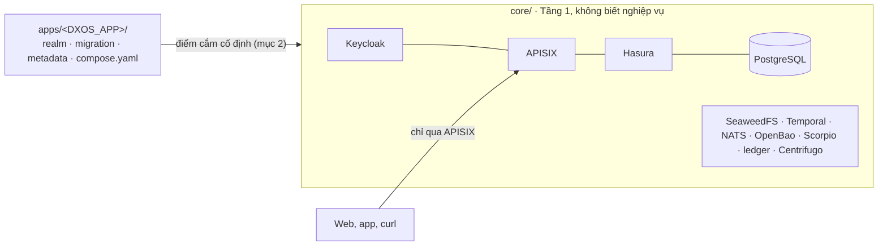

<!-- SPDX-License-Identifier: Apache-2.0 -->
# Viết module cắm–rút cho Disaster DX-OS

Tài liệu cho **lập trình viên** muốn dùng lõi Tầng 1 (`core/`) cho một nghiệp vụ khác. Lõi gồm Keycloak, APISIX, PostgreSQL + PostGIS, Hasura, SeaweedFS, Temporal, NATS, OpenBao, Scorpio, sổ cái Tessera, Centrifugo. Nghiệp vụ mới viết thành một thư mục `apps/<tên>/` và chọn bằng biến `DXOS_APP`, **không sửa `core/`**.

Ví dụ trong repo:

| Module | Nghiệp vụ | Dùng những phần nào của lõi |
|---|---|---|
| [`apps/cuu-tro/`](../apps/cuu-tro/README.md) | Ứng phó thiên tai, cứu trợ (module chính) | Mọi điểm cắm: realm, schema PostGIS, Hasura, backend Python (Temporal, NATS, S3, sổ cái, Centrifugo), web Nuxt, app di động, Grafana |
| [`apps/muon-thiet-bi/`](../apps/muon-thiet-bi/README.md) | Mượn trả thiết bị dùng chung của tổ dân phố, trường học (module mẫu, #110) | Tối thiểu: realm, schema, Hasura. **Không có backend**: chỉ gọi `/graphql` qua gateway |

Module mẫu là điểm khởi đầu nên chép. Nó chạy được với lõi trên volume trống và có smoke riêng (`make smoke-app`).

## 1. Một stack chạy một module

`DXOS_APP` chọn **một** ứng dụng cho một stack (một project Docker Compose). Muốn chạy hai module cùng lúc thì dựng hai stack, đặt `COMPOSE_PROJECT_NAME` và các cổng khác nhau. Mỗi stack có volume, OpenBao, Keycloak riêng.



## 2. Hợp đồng giữa lõi và module

### 2.1. Thư mục lõi đọc

| Đường dẫn trong `apps/<tên>/` | Bắt buộc | Lõi dùng thế nào | Ví dụ |
|---|---|---|---|
| `compose.yaml` | **Có**, kể cả khi chỉ có `services: {}` | `docker-compose.yml` nạp bằng `include` (dịch vụ dùng profile `app`, đường dẫn tương đối tính từ gốc repo) | `muon-thiet-bi/compose.yaml` |
| `keycloak/realm.json` | **Có** | Keycloak import khi tạo realm **lần đầu**. Tên realm phải bằng `KEYCLOAK_REALM` | `muon-thiet-bi/keycloak/realm.json` |
| `hasura/metadata/` | **Có** (dùng GraphQL) | Hasura áp khi khởi động; lệch CSDL thì Hasura dừng | `muon-thiet-bi/hasura/metadata/` |
| `db/migrations/NNNN_<tên>.sql` | Nên có | Container `migrate` chạy theo thứ tự, mỗi tệp đúng một lần trong một transaction, có checksum (sửa tệp đã chạy sẽ báo lỗi) | `muon-thiet-bi/db/migrations/0001_thiet_bi.sql` |
| `db/seed/*.sql` | Không | `make seed`, phải chạy lại được | `muon-thiet-bi/db/seed/0001_kho_mau.sql` |
| `db/tests/*.sql` | Nên có | `make test-db`: chạy trong `BEGIN … ROLLBACK` | `muon-thiet-bi/db/tests/0001_rang_buoc.sql` |
| `tests/smoke.sh` | Nên có | `make smoke-app` chạy sau smoke lõi dùng chung | `muon-thiet-bi/tests/smoke.sh` |
| `s3/buckets.conf` | Không | `s3-buckets` tạo bucket, tên bắt buộc tiền tố `<tên>-` | `cuu-tro/s3/buckets.conf` |
| `nats/streams.json` | Không | Lõi không đọc: backend của module tự tạo stream trong `<tên>.>` | `cuu-tro/nats/streams.json` |
| `openbao/policies/<dịch vụ>.hcl` | Không | `openbao-init` nạp thành policy + AppRole `app-<tên>-<dịch vụ>` | `cuu-tro/openbao/policies/` |
| `openbao/secrets.conf` | Không | Tạo chỗ cho bí mật riêng của module (`@empty`, `@rand:N`), không ghi đè | `cuu-tro/openbao/secrets.conf` |
| `grafana/dashboards/*.json` | Không (profile `bi`) | Grafana nạp từ tệp | `cuu-tro/grafana/dashboards/` |
| `ngsi-ld/context.jsonld` | Không | Module phục vụ ở `<tên>-api:8000/ngsi-ld/context.jsonld` cho route `/ngsi-ld/v1/*` | `cuu-tro/ngsi-ld/` |
| `module.env` | Nên có | Không đọc tự động: liệt kê biến cần đặt trong `.env` khi chạy module | `muon-thiet-bi/module.env` |

### 2.2. Tên lõi tự suy từ `DXOS_APP`

Module **không đặt** các tên dưới đây mà dùng đúng quy ước. Ví dụ `DXOS_APP=muon-thiet-bi`:

| Thứ | Quy ước | Ví dụ |
|---|---|---|
| Schema CSDL | `DXOS_APP` đổi `-` thành `_` | `muon_thiet_bi` |
| Role chủ schema (NOLOGIN, migration chạy bằng role này) | `<schema>_owner` | `muon_thiet_bi_owner` |
| Role dịch vụ của backend (lõi tạo, chưa có quyền; migration cấp quyền theo bảng/cột) | `<schema>_app`, mật khẩu `secret/app/<tên>/db` | `muon_thiet_bi_app` |
| Role chỉ đọc cho Grafana, Parquet | `<schema>_bi`, mật khẩu `secret/app/<tên>/bi-db` | `muon_thiet_bi_bi` |
| Role của Hasura | `hasura`, chỉ có DML (lõi cấp sau mỗi lần migrate) | |
| Bí mật OpenBao của module | `secret/app/<tên>/…` (`db`, `bi-db`, `nats`, `s3`, `ledger`, `realtime` do lõi sinh; thêm bằng `secrets.conf`) | `secret/app/muon-thiet-bi/nats` |
| Bucket S3, định danh S3 | `<tên>-*`, định danh `<tên>-app` chỉ dùng được bucket đó | `muon-thiet-bi-anh` |
| User NATS / MQTT | `<tên>-app` (backend, chỉ cổng NATS), `<tên>-thiet-bi` (thiết bị, chỉ MQTT); subject `<tên>.>` | `muon-thiet-bi-app` |
| Upstream của route `/workflow/*` | `<tên>-api:8000` (đổi bằng `GW_WORKFLOW_UPSTREAM_HOST/PORT`) | |
| Upstream của route `/` (web) | `<tên>-web:3000` (đổi bằng `GW_WEB_UPSTREAM_HOST/PORT`) | |
| Dịch vụ được ghi sổ cái | `<tên>-api` với token `secret/app/<tên>/ledger` | |
| Issuer token Centrifugo | `<tên>-api` | |

Không có `<tên>-api` hay `<tên>-web` thì route `/workflow/*` và `/` trả `503`, gateway vẫn khỏe (`/healthz` `200`). Smoke của module mẫu kiểm điều này.

### 2.3. Claim JWT cho Hasura

Hasura và API phân quyền theo claim `https://hasura.io/jwt/claims` trong access token. Mọi client của realm (ít nhất `dxos-dev-cli` để thử; client web/app của module) cần 3 mapper như realm mẫu:

- `x-hasura-allowed-roles`: các realm role của user;
- `x-hasura-default-role`: thuộc tính user `hasura_default_role` (khai trong user profile, danh sách giá trị là vai của module);
- `x-hasura-user-id`: `sub` của user.

Client `dxos-gateway` (secret `${KC_GATEWAY_CLIENT_SECRET}`, lõi lấy từ OpenBao) phải có trong realm: APISIX dùng nó để kiểm token. Các chỗ `${…}` trong `realm.json` (`KC_DEMO_USER_PASSWORD`, `GATEWAY_PUBLIC_URL`, `KC_REALM_SSL_REQUIRED`) do Keycloak thay lúc import.

## 3. Tạo module mới từng bước

1. **Chép module mẫu:** `cp -r apps/muon-thiet-bi apps/<tên>`. Tên chỉ gồm chữ thường, số, `-` (làm tên schema, tên dịch vụ Docker).
2. **Realm** (`keycloak/realm.json`):
   - đổi `realm` (và `KEYCLOAK_REALM` trong `module.env`), `displayName`, realm role;
   - đổi danh sách giá trị của `hasura_default_role` trong user profile;
   - đổi user mẫu (`id` cố định để seed gán được, mật khẩu `${KC_DEMO_USER_PASSWORD}`, `realmRoles` gồm `default-roles-<realm>`);
   - giữ `dxos-gateway` và mapper của `dxos-dev-cli`.
3. **Migration** `db/migrations/0001_<tên>.sql`:
   - viết DDL không ghi tên schema (`search_path` đã trỏ vào schema của module);
   - đặt Poka-yoke **trong CSDL**: CHECK, chỉ mục duy nhất có điều kiện, trigger. Mọi đường ghi (Hasura, backend, SQL tay) đều phải qua, gửi đồng thời cũng không lọt;
   - backend dùng role `<schema>_app` thì `GRANT` đúng bảng/cột trong migration.
4. **Hasura metadata:**
   - `tables.yaml` liệt kê bảng cần lộ ra;
   - mỗi bảng một tệp với quyền theo vai: `select_permissions`, `insert_permissions` (dùng `set: {cột: x-hasura-user-id}` để người dùng không tự khai danh tính), `update_permissions`;
   - không ai có quyền xóa nếu dữ liệu cần lưu vết.
5. **`compose.yaml`:** không có backend thì để `services: {}`. Có backend thì khai `<tên>-api` (cổng 8000) và/hoặc `<tên>-web` (cổng 3000) với `profiles: [app]`, ở mạng mặc định; bí mật lấy qua một `bao-agent-<tên>` (xem `apps/cuu-tro/compose.yaml`, mục 7.3 của `architecture.md`).
6. **Seed, test DB, smoke:** dữ liệu giả, test ràng buộc (`make test-db`), `tests/smoke.sh` gọi thật qua gateway bằng token của từng vai.
7. **`module.env`:** liệt kê `DXOS_APP`, `KEYCLOAK_REALM`, `SMOKE_CORE_USERS` (user mẫu để smoke lõi đăng nhập), `APP_BI_DB_USER` (nếu dùng Grafana).
8. **Kiểm tra:** `make check` (header SPDX; compose hợp lệ với **mọi** module trong `apps/`), `make lint`, rồi chạy thật (mục 4).

## 4. Chạy và kiểm thử một module

Stack đang chạy module khác thì dùng project và volume riêng (realm chỉ import trên volume Keycloak mới):

```bash
cp .env.example .env
# Bỏ DXOS_APP, KEYCLOAK_REALM có sẵn trong .env rồi thêm biến của module
sed -i.bak '/^DXOS_APP=/d; /^KEYCLOAK_REALM=/d' .env && grep -v '^#' apps/muon-thiet-bi/module.env >> .env
echo 'COMPOSE_PROJECT_NAME=thiet-bi' >> .env    # project riêng nếu máy đang chạy stack khác
make up          # OpenBao → bí mật/AppRole của module → mọi dịch vụ lõi; migrate áp schema; Hasura áp metadata
make seed
make smoke-app   # smoke lõi dùng chung (OpenBao, Hasura, S3, Temporal, NATS) + make test-db + apps/<tên>/tests/smoke.sh
```

Thử bằng tay:

```bash
TOKEN=$(curl -s -X POST http://localhost:8080/realms/thiet-bi/protocol/openid-connect/token \
  -d grant_type=password -d client_id=dxos-dev-cli -d username=nguoimuon01 \
  --data-urlencode password="$KC_DEMO_USER_PASSWORD" | python3 -c 'import sys,json; print(json.load(sys.stdin)["access_token"])')
curl -s -H "Authorization: Bearer $TOKEN" -H 'Content-Type: application/json' \
  -d '{"query":"{ devices { code name condition } }"}' http://localhost:9080/graphql
```

**Đo thật** (27/10/2026, MacBook Apple Silicon, OrbStack): `make up` với `DXOS_APP=muon-thiet-bi` trên volume trống chạy được mà không sửa `core/`. `make smoke-app` đạt 71/71 ca: 38 ca lõi dùng chung (OpenBao 9, Hasura/SeaweedFS/Temporal/NATS 29), 11 ca test DB, 22 ca của module. RAM toàn stack khoảng 2 GiB.

## 5. Không được làm

- **Sửa `core/` vì nghiệp vụ của module.** Lõi thiếu điểm cắm thì thêm điểm cắm **chung** (theo quy ước tên ở mục 2.2) trong một PR riêng, không ghi tên module vào lõi.
- **Gọi thẳng dịch vụ lõi từ client** (PostgreSQL, Hasura cổng 8081, SeaweedFS). Client chỉ đi qua APISIX: JWT, WAF, rate limit.
- **Ghi bí mật vào repo, `.env`, `realm.json`.** Dùng OpenBao (`secrets.conf`, AppRole); chỗ `${…}` trong realm chỉ là tham chiếu.
- **Sửa migration đã chạy:** thêm tệp số tiếp theo.
- **Dùng thành phần không có giấy phép OSI.** Thêm thành phần thì cập nhật `NOTICE`, `DEPENDENCIES.md`.
- **Viết GraphQL có `_is_null` trong điều kiện gửi qua gateway:** WAF (OWASP CRS) coi là dấu hiệu SQL injection và chặn 403 (gặp ở #106). Đổi sang so sánh giá trị hoặc `_not`.

## 6. Lõi còn giới hạn gì

- **Grafana (profile `bi`)** tìm dashboard chính ở `dieu-hanh.json` và đọc CSDL bằng user `APP_BI_DB_USER` (mặc định `cuu_tro_bi`). Module khác đặt biến này và đặt tên dashboard chính như vậy.
- **Chưa có route gateway riêng của module:** module chỉ dùng được `/graphql`, `/files/*` (đọc S3 presigned), `/workflow/*`, `/ngsi-ld/v1/*`, `/realtime/websocket`, `/` (web). Cần đường khác thì đặt sau `/workflow/` trong API của module.
- **`make smoke`** là bộ smoke đầy đủ của `apps/cuu-tro`. Module khác dùng `make smoke-app`.
- **Mỗi stack một module:** chưa chạy nhiều module chung một CSDL, một realm.
